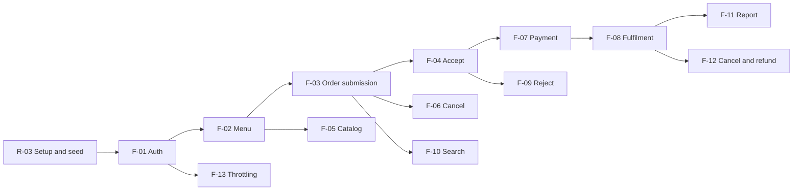

# Omazon — Three-Sprint Plan

| Item | Value |
|---|---|
| Document | `docs/sprints/plan.md` |
| Version | 1.3 |
| Date | 2026-11-12 |
| Related | `docs/features.md`, `docs/traceability.md` |

### Revision history
| Version | Date | Change | Reason |
|---|---|---|---|
| 1.0 | 2026-11-03 | Initial plan | Deliverable 1 |
| 1.1 | 2026-11-05 | Sprint 1 feasibility counts corrected to six tables and ten endpoints | Audit corrections: match the System SDS data model and endpoint summary |
| 1.2 | 2026-11-07 | Document title uses the Omazon display name | Display brand rename (DEC-25); no sprint content changed |
| 1.3 | 2026-11-12 | §2 "Not in Sprint 1" now distinguishes the lightweight Sprint 1 CI workflow from the full CI/CD and deployment work, and the completion outcome says "46 test IDs" rather than "46 planned tests" | `.github/workflows/ci.yml` already runs on Sprint 1 pull requests, so the previous "CI/CD not in Sprint 1" wording was inaccurate; the 46 is the number of TEST-nn IDs (PR #20 review) |

## 1. Overview

| Sprint | Goal | Features | Responsibilities | Checkpoint |
|---|---|---|---|---|
| 1 | A small working slice: login, menu, a customer submits an order, an operator accepts it. Backend authorization and persistence. | F-01, F-02, F-03, F-04 | R-01, R-02, R-03 | Deliverable 1 — 8 Nov 2026 |
| 2 | Core expansion: catalog management, cancellation, simulated payment, fulfilment workflow. Deployed on GCP. | F-05, F-06, F-07, F-08 | R-01 (extended), R-05 | Deliverable 2 — 29 Nov 2026 |
| 3 | Completion and hardening: rejection, search and filter, sales summary, operator cancel and refund, login throttling, performance and usability. | F-09, F-10, F-11, F-12, F-13 | R-01 (extended), R-04 | Progress at 29 Nov; complete by 13 Dec 2026 |

The three sprints together cover FR-01 to FR-17, BR-01 to BR-15 and NFR-01 to NFR-11 (see `docs/traceability.md`).

## 2. Sprint 1 — scope and completion outcome

| Item | Detail |
|---|---|
| Goal | Prove the full vertical slice UI → API → database with real authentication and role permissions |
| Features | F-01 Authentication, F-02 Menu browsing, F-03 Order submission and customer views, F-04 Operator list and acceptance |
| Responsibilities | R-01 Access control, R-02 Validation and errors, R-03 Setup, migrations, seed |
| Dependencies | R-03 first (schema, seed), then F-01, then F-02, then F-03, then F-04. R-01 and R-02 are built with F-01 and extended by each feature |
| Completion outcome | On `main` with a tag: a customer logs in, orders two items, sees the saved order; an operator logs in and accepts it; the customer sees `ACCEPTED`. Rule rejections (unavailable item, invalid quantity, invalid transition) and access restrictions (anonymous, wrong role, other customer's order) are tested through the API. 46 AC with 46 test IDs. Local setup documented |
| Not in Sprint 1 | Catalog editing, cancellation, payment, fulfilment, reject, search, reports, Docker, GCP deployment (Lab 5). A lightweight CI workflow (`.github/workflows/ci.yml`: install, unit/integration tests, E2E) does run on Sprint 1 pull requests; the full CI/CD and deployment pipeline is R-05 in Sprint 2 |

### Why Sprint 1 is feasible
- Four features, one data flow, two roles, six tables.
- No third-party services. Payment is not needed yet.
- The same stack as Labs 1–4, so setup patterns are known.
- Every feature has a short API surface (ten endpoints in total) and one UI screen each.

## 3. Sprint 2 — core expansion

| Feature | Depends on | Completion outcome |
|---|---|---|
| F-05 Catalog management | F-01, F-02 | Operator creates and edits items, price and stock; changes do not alter existing orders |
| F-06 Customer cancellation | F-03 | Customer cancels own `PENDING` order; stock restored; history written |
| F-07 Simulated payment | F-04 | Customer pays an `ACCEPTED` order exactly once with the correct amount |
| F-08 Fulfilment workflow | F-04, F-07 | Paid order moves to `PREPARING`, `READY`, `COMPLETED`; an unpaid order cannot start |
| R-05 Delivery | Lab 5 | CI on PRs, Docker image, GCP deployment; data survives restart (NFR-06); coverage at least 85% on services (NFR-10) |

Outcome: all Sprint 2 features complete, reviewed, deployed and verified. Contracts, AC and STS are written before implementation.

## 4. Sprint 3 — completion and hardening

| Feature | Depends on | Completion outcome |
|---|---|---|
| F-09 Rejection with reason | F-04 | Operator rejects `PENDING` order with a valid reason; stock restored. **Target: implemented and tested by 29 Nov as the Deliverable 2 Sprint 3 workflow** |
| F-10 Search and filter | F-03, F-04 | Filter by status and date, search by order number and customer name, pagination |
| F-11 Sales summary | F-08 | Totals, counts per status, top items for a date range |
| F-12 Operator cancel and refund | F-07, F-08 | Operator cancels an `ACCEPTED` order; paid becomes `REFUNDED`; stock restored |
| F-13 Login throttling | F-01 | 429 after 5 failed logins in 15 minutes |
| R-04 | all | Load test (NFR-05), all screens have loading, empty and error states (NFR-09) |

Final period (1–13 Dec, around exams): bounded fixes, UAT re-tests, final regression, demonstration video, final PDF. No main workflow is left for the last two days.

## 5. Dependency overview

## 6. Alignment with labs and risks

| Date | Event | Effect on plan |
|---|---|---|
| 8 Nov | Deliverable 1 | Sprint 1 release tagged on `main` |
| 15 Nov | Lab 5 (Docker, CI/CD, GCP) | Uses the Sprint 1 release; its output feeds R-05 |
| 22 Nov | Lab 6 (UAT) | UAT findings go to the defect register; fixes may enter Sprint 2 |
| 29 Nov | Deliverable 2 and Lab 7 | Lab 7 change is tracked separately from feature work |
| 1–11 Dec | Final exams | Only bounded work planned |
| 13 Dec | Final delivery | Sprint 3 complete |

| Risk | Impact | Mitigation |
|---|---|---|
| Concurrency tests (AC-24, AC-40) are flaky | Delays Sprint 1 | Use conditional DB updates; run each concurrency test with `Promise.all` against the real test database |
| Exam period reduces time | Sprint 3 slips | Implement F-09 by 29 Nov; keep Sprint 3 items small |
| Documentation drift | Lost marks | Update traceability whenever a test result changes; log revisions |
