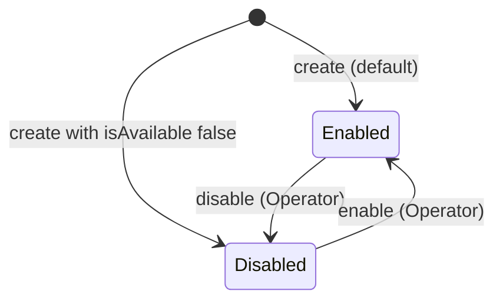

# Omazon — Sprint 2 Features: Engineering Contracts

| Item | Value |
|---|---|
| Document | `docs/sprints/sprint-2/features.md` |
| Sprint | 2 (due with Deliverable 2, 29 Nov 2026) |
| Staging branch | `sprint-2-staging` |
| Release tag (planned) | `sprint-2-v2.0` |
| Version | 1.0 |
| Date | 2026-11-27 |
| Related | `docs/srs.md`, `docs/features.md` (whole-product inventory), `docs/traceability.md`, `docs/sprints/plan.md`, `docs/system-sds.md`, `docs/sprints/sprint-1/features.md` |

## Revision history (contract set)
| Version | Date | Change | Reason |
|---|---|---|---|
| 1.0 | 2026-11-27 | Initial contracts F-05 to F-08 and cross-cutting R-05 (AC-47 to AC-92, DEC-28 to DEC-42) | Written before implementation (Issue #53) |

Each contract below keeps its own revision history. Log every change there with a reason; do not rewrite earlier entries.

Nothing in this document is implemented yet. Every test listed here is `NOT RUN` in `docs/traceability.md`.

## 1. Contract index

| Section | Feature | AC / tests | Requirements |
|---|---|---|---|
| 7 | F-05 Catalog management | AC-47 to AC-57 | FR-10, BR-13, BR-04 (S2 part), BR-08, NFR-09 (partial) |
| 8 | F-06 Customer order cancellation | AC-58 to AC-67 | FR-11, BR-10, BR-06, BR-05, BR-07, BR-15 |
| 9 | F-07 Simulated payment | AC-68 to AC-76 | FR-13, BR-11, BR-07 |
| 10 | F-08 Fulfilment workflow | AC-77 to AC-87 | FR-12, BR-06, BR-09, BR-08, BR-15 |
| 11 | R-05 Delivery and quality gates (with the R-01 extension) | AC-88 to AC-92 | NFR-06, NFR-10, NFR-01, NFR-02 |
| 12 | Decisions and open questions | DEC-28 to DEC-42 | — |

Total: **46 acceptance criteria (AC-47 to AC-92) and 46 test IDs** (TEST-nn verifies AC-nn, continuing from Sprint 1). TEST-88 is also named **COV-01** and TEST-89 is also named **CHECK-01** (DEC-39).

---

## 2. Product Definition of Done (applies to every feature)

A feature is **done** only when all items are true and the evidence is retained:

1. Required behavior is implemented as described in the feature contract, and its AC are met.
2. Every planned test for the feature has been **executed**; the command, tested commit, counts (pass / fail / skipped) and output are saved.
3. Assertions are meaningful. No required test is skipped, disabled, mocked-away or weakened. Any failed or skipped test is disclosed.
4. For each meaningful rule, a test was seen **failing first** (red) and then passing (green); both commit IDs are recorded.
5. The work is on a feature branch created from `sprint-2-staging`, in a PR into `sprint-2-staging` reviewed by the teammate with a specific comment. The author does not approve their own PR.
6. Integration tests and acceptance checks pass on `sprint-2-staging`. The reviewed release PR from staging to `main` is merged, the release is deployed, and the accepted release is tagged `sprint-2-v2.0`.
7. Documents are current: contract revisions are logged with reasons, `README.md`, `.env.example`, migrations and seed match the code.
8. No real secrets or personal data are in Git or in the PDF. Demo data is synthetic.
9. Incomplete work, known defects and limitations are listed in the Deliverable 2 PDF.
10. Completion is shown by test output and screenshots that you produced by running the product, not by an AI agent's statement.
11. Every new endpoint is in `backend/src/routes/registry.ts` and covered by TEST-43 in the same PR that adds it. All Sprint 1 tests (TEST-01 to TEST-46) still pass.

---

## 3. Test-level summary

| Level | Count | Test IDs |
|---|---|---|
| Unit | 4 | TEST-60, 81, 90, 91 |
| Unit + API/database integration | 4 | TEST-51, 52, 69, 70 |
| API + database integration (API-DB) | 28 | TEST-47 to 50, 53 to 55, 58, 59, 61 to 65, 68, 71 to 74, 77 to 80, 82 to 85, 92 |
| UI component | 4 | TEST-56, 66, 75, 86 |
| End-to-end (Playwright) | 4 | TEST-57, 67, 76, 87 |
| Check (CI gate or post-deployment) | 2 | TEST-88 (COV-01), TEST-89 (CHECK-01) |
| **Total** | **46** | |

The 46 is the number of test IDs, not the number of executed cases. One TEST-nn can be implemented by several cases.

---

## 4. Planned Issues and branches

| GitHub issue | Contract item | Planned branch |
|---|---|---|
| #53 | Sprint 2 contracts (this document) | `docs/sprint2-contracts` |
| #54 | F-05 Catalog management | `feature/F-05-catalog` |
| #55 | F-06 Customer order cancellation | `feature/F-06-customer-cancel` |
| #56 | F-07 Simulated payment | `feature/F-07-payment` |
| #57 | F-08 Fulfilment workflow | `feature/F-08-fulfilment` |
| #58 | R-05 Delivery and quality gates | `chore/R-05-coverage-persistence` |

Every branch starts from `sprint-2-staging` and is merged back into it through a reviewed PR. The release goes `sprint-2-staging` → `main` and is tagged `sprint-2-v2.0`.

Order: #53 is merged before the first F-05 to F-08 implementation commit. F-07 (#56) is merged before F-08 (#57). R-05 (#58) is merged after #54 to #57.

Both students author at least two Issues and review the others; record who authored and who reviewed in each PR.

---

## 5. Commit sequence to keep for evidence

For each feature, make these commits in order and keep the hashes:

1. `docs(F-xx): contract revision` (only if the contract must change before coding, with the reason)
2. `test(F-xx): failing tests for AC-.. (red)` — run and save the failing output to `docs/evidence/F-xx-red-<sha>.txt`
3. `feat(F-xx): implementation (green)` — run and save the passing output to `docs/evidence/F-xx-green-<sha>.txt`
4. `docs(F-xx): contract revision` (only if the contract changed during implementation, with the reason)

The specification commit that Sprint 1 listed first is this document, delivered under Issue #53.

---

## 6. Evidence to collect for the Deliverable 2 PDF

| Evidence | From | Maps to |
|---|---|---|
| Versioned contract history: this file's revision tables and `git log` showing contracts merged before implementation | `git log`, PR for #53 | all |
| Catalog journey screenshots: create item, edit price, disable, public menu reflects it; old order still shows the old price | AC-47, AC-49, AC-50, AC-57 | F-05 |
| Cancellation screenshots: Cancel button, `CANCELLED` with history, stock before and after | AC-58, AC-59, AC-67 | F-06 |
| Payment screenshots: confirmation, `PAID` badge, rejection message | AC-68, AC-69, AC-75, AC-76 | F-07 |
| Fulfilment screenshots: operator buttons per status, customer view of progress | AC-85, AC-87 | F-08 |
| **Domain rule test excerpt:** unpaid order cannot start preparing | TEST-80 | F-08 |
| **Access restriction test excerpt:** route sweep listing every Sprint 2 endpoint with its role guard | TEST-92 (runs with TEST-43) | R-01, R-05 |
| TDD red then green output with commit IDs for TEST-50, TEST-63, TEST-73, TEST-80 | git history, `docs/evidence/` | TDD evidence |
| Full test command and output with counts and the tested commit hash | all | Build and test results |
| COV-01 coverage report and the CI run that enforced it | TEST-88 | NFR-10 |
| CHECK-01 record: commands, revision names, order before and after | TEST-89 | NFR-06 |
| AC → TEST → actual test file::name → result table | `docs/traceability.md` | Results table |
| Two Issue and PR chains with branch, author, reviewer, review comment, staging merge, release merge (F-07, #56, is the suggested first chain) | GitHub | Workflow evidence |
| Contribution table, AI-use declaration, known limitations | team | PDF |

---

## 7. F-05 — Catalog Management (Engineering Contract)

| Item | Value |
|---|---|
| Feature | F-05 Catalog management |
| Requirements | FR-10, BR-13, BR-04 (S2 part: catalog edits), BR-08, NFR-09 (partial) |
| Sprint | 2 |
| Depends on | F-01, F-02, R-01 |
| Contract version | 1.0 (2026-11-27) |
| Issue / branch | #54 / `feature/F-05-catalog` |

### Revision history
| Version | Date | Change | Reason |
|---|---|---|---|
| 1.0 | 2026-11-27 | Initial contract | Before implementation |

### 1. Feature design

**Behavior.** An Operator creates menu items and edits their name, description, price, stock and enabled flag. Disabling an item stops new orders for it. Changing the catalog never changes an order that already exists, because each order line stores its own name and unit price (BR-04). The Operator sets daily stock by hand (SRS A-05). There is no delete (DEC-28).

**Workflow.**
1. The Operator opens `/operator/menu`; the screen loads the catalog from `GET /api/menu`.
2. Create: submit the form → `POST /api/menu-items` → the new row appears in the list and on the public menu.
3. Edit: change fields → `PATCH /api/menu-items/:id` with **only the changed fields**.
4. Enable or disable: one button → `PATCH /api/menu-items/:id` with `{ "isAvailable": true }` or `false`.

**Item availability.**

An item is orderable only when it is enabled and has enough stock (`isOrderable`, F-02). F-05 does not change that rule.

**Business and security rules.** BR-13 (`priceSatang > 0`, `stockQty >= 0`), BR-04, BR-08 (only Operators change the catalog).

**Validation (zod, strict).** The same field rules apply to create and update (DEC-29).

| Field | Create | Update | Rule |
|---|---|---|---|
| `name` | required | optional | string, trimmed, 1 to 100 characters, unique (exact match after trimming, DEC-30) |
| `description` | required | optional | string, trimmed, 1 to 500 characters |
| `priceSatang` | required | optional | integer 1 to 1,000,000 (not a string, not a decimal) |
| `stockQty` | required | optional | integer 0 to 10,000 |
| `isAvailable` | optional, default `true` | optional | boolean |
| Any other field | rejected | rejected | for example `id`, `available`, `createdAt` |

An update must contain at least one field.

**Dependencies.** `MenuItem` table and CHECK constraints from migration `0001_init`; `requireAuth` and `requireRole`.

**Permissions.** Create and update: Operator only. There is no ownership rule (single shop, SRS A-01). Reading the catalog stays public (DEC-09).

**Failure and boundary cases.**
- Price boundaries: 1 and 1,000,000 are accepted; 0, -1, 1,000,001, a decimal or a string returns 400 and nothing is saved (AC-51).
- Stock boundaries: 0 and 10,000 are accepted; -1, 10,001, a decimal or a string returns 400 and nothing is saved (AC-52).
- Blank or over-length text, a missing required field, an unknown field, an empty update or a duplicate name returns 400 (AC-53).
- A missing item returns 404 and a non-numeric id returns 400 (AC-54).
- A Customer gets 403 and an anonymous caller gets 401; the catalog is unchanged (AC-55).
- `stockQty` in an update sets an absolute value. If an order reserves stock while the Operator is editing, the last write wins. The edit form sends only changed fields, so a price edit never overwrites stock (AC-56, DEC-31).
- **Known limitation (DEC-32):** the seed matches menu items by name. If an Operator renames a seeded item, the next seed run (every release runs it) creates the original item again.

### 2. API specification

All errors use the shape `{ "error": { "code", "message", "details?" } }` (System SDS §4). Malformed JSON returns 400 `VALIDATION_ERROR`; an unexpected failure returns 500 `INTERNAL_ERROR`. This applies to every endpoint in this document.

```ts
export const menuItemCreateSchema = z
  .object({
    name: z.string().trim().min(1).max(100),
    description: z.string().trim().min(1).max(500),
    priceSatang: z.number().int().min(1).max(1_000_000),
    stockQty: z.number().int().min(0).max(10_000),
    isAvailable: z.boolean().default(true),
  })
  .strict();

// Declared field by field: .partial() on the create schema would keep the
// isAvailable default and silently re-enable an item on every update.
export const menuItemUpdateSchema = z
  .object({
    name: z.string().trim().min(1).max(100).optional(),
    description: z.string().trim().min(1).max(500).optional(),
    priceSatang: z.number().int().min(1).max(1_000_000).optional(),
    stockQty: z.number().int().min(0).max(10_000).optional(),
    isAvailable: z.boolean().optional(),
  })
  .strict()
  .refine((value) => Object.keys(value).length > 0, { message: "Provide at least one field" });
```

#### `POST /api/menu-items` (Operator)
| Item | Spec |
|---|---|
| Role / ownership | `OPERATOR`; no ownership rule |
| Request | `menuItemCreateSchema`, for example `{ "name": "Iced Coffee", "description": "Cold brew with milk", "priceSatang": 3500, "stockQty": 20 }` |
| 201 | `{ "item": { "id", "name", "description", "priceSatang", "stockQty", "isAvailable", "available" } }` (same item shape as `GET /api/menu`) |
| 400 | `VALIDATION_ERROR`: schema violation or unknown field. Duplicate name: message "Invalid request body", `details: [ { "field": "name", "message": "A menu item with this name already exists" } ]` |
| 401 | `UNAUTHENTICATED` |
| 403 | `FORBIDDEN` (Customer) |

#### `PATCH /api/menu-items/:id` (Operator)
| Item | Spec |
|---|---|
| Role / ownership | `OPERATOR`; no ownership rule |
| Request | `menuItemUpdateSchema`, for example `{ "priceSatang": 7000 }` |
| 200 | `{ "item": { ...same shape as 201... } }` with the new values |
| 400 | `VALIDATION_ERROR`: invalid `:id`, schema violation, unknown field, empty body, or duplicate name (same `details` as above) |
| 401 | `UNAUTHENTICATED` |
| 403 | `FORBIDDEN` (Customer) |
| 404 | `NOT_FOUND`: no such menu item |

The duplicate-name answer must also hold when two requests race: the database unique-constraint error is mapped to the same 400, never 500.

`GET /api/menu` is **unchanged**. It already returns every item, including disabled and sold-out ones, with `stockQty` and `isAvailable`, so no separate Operator list endpoint is added (DEC-28).

**Registry.** Add both routes to `protectedRoutes` with `[OPERATOR]`, add `PATCH` to `HttpMethod`, and mount the new router with `mountRouter(app, "/api/menu-items", ...)`. Update the route counts and the request helper in `backend/tests/routes.access.test.ts` so TEST-43 can send `PATCH`.

### 3. UI specification
| Element | Behavior |
|---|---|
| `/operator/menu` | Table: name, description, price (฿), stock, status badge (Enabled / Disabled), **Edit** and **Disable** / **Enable** buttons. **New item** button. Header gains a "Menu management" link for Operators |
| Form | Fields: name, description, price in THB (up to 2 decimals), stock, enabled checkbox. THB is converted to satang by parsing the text, not by floating-point multiplication (`59.99` → `5999`) |
| Edit submit | Sends only the fields whose values changed; **Save** is disabled when nothing changed |
| Saving | Button disabled and shows "Saving…" |
| Success | Form closes and the table shows the saved values |
| Field errors | A 400 shows the messages from `details` and keeps the typed values; a 404 shows the server message and reloads the list |
| Loading / empty / error | "Loading menu…" / "No menu items yet." / error alert with Retry |
| Role guard | `ProtectedRoute roles={["OPERATOR"]}`: in-place 403 alert for a Customer (navigation only) |
| API client | `apiRequest` method type gains `"PATCH"` |
| Public `/menu` | No change |

### 4. Data specification
| Layer | Change |
|---|---|
| Prisma schema | **No change.** `MenuItem` already has `name` (unique), `description`, `priceSatang`, `stockQty`, `isAvailable`, `updatedAt` |
| Constraints | **No change.** CHECK `priceSatang > 0` and `stockQty >= 0` exist (AC-46). The upper bounds and text lengths are API validation only |
| Migration | **None** |
| Seed | **No change** (see the known limitation, DEC-32) |
| `OrderItem` | **No change.** `itemName` and `unitPriceSatang` snapshots already exist |

### 5. Acceptance criteria

| AC | Statement |
|---|---|
| AC-47 | An Operator's valid create returns 201 with the saved item; the same values are read back from the database and the item appears in `GET /api/menu`. When `isAvailable` is omitted it is saved as `true`. |
| AC-48 | An Operator's update of name, description, price or stock returns 200; the new values are read back from the database and from `GET /api/menu`; fields not sent are unchanged. |
| AC-49 | Disabling an item makes `GET /api/menu` report `available: false` and a new order for it returns 409 `ITEM_UNAVAILABLE`; after re-enabling it, an order succeeds. An update that omits `isAvailable` does not change it. |
| AC-50 | After the Operator changes an item's price and name through the API, an existing order keeps its original `itemName`, `unitPriceSatang`, `lineTotalSatang` and `totalSatang`, and a new order uses the new values. |
| AC-51 | On create and update, `priceSatang` 1 and 1,000,000 are accepted; 0, -1, 1,000,001, 1.5 and `"6000"` return 400 `VALIDATION_ERROR` and nothing is saved. |
| AC-52 | On create and update, `stockQty` 0 and 10,000 are accepted; -1, 10,001, 1.5 and `"5"` return 400 `VALIDATION_ERROR` and nothing is saved. |
| AC-53 | A missing required field, blank or over-length `name` or `description`, a non-boolean `isAvailable`, an unknown field, an empty update, or a name already used by another item returns 400 `VALIDATION_ERROR` and nothing changes. Saving an item with its own current name succeeds. |
| AC-54 | Updating a non-existent item returns 404 `NOT_FOUND`; a non-numeric id returns 400. |
| AC-55 | On both write endpoints a Customer gets 403 `FORBIDDEN` and an anonymous caller gets 401 `UNAUTHENTICATED`; the catalog is unchanged. |
| AC-56 | The catalog screen shows loading, empty, error and list states; field errors from the API are shown with the typed values kept; a price typed in THB is sent as the exact satang value; an edit sends only the changed fields. |
| AC-57 | In the UI an Operator creates an item, edits its price and disables it, and the public menu shows each change. |

### 6. Software Test Specification (STS)

| Test | AC | Level | Precondition and input | Action | Expected result | Planned file::test name |
|---|---|---|---|---|---|---|
| TEST-47 | AC-47 | API-DB | `operator1` logged in; valid body without `isAvailable` | POST `/api/menu-items`; read the row from the DB; GET `/api/menu` | 201; DB row equals the body with `isAvailable` true; item listed with `available` true | `backend/tests/menuItems.test.ts::TEST-47` |
| TEST-48 | AC-48 | API-DB | Seeded item 1 | PATCH description and `stockQty`; then PATCH `name` and `priceSatang`; read the DB; GET `/api/menu` | Each 200; DB and menu show the new values; unsent fields unchanged | `backend/tests/menuItems.test.ts::TEST-48` |
| TEST-49 | AC-49 | API-DB | Seeded item 1 with stock | PATCH `isAvailable: false`; GET menu; customer orders it; PATCH `priceSatang`; PATCH `isAvailable: true`; order again | `available` false; order 409 `ITEM_UNAVAILABLE`; price-only PATCH leaves it disabled; after enable the order is 201 | `backend/tests/menuItems.test.ts::TEST-49` |
| TEST-50 | AC-50 | API-DB | `customer1` order for item 1 × 2 at 6000 | `operator1` PATCHes item 1 price to 9000 and a new name; GET the old order; read its `OrderItem` row; place a new order | Old order: old name, 6000, line and total 12000 in API and DB. New order: 9000 and the new name | `backend/tests/menuItems.test.ts::TEST-50` |
| TEST-51 | AC-51 | Unit + API-DB | `operator1` logged in | Unit: both schemas with each value. API: create and update with each value | 1 and 1000000 accepted; 0, -1, 1000001, 1.5, `"6000"` rejected with 400; row count and existing price unchanged | `backend/src/middleware/menuItemSchema.test.ts::TEST-51`; `backend/tests/menuItems.test.ts::TEST-51` |
| TEST-52 | AC-52 | Unit + API-DB | `operator1` logged in | Same method for `stockQty` | 0 and 10000 accepted; -1, 10001, 1.5, `"5"` rejected with 400; DB unchanged | `backend/src/middleware/menuItemSchema.test.ts::TEST-52`; `backend/tests/menuItems.test.ts::TEST-52` |
| TEST-53 | AC-53 | API-DB | Items 1 and 2 exist | Create and update with: a missing field; `"   "`; 101-character name; 501-character description; `isAvailable: "yes"`; field `id`; `{}` as update; item 2 renamed to item 1's name; create with item 1's name; item 1 saved with its own name | All 400 `VALIDATION_ERROR` with no DB change (duplicate: `details[0].field` is `name`); saving the own name is 200 | `backend/tests/menuItems.test.ts::TEST-53` |
| TEST-54 | AC-54 | API-DB | `operator1` logged in | PATCH `/api/menu-items/99999`; PATCH `/api/menu-items/abc` | 404 `NOT_FOUND`; 400 `VALIDATION_ERROR` | `backend/tests/menuItems.test.ts::TEST-54` |
| TEST-55 | AC-55 | API-DB | `customer1` logged in; no-cookie client | Both write endpoints with a valid body from each | Customer 403; anonymous 401; menu rows identical to before | `backend/tests/menuItems.test.ts::TEST-55` |
| TEST-56 | AC-56 | UI component | API client mocked: pending, empty, error, list, 400 with `details` | Render each state; create with price `59.99`; edit only the price | "Loading menu…"; "No menu items yet."; error with Retry; rows; field message shown and input kept; `priceSatang` 5999; PATCH body contains only `priceSatang` | `frontend/src/pages/OperatorMenu.test.tsx::TEST-56` |
| TEST-57 | AC-57 | E2E | Seeded database; item name unique to the run | Log in as operator; create the item; edit its price; disable it; open `/menu` after each step | Menu shows the item, then the new price, then unavailable | `frontend/e2e/catalog.spec.ts::TEST-57` |

### 7. Definition of Done (feature-specific)
In addition to the Product Definition of Done:
- TEST-47 to TEST-57 executed and passing, results recorded; TEST-43 passes with the two new routes.
- **TDD evidence** (red then green with commit IDs) for TEST-50 (price snapshot) and TEST-51 (price boundary).
- Screenshots: catalog list, create, edit, disabled item, field error, and an old order showing its original price.
- Traceability rows FR-10, BR-13 and BR-04 updated with test file and commit.

---
