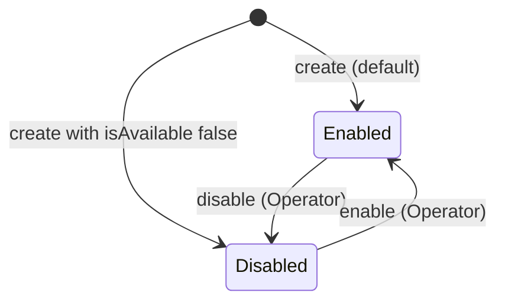
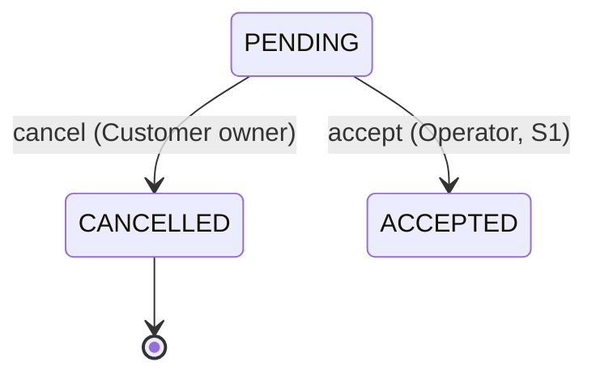
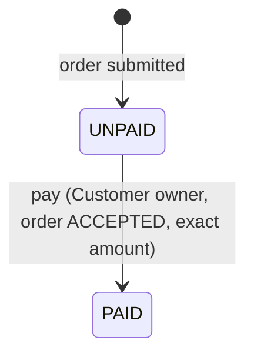
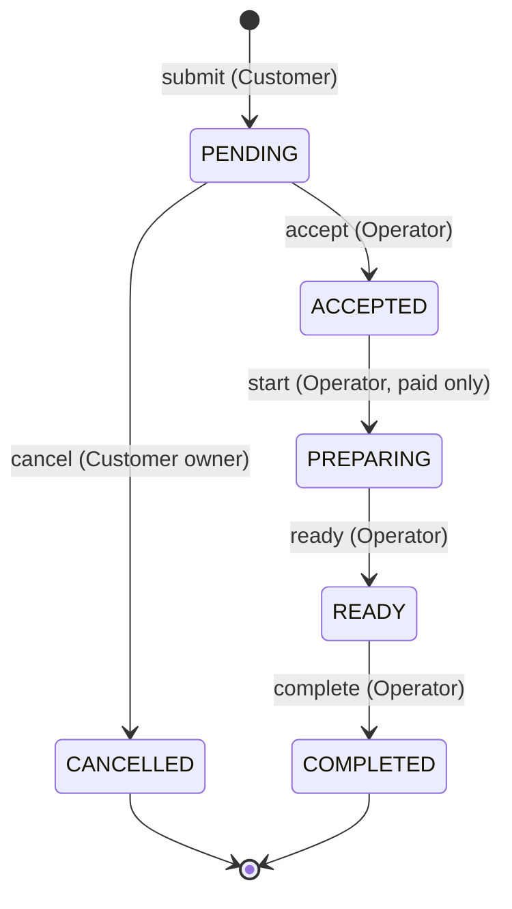

# Omazon — Sprint 2 Features: Engineering Contracts

| Item | Value |
|---|---|
| Document | `docs/sprints/sprint-2/features.md` |
| Sprint | 2 (due with Deliverable 2, 29 Nov 2026) |
| Staging branch | `sprint-2-staging` |
| Release tag (planned) | `sprint-2-v2.0` |
| Version | 1.0 |
| Date | 2026-11-27 |
| Related | `docs/srs.md`, `docs/features.md` (whole-product inventory), `docs/traceability.md`, `docs/sprints/plan.md`, `docs/system-sds.md`, `docs/sprints/sprint-1/features.md` |

## Revision history (contract set)
| Version | Date | Change | Reason |
|---|---|---|---|
| 1.0 | 2026-11-27 | Initial contracts F-05 to F-08 and cross-cutting R-05 (AC-47 to AC-92, DEC-28 to DEC-42) | Written before implementation (Issue #53) |

Each contract below keeps its own revision history. Log every change there with a reason; do not rewrite earlier entries.

Nothing in this document is implemented yet. Every test listed here is `NOT RUN` in `docs/traceability.md`.

## 1. Contract index

| Section | Feature | AC / tests | Requirements |
|---|---|---|---|
| 7 | F-05 Catalog management | AC-47 to AC-57 | FR-10, BR-13, BR-04 (S2 part), BR-08, NFR-09 (partial) |
| 8 | F-06 Customer order cancellation | AC-58 to AC-67 | FR-11, BR-10, BR-06, BR-05, BR-07, BR-15 |
| 9 | F-07 Simulated payment | AC-68 to AC-76 | FR-13, BR-11, BR-07 |
| 10 | F-08 Fulfilment workflow | AC-77 to AC-87 | FR-12, BR-06, BR-09, BR-08, BR-15 |
| 11 | R-05 Delivery and quality gates (with the R-01 extension) | AC-88 to AC-92 | NFR-06, NFR-10, NFR-01, NFR-02 |
| 12 | Decisions and open questions | DEC-28 to DEC-42 | — |

Total: **46 acceptance criteria (AC-47 to AC-92) and 46 test IDs** (TEST-nn verifies AC-nn, continuing from Sprint 1). TEST-88 is also named **COV-01** and TEST-89 is also named **CHECK-01** (DEC-39).

---

## 2. Product Definition of Done (applies to every feature)

A feature is **done** only when all items are true and the evidence is retained:

1. Required behavior is implemented as described in the feature contract, and its AC are met.
2. Every planned test for the feature has been **executed**; the command, tested commit, counts (pass / fail / skipped) and output are saved.
3. Assertions are meaningful. No required test is skipped, disabled, mocked-away or weakened. Any failed or skipped test is disclosed.
4. For each meaningful rule, a test was seen **failing first** (red) and then passing (green); both commit IDs are recorded.
5. The work is on a feature branch created from `sprint-2-staging`, in a PR into `sprint-2-staging` reviewed by the teammate with a specific comment. The author does not approve their own PR.
6. Integration tests and acceptance checks pass on `sprint-2-staging`. The reviewed release PR from staging to `main` is merged, the release is deployed, and the accepted release is tagged `sprint-2-v2.0`.
7. Documents are current: contract revisions are logged with reasons, `README.md`, `.env.example`, migrations and seed match the code.
8. No real secrets or personal data are in Git or in the PDF. Demo data is synthetic.
9. Incomplete work, known defects and limitations are listed in the Deliverable 2 PDF.
10. Completion is shown by test output and screenshots that you produced by running the product, not by an AI agent's statement.
11. Every new endpoint is in `backend/src/routes/registry.ts` and covered by TEST-43 in the same PR that adds it. All Sprint 1 tests (TEST-01 to TEST-46) still pass.

---

## 3. Test-level summary

| Level | Count | Test IDs |
|---|---|---|
| Unit | 4 | TEST-60, 81, 90, 91 |
| Unit + API/database integration | 4 | TEST-51, 52, 69, 70 |
| API + database integration (API-DB) | 28 | TEST-47 to 50, 53 to 55, 58, 59, 61 to 65, 68, 71 to 74, 77 to 80, 82 to 85, 92 |
| UI component | 4 | TEST-56, 66, 75, 86 |
| End-to-end (Playwright) | 4 | TEST-57, 67, 76, 87 |
| Check (CI gate or post-deployment) | 2 | TEST-88 (COV-01), TEST-89 (CHECK-01) |
| **Total** | **46** | |

The 46 is the number of test IDs, not the number of executed cases. One TEST-nn can be implemented by several cases.

---

## 4. Planned Issues and branches

| GitHub issue | Contract item | Planned branch |
|---|---|---|
| #53 | Sprint 2 contracts (this document) | `docs/sprint2-contracts` |
| #54 | F-05 Catalog management | `feature/F-05-catalog` |
| #55 | F-06 Customer order cancellation | `feature/F-06-customer-cancel` |
| #56 | F-07 Simulated payment | `feature/F-07-payment` |
| #57 | F-08 Fulfilment workflow | `feature/F-08-fulfilment` |
| #58 | R-05 Delivery and quality gates | `chore/R-05-coverage-persistence` |

Every branch starts from `sprint-2-staging` and is merged back into it through a reviewed PR. The release goes `sprint-2-staging` → `main` and is tagged `sprint-2-v2.0`.

Order: #53 is merged before the first F-05 to F-08 implementation commit. F-07 (#56) is merged before F-08 (#57). R-05 (#58) is merged after #54 to #57.

Both students author at least two Issues and review the others; record who authored and who reviewed in each PR.

---

## 5. Commit sequence to keep for evidence

For each feature, make these commits in order and keep the hashes:

1. `docs(F-xx): contract revision` (only if the contract must change before coding, with the reason)
2. `test(F-xx): failing tests for AC-.. (red)` — run and save the failing output to `docs/evidence/F-xx-red-<sha>.txt`
3. `feat(F-xx): implementation (green)` — run and save the passing output to `docs/evidence/F-xx-green-<sha>.txt`
4. `docs(F-xx): contract revision` (only if the contract changed during implementation, with the reason)

The specification commit that Sprint 1 listed first is this document, delivered under Issue #53.

---

## 6. Evidence to collect for the Deliverable 2 PDF

| Evidence | From | Maps to |
|---|---|---|
| Versioned contract history: this file's revision tables and `git log` showing contracts merged before implementation | `git log`, PR for #53 | all |
| Catalog journey screenshots: create item, edit price, disable, public menu reflects it; old order still shows the old price | AC-47, AC-49, AC-50, AC-57 | F-05 |
| Cancellation screenshots: Cancel button, `CANCELLED` with history, stock before and after | AC-58, AC-59, AC-67 | F-06 |
| Payment screenshots: confirmation, `PAID` badge, rejection message | AC-68, AC-69, AC-75, AC-76 | F-07 |
| Fulfilment screenshots: operator buttons per status, customer view of progress | AC-85, AC-87 | F-08 |
| **Domain rule test excerpt:** unpaid order cannot start preparing | TEST-80 | F-08 |
| **Access restriction test excerpt:** route sweep listing every Sprint 2 endpoint with its role guard | TEST-92 (runs with TEST-43) | R-01, R-05 |
| TDD red then green output with commit IDs for TEST-50, TEST-63, TEST-73, TEST-80 | git history, `docs/evidence/` | TDD evidence |
| Full test command and output with counts and the tested commit hash | all | Build and test results |
| COV-01 coverage report and the CI run that enforced it | TEST-88 | NFR-10 |
| CHECK-01 record: commands, revision names, order before and after | TEST-89 | NFR-06 |
| AC → TEST → actual test file::name → result table | `docs/traceability.md` | Results table |
| Two Issue and PR chains with branch, author, reviewer, review comment, staging merge, release merge (F-07, #56, is the suggested first chain) | GitHub | Workflow evidence |
| Contribution table, AI-use declaration, known limitations | team | PDF |

---

## 7. F-05 — Catalog Management (Engineering Contract)

| Item | Value |
|---|---|
| Feature | F-05 Catalog management |
| Requirements | FR-10, BR-13, BR-04 (S2 part: catalog edits), BR-08, NFR-09 (partial) |
| Sprint | 2 |
| Depends on | F-01, F-02, R-01 |
| Contract version | 1.0 (2026-11-27) |
| Issue / branch | #54 / `feature/F-05-catalog` |

### Revision history
| Version | Date | Change | Reason |
|---|---|---|---|
| 1.0 | 2026-11-27 | Initial contract | Before implementation |

### 1. Feature design

**Behavior.** An Operator creates menu items and edits their name, description, price, stock and enabled flag. Disabling an item stops new orders for it. Changing the catalog never changes an order that already exists, because each order line stores its own name and unit price (BR-04). The Operator sets daily stock by hand (SRS A-05). There is no delete (DEC-28).

**Workflow.**
1. The Operator opens `/operator/menu`; the screen loads the catalog from `GET /api/menu`.
2. Create: submit the form → `POST /api/menu-items` → the new row appears in the list and on the public menu.
3. Edit: change fields → `PATCH /api/menu-items/:id` with **only the changed fields**.
4. Enable or disable: one button → `PATCH /api/menu-items/:id` with `{ "isAvailable": true }` or `false`.

**Item availability.**

An item is orderable only when it is enabled and has enough stock (`isOrderable`, F-02). F-05 does not change that rule.

**Business and security rules.** BR-13 (`priceSatang > 0`, `stockQty >= 0`), BR-04, BR-08 (only Operators change the catalog).

**Validation (zod, strict).** The same field rules apply to create and update (DEC-29).

| Field | Create | Update | Rule |
|---|---|---|---|
| `name` | required | optional | string, trimmed, 1 to 100 characters, unique (exact match after trimming, DEC-30) |
| `description` | required | optional | string, trimmed, 1 to 500 characters |
| `priceSatang` | required | optional | integer 1 to 1,000,000 (not a string, not a decimal) |
| `stockQty` | required | optional | integer 0 to 10,000 |
| `isAvailable` | optional, default `true` | optional | boolean |
| Any other field | rejected | rejected | for example `id`, `available`, `createdAt` |

An update must contain at least one field.

**Dependencies.** `MenuItem` table and CHECK constraints from migration `0001_init`; `requireAuth` and `requireRole`.

**Permissions.** Create and update: Operator only. There is no ownership rule (single shop, SRS A-01). Reading the catalog stays public (DEC-09).

**Failure and boundary cases.**
- Price boundaries: 1 and 1,000,000 are accepted; 0, -1, 1,000,001, a decimal or a string returns 400 and nothing is saved (AC-51).
- Stock boundaries: 0 and 10,000 are accepted; -1, 10,001, a decimal or a string returns 400 and nothing is saved (AC-52).
- Blank or over-length text, a missing required field, an unknown field, an empty update or a duplicate name returns 400 (AC-53).
- A missing item returns 404 and a non-numeric id returns 400 (AC-54).
- A Customer gets 403 and an anonymous caller gets 401; the catalog is unchanged (AC-55).
- `stockQty` in an update sets an absolute value. If an order reserves stock while the Operator is editing, the last write wins. The edit form sends only changed fields, so a price edit never overwrites stock (AC-56, DEC-31).
- **Known limitation (DEC-32):** the seed matches menu items by name. If an Operator renames a seeded item, the next seed run (every release runs it) creates the original item again.

### 2. API specification

All errors use the shape `{ "error": { "code", "message", "details?" } }` (System SDS §4). Malformed JSON returns 400 `VALIDATION_ERROR`; an unexpected failure returns 500 `INTERNAL_ERROR`. This applies to every endpoint in this document.

```ts
export const menuItemCreateSchema = z
  .object({
    name: z.string().trim().min(1).max(100),
    description: z.string().trim().min(1).max(500),
    priceSatang: z.number().int().min(1).max(1_000_000),
    stockQty: z.number().int().min(0).max(10_000),
    isAvailable: z.boolean().default(true),
  })
  .strict();

// Declared field by field: .partial() on the create schema would keep the
// isAvailable default and silently re-enable an item on every update.
export const menuItemUpdateSchema = z
  .object({
    name: z.string().trim().min(1).max(100).optional(),
    description: z.string().trim().min(1).max(500).optional(),
    priceSatang: z.number().int().min(1).max(1_000_000).optional(),
    stockQty: z.number().int().min(0).max(10_000).optional(),
    isAvailable: z.boolean().optional(),
  })
  .strict()
  .refine((value) => Object.keys(value).length > 0, { message: "Provide at least one field" });
```

#### `POST /api/menu-items` (Operator)
| Item | Spec |
|---|---|
| Role / ownership | `OPERATOR`; no ownership rule |
| Request | `menuItemCreateSchema`, for example `{ "name": "Iced Coffee", "description": "Cold brew with milk", "priceSatang": 3500, "stockQty": 20 }` |
| 201 | `{ "item": { "id", "name", "description", "priceSatang", "stockQty", "isAvailable", "available" } }` (same item shape as `GET /api/menu`) |
| 400 | `VALIDATION_ERROR`: schema violation or unknown field. Duplicate name: message "Invalid request body", `details: [ { "field": "name", "message": "A menu item with this name already exists" } ]` |
| 401 | `UNAUTHENTICATED` |
| 403 | `FORBIDDEN` (Customer) |

#### `PATCH /api/menu-items/:id` (Operator)
| Item | Spec |
|---|---|
| Role / ownership | `OPERATOR`; no ownership rule |
| Request | `menuItemUpdateSchema`, for example `{ "priceSatang": 7000 }` |
| 200 | `{ "item": { ...same shape as 201... } }` with the new values |
| 400 | `VALIDATION_ERROR`: invalid `:id`, schema violation, unknown field, empty body, or duplicate name (same `details` as above) |
| 401 | `UNAUTHENTICATED` |
| 403 | `FORBIDDEN` (Customer) |
| 404 | `NOT_FOUND`: no such menu item |

The duplicate-name answer must also hold when two requests race: the database unique-constraint error is mapped to the same 400, never 500.

`GET /api/menu` is **unchanged**. It already returns every item, including disabled and sold-out ones, with `stockQty` and `isAvailable`, so no separate Operator list endpoint is added (DEC-28).

**Registry.** Add both routes to `protectedRoutes` with `[OPERATOR]`, add `PATCH` to `HttpMethod`, and mount the new router with `mountRouter(app, "/api/menu-items", ...)`. Update the route counts and the request helper in `backend/tests/routes.access.test.ts` so TEST-43 can send `PATCH`.

### 3. UI specification
| Element | Behavior |
|---|---|
| `/operator/menu` | Table: name, description, price (฿), stock, status badge (Enabled / Disabled), **Edit** and **Disable** / **Enable** buttons. **New item** button. Header gains a "Menu management" link for Operators |
| Form | Fields: name, description, price in THB (up to 2 decimals), stock, enabled checkbox. THB is converted to satang by parsing the text, not by floating-point multiplication (`59.99` → `5999`) |
| Edit submit | Sends only the fields whose values changed; **Save** is disabled when nothing changed |
| Saving | Button disabled and shows "Saving…" |
| Success | Form closes and the table shows the saved values |
| Field errors | A 400 shows the messages from `details` and keeps the typed values; a 404 shows the server message and reloads the list |
| Loading / empty / error | "Loading menu…" / "No menu items yet." / error alert with Retry |
| Role guard | `ProtectedRoute roles={["OPERATOR"]}`: in-place 403 alert for a Customer (navigation only) |
| API client | `apiRequest` method type gains `"PATCH"` |
| Public `/menu` | No change |

### 4. Data specification
| Layer | Change |
|---|---|
| Prisma schema | **No change.** `MenuItem` already has `name` (unique), `description`, `priceSatang`, `stockQty`, `isAvailable`, `updatedAt` |
| Constraints | **No change.** CHECK `priceSatang > 0` and `stockQty >= 0` exist (AC-46). The upper bounds and text lengths are API validation only |
| Migration | **None** |
| Seed | **No change** (see the known limitation, DEC-32) |
| `OrderItem` | **No change.** `itemName` and `unitPriceSatang` snapshots already exist |

### 5. Acceptance criteria

| AC | Statement |
|---|---|
| AC-47 | An Operator's valid create returns 201 with the saved item; the same values are read back from the database and the item appears in `GET /api/menu`. When `isAvailable` is omitted it is saved as `true`. |
| AC-48 | An Operator's update of name, description, price or stock returns 200; the new values are read back from the database and from `GET /api/menu`; fields not sent are unchanged. |
| AC-49 | Disabling an item makes `GET /api/menu` report `available: false` and a new order for it returns 409 `ITEM_UNAVAILABLE`; after re-enabling it, an order succeeds. An update that omits `isAvailable` does not change it. |
| AC-50 | After the Operator changes an item's price and name through the API, an existing order keeps its original `itemName`, `unitPriceSatang`, `lineTotalSatang` and `totalSatang`, and a new order uses the new values. |
| AC-51 | On create and update, `priceSatang` 1 and 1,000,000 are accepted; 0, -1, 1,000,001, 1.5 and `"6000"` return 400 `VALIDATION_ERROR` and nothing is saved. |
| AC-52 | On create and update, `stockQty` 0 and 10,000 are accepted; -1, 10,001, 1.5 and `"5"` return 400 `VALIDATION_ERROR` and nothing is saved. |
| AC-53 | A missing required field, blank or over-length `name` or `description`, a non-boolean `isAvailable`, an unknown field, an empty update, or a name already used by another item returns 400 `VALIDATION_ERROR` and nothing changes. Saving an item with its own current name succeeds. |
| AC-54 | Updating a non-existent item returns 404 `NOT_FOUND`; a non-numeric id returns 400. |
| AC-55 | On both write endpoints a Customer gets 403 `FORBIDDEN` and an anonymous caller gets 401 `UNAUTHENTICATED`; the catalog is unchanged. |
| AC-56 | The catalog screen shows loading, empty, error and list states; field errors from the API are shown with the typed values kept; a price typed in THB is sent as the exact satang value; an edit sends only the changed fields. |
| AC-57 | In the UI an Operator creates an item, edits its price and disables it, and the public menu shows each change. |

### 6. Software Test Specification (STS)

| Test | AC | Level | Precondition and input | Action | Expected result | Planned file::test name |
|---|---|---|---|---|---|---|
| TEST-47 | AC-47 | API-DB | `operator1` logged in; valid body without `isAvailable` | POST `/api/menu-items`; read the row from the DB; GET `/api/menu` | 201; DB row equals the body with `isAvailable` true; item listed with `available` true | `backend/tests/menuItems.test.ts::TEST-47` |
| TEST-48 | AC-48 | API-DB | Seeded item 1 | PATCH description and `stockQty`; then PATCH `name` and `priceSatang`; read the DB; GET `/api/menu` | Each 200; DB and menu show the new values; unsent fields unchanged | `backend/tests/menuItems.test.ts::TEST-48` |
| TEST-49 | AC-49 | API-DB | Seeded item 1 with stock | PATCH `isAvailable: false`; GET menu; customer orders it; PATCH `priceSatang`; PATCH `isAvailable: true`; order again | `available` false; order 409 `ITEM_UNAVAILABLE`; price-only PATCH leaves it disabled; after enable the order is 201 | `backend/tests/menuItems.test.ts::TEST-49` |
| TEST-50 | AC-50 | API-DB | `customer1` order for item 1 × 2 at 6000 | `operator1` PATCHes item 1 price to 9000 and a new name; GET the old order; read its `OrderItem` row; place a new order | Old order: old name, 6000, line and total 12000 in API and DB. New order: 9000 and the new name | `backend/tests/menuItems.test.ts::TEST-50` |
| TEST-51 | AC-51 | Unit + API-DB | `operator1` logged in | Unit: both schemas with each value. API: create and update with each value | 1 and 1000000 accepted; 0, -1, 1000001, 1.5, `"6000"` rejected with 400; row count and existing price unchanged | `backend/src/middleware/menuItemSchema.test.ts::TEST-51`; `backend/tests/menuItems.test.ts::TEST-51` |
| TEST-52 | AC-52 | Unit + API-DB | `operator1` logged in | Same method for `stockQty` | 0 and 10000 accepted; -1, 10001, 1.5, `"5"` rejected with 400; DB unchanged | `backend/src/middleware/menuItemSchema.test.ts::TEST-52`; `backend/tests/menuItems.test.ts::TEST-52` |
| TEST-53 | AC-53 | API-DB | Items 1 and 2 exist | Create and update with: a missing field; `"   "`; 101-character name; 501-character description; `isAvailable: "yes"`; field `id`; `{}` as update; item 2 renamed to item 1's name; create with item 1's name; item 1 saved with its own name | All 400 `VALIDATION_ERROR` with no DB change (duplicate: `details[0].field` is `name`); saving the own name is 200 | `backend/tests/menuItems.test.ts::TEST-53` |
| TEST-54 | AC-54 | API-DB | `operator1` logged in | PATCH `/api/menu-items/99999`; PATCH `/api/menu-items/abc` | 404 `NOT_FOUND`; 400 `VALIDATION_ERROR` | `backend/tests/menuItems.test.ts::TEST-54` |
| TEST-55 | AC-55 | API-DB | `customer1` logged in; no-cookie client | Both write endpoints with a valid body from each | Customer 403; anonymous 401; menu rows identical to before | `backend/tests/menuItems.test.ts::TEST-55` |
| TEST-56 | AC-56 | UI component | API client mocked: pending, empty, error, list, 400 with `details` | Render each state; create with price `59.99`; edit only the price | "Loading menu…"; "No menu items yet."; error with Retry; rows; field message shown and input kept; `priceSatang` 5999; PATCH body contains only `priceSatang` | `frontend/src/pages/OperatorMenu.test.tsx::TEST-56` |
| TEST-57 | AC-57 | E2E | Seeded database; item name unique to the run | Log in as operator; create the item; edit its price; disable it; open `/menu` after each step | Menu shows the item, then the new price, then unavailable | `frontend/e2e/catalog.spec.ts::TEST-57` |

### 7. Definition of Done (feature-specific)
In addition to the Product Definition of Done:
- TEST-47 to TEST-57 executed and passing, results recorded; TEST-43 passes with the two new routes.
- **TDD evidence** (red then green with commit IDs) for TEST-50 (price snapshot) and TEST-51 (price boundary).
- Screenshots: catalog list, create, edit, disabled item, field error, and an old order showing its original price.
- Traceability rows FR-10, BR-13 and BR-04 updated with test file and commit.

---

## 8. F-06 — Customer Order Cancellation (Engineering Contract)

| Item | Value |
|---|---|
| Feature | F-06 Customer order cancellation |
| Requirements | FR-11, BR-10, BR-06, BR-05, BR-07, BR-15 |
| Sprint | 2 |
| Depends on | F-03 (the race test also uses F-04 accept) |
| Contract version | 1.0 (2026-11-27) |
| Issue / branch | #55 / `feature/F-06-customer-cancel` |

### Revision history
| Version | Date | Change | Reason |
|---|---|---|---|
| 1.0 | 2026-11-27 | Initial contract | Before implementation |

### 1. Feature design

**Behavior.** A Customer cancels their own order while it is `PENDING`. The order becomes `CANCELLED`, the stock reserved by every line is given back, and a history entry is written, all in one transaction.

**State transitions added.**

`orderStateMachine.ts` gains `PENDING → CANCELLED`. No transition into `CANCELLED` exists from any other status in Sprint 2.

**Workflow (`POST /api/orders/:id/cancel`).**
1. Authenticate (401) and require role `CUSTOMER` (403).
2. Validate `:id` (400). In a transaction load the order: missing → 404; `customerId` is not the caller → 403.
3. `assertTransition(status, "CANCELLED")` → 409 if the status is not `PENDING`.
4. Conditional update: set `CANCELLED` where `id`, `customerId` and `status = PENDING` all match. Zero rows → re-read and return 409 `INVALID_TRANSITION`.
5. Only after that update succeeds, add each line's quantity back to `MenuItem.stockQty` with an atomic increment, in ascending `menuItemId` order (the same lock order as order creation).
6. Insert history `PENDING → CANCELLED`, actor = the customer, role `CUSTOMER`.
7. Commit and return 200. Any failure rolls back steps 4 to 6.

**Business rules.** BR-10, BR-06, BR-05 (stock never wrong or negative), BR-07, BR-15. `paymentStatus` stays `UNPAID`: a `PENDING` order cannot have been paid (BR-11).

**Validation.** `:id` positive integer. The endpoint takes no body; like accept, any body sent is ignored (DEC-33).

**Dependencies.** `Order`, `OrderItem`, `OrderStatusHistory`, `MenuItem.stockQty`.

**Permissions.** Customer who owns the order. Operators cannot use this endpoint (403). Operator cancellation of an `ACCEPTED` order is F-12, Sprint 3 (DEC-33).

**Failure and boundary cases.**
- Cancel from `ACCEPTED`, `PREPARING`, `READY`, `COMPLETED`, `REJECTED` or `CANCELLED` returns 409 and changes nothing, so a repeated cancel never restores stock twice (AC-60, AC-61).
- Two cancels at once restore stock once (AC-62).
- Cancel and accept at once: exactly one wins (AC-63).
- A failure part-way leaves order, stock and history unchanged (AC-64).
- Stock is restored to an item even if it has since been disabled; the item stays disabled (AC-59). Stock is added to the current value, including a value the Operator has since edited (DEC-34).
- Another customer gets 403, an Operator 403, anonymous 401, a missing order 404, a non-numeric id 400 (AC-65).

### 2. API specification

#### `POST /api/orders/:id/cancel` (Customer, owner)
| Item | Spec |
|---|---|
| Role / ownership | `CUSTOMER`, and `order.customerId` equals the session user id (checked in the service) |
| Request | No body; no zod body schema. `:id` is parsed with `parsePositiveIntegerParam` |
| 200 | `{ "order": { ...order detail, same shape as F-03... } }` with `status` `CANCELLED` and the new history entry |
| 400 | `VALIDATION_ERROR`: invalid `:id` |
| 401 | `UNAUTHENTICATED` |
| 403 | `FORBIDDEN`: caller is an Operator, or a Customer who is not the owner. Generic error only, no order data |
| 404 | `NOT_FOUND`: no such order |
| 409 | `INVALID_TRANSITION`: order is not `PENDING`; `details: { "from": "<current status>", "to": "CANCELLED" }` |

**BR-10 and Operators.** In Sprint 2 no Operator may call cancel, so the role guard answers 403 before any status check. BR-10's "409 `INVALID_TRANSITION` by any role" for `PREPARING`, `READY` and `COMPLETED` is enforced by the state machine, which does not look at the role (TEST-60), and is observable through the API for the owner (TEST-61). F-12 must keep it for the Operator cancel path.

**Registry.** `POST /api/orders/:id/cancel` with `[CUSTOMER]`.

### 3. UI specification
| Element | Behavior |
|---|---|
| Order detail `/orders/:id` | A **Cancel order** button is shown only to a Customer when the status is `PENDING`. Operators never see it |
| Confirmation | The first click shows "Cancel this order?" with **Yes, cancel** and **Keep order** (DEC-38) |
| Pending | "Cancelling…", both buttons disabled |
| Success | The page shows the returned order: badge "Cancelled", history "Pending → Cancelled", no Cancel button |
| 409 | Alert "This order can no longer be cancelled." and the order is reloaded |
| Other errors | Alert with the API message; generic message for network or 500 errors. The button remains |
| Loading / empty / error | Existing order detail states are unchanged. Empty does not apply to a single order |
| My orders and operator list | No change beyond showing the `CANCELLED` status they already support |

### 4. Data specification
| Layer | Change |
|---|---|
| Prisma schema | **No change.** `OrderStatus.CANCELLED` and `OrderStatusHistory` exist |
| Constraints | **No change.** CHECK `stockQty >= 0` stays |
| Migration | **None** |
| Data written | `Order.status`, `MenuItem.stockQty`, one `OrderStatusHistory` row |
| Seed | **No change** |

### 5. Acceptance criteria

| AC | Statement |
|---|---|
| AC-58 | A Customer cancelling their own `PENDING` order gets 200; the database shows `CANCELLED` with `paymentStatus` `UNPAID`, and exactly one new history row (`PENDING → CANCELLED`, actor = that customer, role `CUSTOMER`, with a `createdAt`). |
| AC-59 | Cancellation increases the stock of every ordered item by exactly its ordered quantity, including an item that has since been disabled (which stays disabled); other items are unchanged. |
| AC-60 | The state machine allows `PENDING → CANCELLED` and rejects a transition to `CANCELLED` from `ACCEPTED`, `PREPARING`, `READY`, `COMPLETED`, `REJECTED` and `CANCELLED` with `INVALID_TRANSITION`. |
| AC-61 | Cancelling an order that is not `PENDING` (including a second cancel) returns 409 `INVALID_TRANSITION`; status, stock and history are unchanged. |
| AC-62 | Two simultaneous cancels of one order give exactly one 200 and one 409; stock is restored once and there is one cancel history row. |
| AC-63 | When the owner cancels while an Operator accepts, exactly one request gets 200 and the other 409. The final status, stock and history match the winner only. |
| AC-64 | Cancellation is atomic: if writing the history row fails, the response is 500 `INTERNAL_ERROR` and the order status, every stock value and the history are unchanged. |
| AC-65 | Another Customer and an Operator get 403 `FORBIDDEN` with no order data, an anonymous caller gets 401, a missing order gets 404 and a non-numeric id gets 400; nothing changes. |
| AC-66 | In the UI the Cancel button appears only for a Customer on a `PENDING` order, asks for confirmation, shows a pending state, updates status and history on success, and on 409 shows an alert and reloads the order. |
| AC-67 | In the UI a Customer places an order, cancels it, still sees "Cancelled" after a reload, and the menu stock is back to its earlier value. |

### 6. Software Test Specification (STS)

| Test | AC | Level | Precondition and input | Action | Expected result | Planned file::test name |
|---|---|---|---|---|---|---|
| TEST-58 | AC-58 | API-DB | `customer1` owns `PENDING` order O1 | POST `/api/orders/O1/cancel`; read order and history from the DB; GET O1 | 200; DB `CANCELLED`, `UNPAID`; history has 2 rows, the second as in AC-58; GET shows the same | `backend/tests/orders.cancel.test.ts::TEST-58` |
| TEST-59 | AC-59 | API-DB | O1 = item 1 × 2 and item 4 × 3; note all stock; then disable item 4 | Cancel O1; read all stock | Item 1 +2, item 4 +3 and still disabled; all others unchanged | `backend/tests/orders.cancel.test.ts::TEST-59` |
| TEST-60 | AC-60 | Unit | None | Table-driven `assertTransition(from, "CANCELLED")` over all 7 statuses | Only `PENDING` passes; the other 6 throw 409 `INVALID_TRANSITION` with `{from, to}` | `backend/src/services/orderStateMachine.test.ts::TEST-60` |
| TEST-61 | AC-61 | API-DB | `customer1` orders in `ACCEPTED`, `PREPARING`, `READY`, `COMPLETED`, `REJECTED`, `CANCELLED` (set in the DB by the helper, one of them by a first cancel) | Cancel each | Each 409 with `details.from`; status, stock and history count unchanged | `backend/tests/orders.cancel.test.ts::TEST-61` |
| TEST-62 | AC-62 | API-DB | `PENDING` order; two requests from `customer1` | Two cancels with `Promise.all`; repeat 10 times | One 200 and one 409 each time; stock rises by the quantity once; one cancel history row | `backend/tests/orders.cancel.test.ts::TEST-62` |
| TEST-63 | AC-63 | API-DB | `PENDING` order; `customer1` and `operator1` logged in | Cancel and accept with `Promise.all` behind a synchronization barrier (as TEST-40); repeat 10 times | Exactly one 200 and one 409. Cancel wins: `CANCELLED`, stock restored. Accept wins: `ACCEPTED`, stock still reserved. Exactly one history row after creation | `backend/tests/orders.cancel.test.ts::TEST-63` |
| TEST-64 | AC-64 | API-DB | `PENDING` order; a temporary test-database trigger raises on insert of a `CANCELLED` history row | Cancel; read DB; drop the trigger | 500 `INTERNAL_ERROR`; order still `PENDING`; stock and history unchanged | `backend/tests/orders.cancel.test.ts::TEST-64` |
| TEST-65 | AC-65 | API-DB | O1 owned by `customer1` | Cancel as `customer2`, `operator1`, anonymous; `customer1` cancels id 99999 and `abc` | 403, 403, 401, 404, 400; 403 bodies contain only `error`; O1 `PENDING`, stock unchanged | `backend/tests/orders.cancel.test.ts::TEST-65` |
| TEST-66 | AC-66 | UI component | API client mocked: `PENDING` and `ACCEPTED` orders; Customer and Operator users; success and 409 | Render detail; click Cancel, then Keep; click Cancel, then confirm | Button only for Customer + `PENDING`; Keep sends nothing; "Cancelling…"; success shows "Cancelled"; 409 shows the alert and refetches | `frontend/src/pages/OrderDetail.test.tsx::TEST-66` |
| TEST-67 | AC-67 | E2E | Seeded database; `customer1` | Note stock; place an order; cancel it; reload; compare menu stock | "Cancelled" with history after reload; stock equals the earlier value | `frontend/e2e/cancel.spec.ts::TEST-67` |

### 7. Definition of Done (feature-specific)
In addition to the Product Definition of Done:
- TEST-58 to TEST-67 executed and passing, results recorded; TEST-43 passes with the new route.
- **TDD evidence** (red then green with commit IDs) for TEST-59 (stock restore) and TEST-63 (cancel vs accept).
- Race tests run against the real PostgreSQL test database (no mock).
- Screenshots: Cancel confirmation, cancelled order with history, stock before and after. API output showing a 403 for a non-owner.
- Transitions stay in `orderStateMachine.ts`; none are duplicated in controllers.
- Traceability rows FR-11, BR-10 and BR-06 updated.

---

## 9. F-07 — Simulated Payment (Engineering Contract)

| Item | Value |
|---|---|
| Feature | F-07 Simulated payment |
| Requirements | FR-13, BR-11, BR-07 |
| Sprint | 2 |
| Depends on | F-04 |
| Contract version | 1.0 (2026-11-27) |
| Issue / branch | #56 / `feature/F-07-payment` |

### Revision history
| Version | Date | Change | Reason |
|---|---|---|---|
| 1.0 | 2026-11-27 | Initial contract | Before implementation |

### 1. Feature design

**Behavior.** A Customer pays for their own `ACCEPTED`, `UNPAID` order. The payment is simulated: no gateway, no card data (SRS §3.2). The Customer confirms the amount; it must equal the order total. `paymentStatus` becomes `PAID` exactly once. The order status stays `ACCEPTED`.

**Payment status.**

`PAID` → `REFUNDED` is F-12, Sprint 3.

**Workflow (`POST /api/orders/:id/pay`).** Checks run in this order, and the first failure is returned:
1. Authenticate (401), require role `CUSTOMER` (403).
2. Validate the body (400), then `:id` (400).
3. In a transaction load the order: missing → 404; not the owner → 403.
4. Status is not `ACCEPTED`, or `paymentStatus` is not `UNPAID` → 409.
5. `amountSatang` differs from `totalSatang` → 400.
6. Conditional update: set `paymentStatus = PAID` where `id`, `customerId`, `status = ACCEPTED`, `paymentStatus = UNPAID` and `totalSatang = amountSatang` all match. Zero rows → re-read and return 409.
7. Commit and return 200.

Steps 4 and 5 are a pure function in `backend/src/services/paymentRules.ts` (`assertPaymentAllowed(order, amountSatang)`), so they can be unit-tested.

**Business rules.** BR-11, BR-07. The server total is the only authority (BR-03); the client amount is only compared with it, never stored.

**Validation (zod, strict).** `amountSatang`: required, integer greater than 0 (not a string, not a decimal). Unknown fields are rejected.

**Dependencies.** `Order.paymentStatus` (exists since `0001_init`).

**Permissions.** Customer who owns the order. Operators cannot pay.

**Failure and boundary cases.**
- Total - 1 and total + 1 return 400 and the order stays `UNPAID` (AC-69).
- A missing, zero, negative, decimal or string amount, or an unknown field, returns 400 (AC-70).
- Paying a `PENDING`, `REJECTED` or `CANCELLED` order returns 409; so does any unpaid order that is not `ACCEPTED` (AC-71).
- Paying a paid order returns 409, in any later status too (AC-72). Two payments at once: one succeeds (AC-73).
- Another customer 403, Operator 403, anonymous 401, missing 404, bad id 400 (AC-74).

### 2. API specification

```ts
export const orderPaymentSchema = z
  .object({ amountSatang: z.number().int().positive() })
  .strict();
```

#### `POST /api/orders/:id/pay` (Customer, owner)
| Item | Spec |
|---|---|
| Role / ownership | `CUSTOMER`, and `order.customerId` equals the session user id |
| Request | `orderPaymentSchema`, for example `{ "amountSatang": 15000 }` |
| 200 | `{ "order": { ...order detail... } }` with `paymentStatus` `PAID` and `status` `ACCEPTED` |
| 400 | `VALIDATION_ERROR`: schema violation, unknown field or invalid `:id`. Wrong amount: message "Payment amount must equal the order total.", `details: [ { "field": "amountSatang", "message": "Must equal 15000" } ]` |
| 401 | `UNAUTHENTICATED` |
| 403 | `FORBIDDEN`: Operator, or a Customer who is not the owner. Generic error only |
| 404 | `NOT_FOUND` |
| 409 | `INVALID_TRANSITION`: order not `ACCEPTED`, or already `PAID`; `details: { "from": "<paymentStatus>", "to": "PAID", "orderStatus": "<status>" }` |

No new error code is introduced (DEC-36). There is no idempotency key: a repeat of a successful payment gets 409, and the client reloads the order to see `PAID`.

**Registry.** `POST /api/orders/:id/pay` with `[CUSTOMER]`.

### 3. UI specification
| Element | Behavior |
|---|---|
| Order detail `/orders/:id` | A **Pay** button is shown only to a Customer when the status is `ACCEPTED` and payment is `UNPAID` |
| Confirmation | Click shows "Pay ฿150.00 (simulated)?" with **Confirm payment** and **Back**. The amount is the order's `totalSatang`; the user does not type it, and no card fields exist (DEC-38) |
| Pending | "Paying…", buttons disabled |
| Success | Payment badge "Paid"; Pay button gone |
| 409 / 400 | Alert with the API message, then the order is reloaded |
| Other errors | Generic message; the button remains |
| `PENDING` + `UNPAID` | Text "You can pay after the shop accepts this order." |
| Loading / empty / error | Existing order detail states are unchanged. Empty does not apply |

### 4. Data specification
| Layer | Change |
|---|---|
| Prisma schema | **No change.** `Order.paymentStatus` (`UNPAID`, `PAID`, `REFUNDED`) exists. No `Payment` table and no new column (DEC-35) |
| Constraints | **No change** |
| Migration | **None** |
| Data written | `Order.paymentStatus` and `updatedAt`. **No** `OrderStatusHistory` row, because the order status does not change (BR-15, DEC-35) |
| Seed | **No change** |

### 5. Acceptance criteria

| AC | Statement |
|---|---|
| AC-68 | The owner paying the exact total of an `ACCEPTED`, `UNPAID` order gets 200; the database and `GET /api/orders/:id` show `paymentStatus` `PAID` with status still `ACCEPTED`; total, stock and history are unchanged. |
| AC-69 | An amount of total - 1 or total + 1 returns 400 `VALIDATION_ERROR` naming `amountSatang`; the order stays `UNPAID`. The exact total is accepted. |
| AC-70 | A missing body, a missing, zero, negative, decimal or string `amountSatang`, or an unknown field returns 400 `VALIDATION_ERROR`; the order stays `UNPAID`. |
| AC-71 | Paying an unpaid order whose status is `PENDING`, `PREPARING`, `READY`, `COMPLETED`, `REJECTED` or `CANCELLED` returns 409 `INVALID_TRANSITION`; payment status is unchanged. |
| AC-72 | Paying an already `PAID` order returns 409 `INVALID_TRANSITION`; it stays `PAID` and nothing else changes. |
| AC-73 | Two simultaneous payments of one order give exactly one 200 and one 409, and the order is `PAID`. |
| AC-74 | Another Customer and an Operator get 403 `FORBIDDEN` with no order data, an anonymous caller gets 401, a missing order gets 404 and a non-numeric id gets 400; the order stays `UNPAID`. |
| AC-75 | In the UI the Pay button appears only for a Customer on an `ACCEPTED`, `UNPAID` order; the confirmation shows the total; the request sends that exact amount; success shows "Paid"; a rejection shows the message and reloads the order. |
| AC-76 | In the UI, after an Operator accepts an order, the Customer pays it and still sees "Paid" after a reload. |

### 6. Software Test Specification (STS)

| Test | AC | Level | Precondition and input | Action | Expected result | Planned file::test name |
|---|---|---|---|---|---|---|
| TEST-68 | AC-68 | API-DB | `customer1` order O1 (total 15000) accepted by `operator1` | POST pay 15000; read DB; GET O1 | 200; DB `PAID`, `ACCEPTED`, total 15000; stock and history count unchanged; GET shows `PAID` | `backend/tests/orders.pay.test.ts::TEST-68` |
| TEST-69 | AC-69 | Unit + API-DB | Total 15000 | Unit: `assertPaymentAllowed` with 14999, 15000, 15001. API: pay 14999, 15001, then 15000 | Unit: only 15000 passes. API: 400, 400 (`details[0].field` = `amountSatang`, still `UNPAID`), then 200 | `backend/src/services/paymentRules.test.ts::TEST-69`; `backend/tests/orders.pay.test.ts::TEST-69` |
| TEST-70 | AC-70 | Unit + API-DB | Accepted unpaid O1 | Schema and API with: no body, `{}`, 0, -15000, 150.5, `"15000"`, extra `paymentStatus: "PAID"` | All rejected; API 400; O1 `UNPAID` | `backend/src/middleware/paymentSchema.test.ts::TEST-70`; `backend/tests/orders.pay.test.ts::TEST-70` |
| TEST-71 | AC-71 | API-DB | One unpaid order per listed status (set by test helper) | Pay each with its exact total | Each 409 with `details.orderStatus`; still `UNPAID` | `backend/tests/orders.pay.test.ts::TEST-71` |
| TEST-72 | AC-72 | API-DB | O1 already paid | Pay again; repeat after moving O1 to `PREPARING` in the DB | Both 409, `details.from` = `PAID`; still `PAID`; history unchanged | `backend/tests/orders.pay.test.ts::TEST-72` |
| TEST-73 | AC-73 | API-DB | Accepted unpaid order | Two pay calls with `Promise.all` behind a synchronization barrier; repeat 10 times with new orders | One 200 and one 409 each time; final `PAID` | `backend/tests/orders.pay.test.ts::TEST-73` |
| TEST-74 | AC-74 | API-DB | Accepted unpaid O1 owned by `customer1` | Pay as `customer2`, `operator1`, anonymous; `customer1` pays id 99999 and `abc` with a valid body | 403, 403, 401, 404, 400; 403 bodies contain only `error`; O1 `UNPAID` | `backend/tests/orders.pay.test.ts::TEST-74` |
| TEST-75 | AC-75 | UI component | API client mocked: orders in `PENDING`, `ACCEPTED` unpaid and paid; Operator user; success and 409 | Render; Pay; Back; Pay; Confirm | Button only in the allowed case; confirmation shows `฿150.00`; Back sends nothing; request has `amountSatang` 15000; "Paid" on success; alert and refetch on 409 | `frontend/src/pages/OrderDetail.test.tsx::TEST-75` |
| TEST-76 | AC-76 | E2E | `customer1` order created and accepted in the test | Log in as customer; open order; pay; confirm; reload | "Paid" before and after reload; no Pay button | `frontend/e2e/payment.spec.ts::TEST-76` |

### 7. Definition of Done (feature-specific)
In addition to the Product Definition of Done:
- TEST-68 to TEST-76 executed and passing, results recorded; TEST-43 passes with the new route.
- **TDD evidence** (red then green with commit IDs) for TEST-69 (amount rule) and TEST-73 (double payment).
- The concurrency test runs against the real PostgreSQL test database (no mock).
- Screenshots: confirmation, paid order, rejection message. API output showing a 403 for a non-owner.
- No card number or other payment data is collected, logged or stored.
- Traceability rows FR-13 and BR-11 updated.

---

## 10. F-08 — Fulfilment Workflow (Engineering Contract)

| Item | Value |
|---|---|
| Feature | F-08 Fulfilment workflow |
| Requirements | FR-12, BR-06, BR-09, BR-08, BR-15 |
| Sprint | 2 |
| Depends on | F-04, F-07 |
| Contract version | 1.0 (2026-11-27) |
| Issue / branch | #57 / `feature/F-08-fulfilment` |

### Revision history
| Version | Date | Change | Reason |
|---|---|---|---|
| 1.0 | 2026-11-27 | Initial contract | Before implementation |

### 1. Feature design

**Behavior.** An Operator moves a paid order through `ACCEPTED → PREPARING → READY → COMPLETED`, one step at a time. An unpaid order cannot start. Every step writes a history entry, and the Customer sees the status and timeline on their order.

**State machine at the end of Sprint 2** (with F-04 and F-06):

`REJECTED` (F-09) and `ACCEPTED → CANCELLED` (F-12) are Sprint 3.

| Endpoint | Required status | New status | Extra precondition |
|---|---|---|---|
| `/start` | `ACCEPTED` | `PREPARING` | `paymentStatus = PAID` (BR-09) |
| `/ready` | `PREPARING` | `READY` | none |
| `/complete` | `READY` | `COMPLETED` | none |

**Workflow (each endpoint).**
1. Authenticate (401), require role `OPERATOR` (403), validate `:id` (400).
2. In a transaction load the order (404). `assertTransition(current, target)` → 409.
3. For `/start`: payment status is not `PAID` → 409.
4. Conditional update where `id` and the required status match (for `/start` also `paymentStatus = PAID`). Zero rows → re-read and return 409.
5. Insert history `required → new`, actor = the operator, role `OPERATOR`.
6. Commit and return 200.

**Business rules.** BR-06 (only the listed transitions), BR-09, BR-08, BR-15.

**Validation.** `:id` positive integer. The endpoints take no body; any body sent is ignored, as for accept.

**Dependencies.** F-07 sets `PAID`.

**Permissions.** Operator only, any order (single shop). A Customer, including the owner, gets 403.

**Failure and boundary cases.**
- An unpaid `ACCEPTED` order cannot start: 409, no change (AC-80).
- Skipping, going back, repeating a step and moving a terminal order return 409 with no change (AC-81, AC-82).
- Two Operators making the same step at once: one succeeds, one history row (AC-83).
- Customer 403, anonymous 401, missing order 404, bad id 400 (AC-84).

### 2. API specification

All three endpoints: role `OPERATOR`, no ownership rule, no request body and no zod body schema; `:id` is parsed with `parsePositiveIntegerParam`.

#### `POST /api/orders/:id/start`, `POST /api/orders/:id/ready`, `POST /api/orders/:id/complete`
| Status | Code | When |
|---|---|---|
| 200 | — | `{ "order": { ...order detail, with `customer: { id, displayName }` as in the F-04 Operator view... } }` with the new status and history entry |
| 400 | `VALIDATION_ERROR` | Invalid `:id` |
| 401 | `UNAUTHENTICATED` | No session |
| 403 | `FORBIDDEN` | Caller is a Customer |
| 404 | `NOT_FOUND` | No such order |
| 409 | `INVALID_TRANSITION` | Current status is not the required one; `details: { "from": "<current>", "to": "<target>" }` |
| 409 | `INVALID_TRANSITION` | `/start` only: order is `ACCEPTED` but not `PAID`; message "Order must be paid before preparation can start.", `details: { "from": "ACCEPTED", "to": "PREPARING", "paymentStatus": "UNPAID" }` |

**Registry.** All three with `[OPERATOR]`.

**Customer progress.** `GET /api/orders/:id`, `GET /api/orders/mine` and `GET /api/orders` are **unchanged**; they already return the status, payment status and (detail only) history.

### 3. UI specification
| Element | Behavior |
|---|---|
| `/operator/orders` columns | Add a **Payment** badge (Paid / Unpaid) |
| Action per row | `PENDING`: Accept (unchanged). `ACCEPTED` + `PAID`: **Start preparing**. `ACCEPTED` + `UNPAID`: text "Awaiting payment", no button. `PREPARING`: **Mark ready**. `READY`: **Complete**. Other statuses: no button |
| Pending | The clicked button shows "Updating…" and is disabled |
| Success | The row shows the new status and next action; if the active status filter no longer matches, the list reloads |
| 409 | Alert with the API message and the list reloads |
| Loading / empty / error | Existing states: "Loading orders…", "No orders to show.", error alert with Retry |
| Customer order detail | Status badge and history timeline show each step. The page updates when loaded or reloaded; there is no polling or push (DEC-38). Existing loading and error states apply |

### 4. Data specification
| Layer | Change |
|---|---|
| Prisma schema | **No change.** `PREPARING`, `READY`, `COMPLETED` are in `OrderStatus` since `0001_init` |
| Constraints | **No change.** BR-09 is enforced in the service and its conditional update, not by a CHECK constraint |
| Migration | **None** |
| Data written | `Order.status` and one `OrderStatusHistory` row per step. Stock and payment status are not touched |
| Seed | **No change** |

### 5. Acceptance criteria

| AC | Statement |
|---|---|
| AC-77 | Starting a paid `ACCEPTED` order returns 200; the database shows `PREPARING` and one new history row (`ACCEPTED → PREPARING`, actor = the operator, role `OPERATOR`, with a `createdAt`); payment status and stock are unchanged. |
| AC-78 | Marking a `PREPARING` order ready returns 200; the database shows `READY` with one new history row `PREPARING → READY` by that operator. |
| AC-79 | Completing a `READY` order returns 200; the database shows `COMPLETED` with one new history row `READY → COMPLETED` by that operator. |
| AC-80 | Starting an `ACCEPTED`, `UNPAID` order returns 409 `INVALID_TRANSITION` with `paymentStatus` `UNPAID` in `details`; status and history are unchanged. |
| AC-81 | Across all 49 ordered pairs of statuses, the state machine allows exactly `PENDING → ACCEPTED`, `PENDING → CANCELLED`, `ACCEPTED → PREPARING`, `PREPARING → READY` and `READY → COMPLETED`. |
| AC-82 | Calling start, ready or complete on an order in any status other than the required one (skipping, going back, repeating, terminal) returns 409 `INVALID_TRANSITION`; status and history are unchanged. |
| AC-83 | Two simultaneous identical fulfilment calls give exactly one 200 and one 409, with exactly one history row for that step. |
| AC-84 | On all three endpoints a Customer (including the owner) gets 403 `FORBIDDEN` with no order data, an anonymous caller gets 401, a missing order gets 404 and a non-numeric id gets 400; nothing changes. |
| AC-85 | The cross-feature journey create → accept → pay → prepare → ready → complete succeeds through the API. The database shows `COMPLETED` and `PAID`, stock reduced once, and exactly 5 history rows in order (create, accept, preparing, ready, completed) with the right actors; the owner's `GET /api/orders/:id` shows the matching status after each step. |
| AC-86 | In the UI the operator table shows the payment badge and only the valid action for each row ("Awaiting payment" for unpaid accepted orders), with pending and 409 behavior; the customer order detail shows the fulfilment status and timeline. |
| AC-87 | In the UI an Operator takes a paid order to Completed with the three buttons, and the Customer then sees "Completed" and the full timeline. |

### 6. Software Test Specification (STS)

| Test | AC | Level | Precondition and input | Action | Expected result | Planned file::test name |
|---|---|---|---|---|---|---|
| TEST-77 | AC-77 | API-DB | Order accepted and paid through the API | POST start; read DB | 200; `PREPARING`; new history row as AC-77; `PAID`; stock unchanged | `backend/tests/orders.fulfilment.test.ts::TEST-77` |
| TEST-78 | AC-78 | API-DB | Order in `PREPARING` reached through the API | POST ready; read DB | 200; `READY`; one new row `PREPARING → READY` | `backend/tests/orders.fulfilment.test.ts::TEST-78` |
| TEST-79 | AC-79 | API-DB | Order in `READY` reached through the API | POST complete; read DB | 200; `COMPLETED`; one new row `READY → COMPLETED` | `backend/tests/orders.fulfilment.test.ts::TEST-79` |
| TEST-80 | AC-80 | API-DB | Order accepted, not paid | POST start; read DB | 409; message and `details` as specified; still `ACCEPTED`, `UNPAID`; history unchanged | `backend/tests/orders.fulfilment.test.ts::TEST-80` |
| TEST-81 | AC-81 | Unit | None | Table-driven `canTransition` and `assertTransition` over all 7 × 7 pairs | Exactly the 5 listed pairs pass; the other 44 throw `INVALID_TRANSITION` | `backend/src/services/orderStateMachine.test.ts::TEST-81` |
| TEST-82 | AC-82 | API-DB | One **paid** order in each status (set by test helper) | Call each endpoint on every status except its required one (18 cases) | Each 409 with `{from, to}`; status and history unchanged | `backend/tests/orders.fulfilment.test.ts::TEST-82` |
| TEST-83 | AC-83 | API-DB | `operator1` and `operator2`; fresh order at each step | For each endpoint, two calls with `Promise.all` behind a synchronization barrier; repeat 10 times | One 200 and one 409; one history row per step | `backend/tests/orders.fulfilment.test.ts::TEST-83` |
| TEST-84 | AC-84 | API-DB | For each endpoint, an order in its required status owned by `customer1` | Call as `customer1` and anonymously; as operator on id 99999 and `abc` | 403, 401, 404, 400; 403 bodies contain only `error`; nothing changed | `backend/tests/orders.fulfilment.test.ts::TEST-84` |
| TEST-85 | AC-85 | API-DB | Seeded database; `customer1`, `operator1` | Create → accept → pay → start → ready → complete, API only; GET as owner after each; read order, history and stock from the DB at the end | All succeed; final state and 5 history rows as in AC-85 | `backend/tests/orders.journey.test.ts::TEST-85` |
| TEST-86 | AC-86 | UI component | API client mocked: rows in every status, paid and unpaid; success and 409; completed order detail | Render table; click each action; render customer detail | Actions and badges as specified; "Updating…"; alert and reload on 409; detail shows "Completed" and the timeline | `frontend/src/pages/OperatorOrders.test.tsx::TEST-86`; `frontend/src/pages/OrderDetail.test.tsx::TEST-86` |
| TEST-87 | AC-87 | E2E | Order created, accepted and paid in the test | Operator: Start preparing, Mark ready, Complete (switching filter as needed); log in as customer and open the order | Each status shown; customer sees "Completed" and all steps | `frontend/e2e/fulfilment.spec.ts::TEST-87` |

### 7. Definition of Done (feature-specific)
In addition to the Product Definition of Done:
- TEST-77 to TEST-87 executed and passing, results recorded; TEST-43 passes with the three new routes.
- **TDD evidence** (red then green with commit IDs) for TEST-80 (unpaid cannot start) and TEST-81 (transition table).
- TEST-85 uses only API calls to change state (no direct database writes).
- Screenshots: operator table with each action, "Awaiting payment", customer timeline.
- The state machine stays a single shared function.
- Traceability rows FR-12, BR-09 and BR-06 updated.

---

## 11. R-05 — Delivery and Quality Gates (Engineering Contract)

| Item | Value |
|---|---|
| Responsibilities | R-05 Delivery and quality gates, with the Sprint 2 extension of R-01 Access control |
| Requirements | NFR-06, NFR-10, NFR-01, NFR-02 |
| Sprint | 2 |
| Depends on | Lab 5 deployment; F-05 to F-08 merged |
| Contract version | 1.0 (2026-11-27) |
| Issue / branch | #58 / `chore/R-05-coverage-persistence` |

### Revision history
| Version | Date | Change | Reason |
|---|---|---|---|
| 1.0 | 2026-11-27 | Initial contract | Before implementation |

### 1. Design

Lab 5 already delivered the Dockerfile, CI, Cloud Run, Cloud SQL and the release pipeline (`docs/labs/lab-05/deployment.md`). R-05 adds the three things below.

#### COV-01 Coverage gate (NFR-10)
- Add the dev dependency `@vitest/coverage-v8` (same major version as `vitest`) and a backend script `coverage` that applies the test migrations and runs `vitest run --coverage`.
- Coverage settings in `backend/vitest.config.ts`: provider `v8`; include `src/services/**/*.ts`; exclude `**/*.test.ts`; `thresholds.lines: 85`; reporters `text`, `json-summary` and `lcov`. Files in the include list that no test imports count as uncovered.
- Run it in `.github/workflows/ci.yml` (every PR) and upload the report as a run artifact.
- `main` requires only the check `test-and-docker`, and the deploy workflow depends on that job (DEC-40). So the backend test step in `.github/workflows/ci-docker.yml` also runs the coverage script, and `sprint-2-staging` is added to that workflow's pull-request branches.
- Raising the percentage by excluding service files or by assertion-free tests is not allowed (Product DoD item 3).

#### CHECK-01 Persistence after restart and redeploy (NFR-06)
Run against the deployed Sprint 2 release on GCP (service `toktickit`, region `asia-southeast1`), after the release is merged to `main` and before it is tagged. Cloud SQL must be running and demo accounts must exist (deployment notes §10). Nobody else uses the system during the check.

1. Record the current revision name and `GET /api/health` version.
2. As `customer1`, create an order through the deployed app. Save the `GET /api/orders/:id` body and the `stockQty` of the ordered items from `GET /api/menu`.
3. **Restart:** force a new revision of the same image, for example `gcloud run services update toktickit --region asia-southeast1 --update-labels=check01=<timestamp>`.
4. Record the new revision name and confirm it serves 100% of traffic. Log in again, read the same order and stock, and compare.
5. **Redeploy:** run the `Deploy demo` workflow on `main` with `rollback` = `false`. It runs the migration and seed job, then updates the service.
6. Record the workflow run URL, the image digest and the serving revision name. Log in again, read the same order and stock, and compare. If no new revision was created, record that and make the redeploy produce one before the check can pass.

**Pass:** at steps 4 and 6 the order body is identical (id, order number, status, payment status, items, total, history), the stock values are identical, the same account can log in, and the revision name differs from the one before.

Save commands, output, revision names, commit SHA and date to `docs/evidence/CHECK-01-<sha>.txt`. Never record passwords, cookies or connection strings.

#### Route registry fixes (R-01 extension)
These close the two README "Known Limitations" of `backend/src/routes/registry.ts` (DEC-41).

| Limitation | Required behavior |
|---|---|
| Nested sub-routers are not extracted | `extractExpressRoutes` walks router stacks recursively. `mountRouter` accepts an application **or a parent router**, and full paths join all prefixes. A nested router mounted with a raw `router.use` is reported as `<unregistered-mount>` |
| A router mounted under two prefixes keeps only the last | The `WeakMap` stores every recorded prefix, and each route is reported once per prefix. If a router appears in the stacks more times than `mountRouter` recorded it, it is reported as `<unregistered-mount>` |

Remove the two limitation bullets from `README.md` only after TEST-90 and TEST-91 pass.

**Sprint 2 routes TEST-43 must cover:**

| Route | Roles | Added by |
|---|---|---|
| `POST /api/menu-items` | `OPERATOR` | F-05 |
| `PATCH /api/menu-items/:id` | `OPERATOR` | F-05 |
| `POST /api/orders/:id/cancel` | `CUSTOMER` | F-06 |
| `POST /api/orders/:id/pay` | `CUSTOMER` | F-07 |
| `POST /api/orders/:id/start` | `OPERATOR` | F-08 |
| `POST /api/orders/:id/ready` | `OPERATOR` | F-08 |
| `POST /api/orders/:id/complete` | `OPERATOR` | F-08 |

With these, the registry has 5 public and 13 protected routes (18 mounted). Each feature PR registers its own routes and updates the counts; R-05 verifies the final set.

**Delivery upkeep.** Docker build, `.env.example`, migrations and seed stay current. Sprint 2 contracts add **no** environment variable, migration or seed change.

**Failure and boundary cases.**
- Coverage of exactly 85% passes; below 85% fails the job (AC-88).
- A changed or missing order, stock value or account after restart or redeploy fails CHECK-01 (AC-89).
- An unregistered nested route, or a second unrecorded mount, fails the meta-test (AC-90, AC-91).

### 2. API specification
R-05 adds no endpoint and changes no request or response. It verifies the 401 and 403 behavior of the seven Sprint 2 routes above.

### 3. UI specification
**No change.** The footer and `GET /api/health` already show the deployed commit, which CHECK-01 records.

### 4. Data specification
| Layer | Change |
|---|---|
| Prisma schema | **No change** |
| Constraints and migration | **No change; no migration** |
| Seed | **No change** |
| Cloud data | CHECK-01 creates one synthetic order in Cloud SQL |

### 5. Acceptance criteria

| AC | Statement |
|---|---|
| AC-88 | CI measures line coverage of `backend/src/services` (test files excluded), publishes the report, and fails the job, including the required `test-and-docker` check, when it is below 85%. The Sprint 2 release commit is at or above 85%. |
| AC-89 | On the deployed GCP release, an order, its stock effect and the account used survive a restart (new revision) and a redeployment: the same data is read back after each. |
| AC-90 | The route extractor reports routes of nested routers with their full path; an unregistered nested route, or a nested router mounted without `mountRouter`, is returned by `findUnregisteredRoutes`. |
| AC-91 | A router mounted twice with `mountRouter` is reported under both prefixes; a second mount made without `mountRouter` is reported as unregistered. |
| AC-92 | The access sweep covers all 13 protected routes, including the 7 Sprint 2 routes with the roles listed above: 401 anonymously and 403 for each non-allowed role with no private data; a non-owner Customer gets 403 on cancel and pay; the registry matches the 18 mounted routes; no negative call changes data. |

### 6. Software Test Specification (STS)

| Test | AC | Level | Precondition and input | Action | Expected result | Planned file::test name |
|---|---|---|---|---|---|---|
| TEST-88 (**COV-01**) | AC-88 | Check (CI) | Sprint 2 code with PostgreSQL service | Run the coverage script in CI. Gate proof: once, locally or on a throwaway branch, set the threshold above the measured value and run again | Report lists every file in `src/services`; lines ≥ 85% and job passes; the gate-proof run exits non-zero. Report, both outputs and CI run URL saved | `.github/workflows/ci.yml` and `ci-docker.yml` coverage step::COV-01 |
| TEST-89 (**CHECK-01**) | AC-89 | Check (post-deployment) | Deployed release; Cloud SQL running; demo accounts | Steps 1 to 6 above | All pass conditions met after restart and after redeploy | `docs/evidence/CHECK-01-<sha>.txt`::CHECK-01 |
| TEST-90 | AC-90 | Unit | Test apps built with Express routers | Extract: nested via `mountRouter` (two levels); an unregistered nested route; a nested raw `router.use` | Full paths correct; both bad cases appear in `findUnregisteredRoutes` | `backend/tests/routes.registry.test.ts::TEST-90` |
| TEST-91 | AC-91 | Unit | One router with one route | Mount under `/api/a` and `/api/b` with `mountRouter`; in a second app, one `mountRouter` plus one raw `app.use` | Both paths reported; the raw mount is reported as `<unregistered-mount>` | `backend/tests/routes.registry.test.ts::TEST-91` |
| TEST-92 | AC-92 | API-DB | Seeded users; a `customer1` order; final Sprint 2 app | TEST-43 sweep over the registry, with a pinned list of the 7 Sprint 2 `method path roles` entries; `customer2` calls cancel and pay (with a valid body) on `customer1`'s order | Pinned entries match; 401 and 403 as in AC-92; 5 public, 13 protected, 18 mounted; order, payment, stock and menu unchanged | `backend/tests/routes.access.test.ts::TEST-92` (runs with `::TEST-43`) |

### 7. Definition of Done (feature-specific)
In addition to the Product Definition of Done:
- TEST-88 to TEST-92 executed; COV-01 report attached to a CI run and CHECK-01 record saved.
- The meta-test is enabled (not skipped). **Red-then-green evidence** for TEST-90 and TEST-91 (they fail against the Sprint 1 extractor).
- README "Known Limitations" and `docs/labs/lab-05/deployment.md` updated where behavior changed.
- CI is green with the gate, `sprint-2-staging` is merged to `main`, deployed, checked and tagged `sprint-2-v2.0`.
- Traceability rows NFR-06 and NFR-10 updated.

---

## 12. Decisions and open questions

These continue the decision numbering of `docs/srs.md` §9 (last used: DEC-27). The SRS and SDS do not settle these points; each takes the simplest option consistent with the current code. Status of all entries: **proposed**, confirmed by merging the PR for Issue #53.

| ID | Decision | Rationale | Applies to | Date |
|---|---|---|---|---|
| DEC-28 | Catalog writes are `POST /api/menu-items` and `PATCH /api/menu-items/:id`. No delete endpoint and no Operator list endpoint; the Operator screen reads `GET /api/menu`. | FR-10 asks for create, edit, enable and disable only. `GET /api/menu` already returns all items and fields. Order lines reference menu items. | F-05 | 2026-11-27 |
| DEC-29 | Limits: `name` 1–100 and `description` 1–500 characters after trimming; `priceSatang` 1–1,000,000; `stockQty` 0–10,000. Upper bounds are API validation only. | BR-13 sets lower bounds only. The price cap keeps the largest order (10 lines × 10 × price = 100,000,000) inside the 32-bit `totalSatang` column. | F-05 | 2026-11-27 |
| DEC-30 | A duplicate name returns 400 `VALIDATION_ERROR` with `details` on `name`. Uniqueness is exact and case-sensitive after trimming. | Matches the existing unique index and adds no new error code. | F-05 | 2026-11-27 |
| DEC-31 | `stockQty` in an update is an absolute value (last write wins), with no version check. The edit form sends only changed fields. | A-05: stock is set by hand. Order reservation stays atomic, so stock cannot become negative. | F-05 | 2026-11-27 |
| DEC-32 | The seed is not changed. Renaming a seeded item makes the next seed run create the original again; this is a known limitation. | The seed upserts by name and is create-only. Changing it is outside FR-10. | F-05, R-05 | 2026-11-27 |
| DEC-33 | Cancel is `POST /api/orders/:id/cancel`, `CUSTOMER` only in Sprint 2; Operators get 403. No body and no reason. BR-10's 409 "by any role" is enforced in the role-independent state machine and reaches Operators when F-12 adds their cancel path. | Operator cancellation is FR-17 (Sprint 3). The endpoint follows the accept endpoint. | F-06 | 2026-11-27 |
| DEC-34 | Cancellation adds each line quantity to the item's current stock, including disabled items. The sum is not capped, so it can exceed the DEC-29 API limit. | BR-10 requires restoring reserved stock. The limit applies to Operator input only. | F-06 | 2026-11-27 |
| DEC-35 | Payment stores only `Order.paymentStatus`: no `Payment` table, paid amount, paid time or history row. No migration. | The amount must equal the stored total. BR-15 covers order creation and status changes. The enum already exists. | F-07 | 2026-11-27 |
| DEC-36 | A wrong amount is 400 `VALIDATION_ERROR`; a wrong state or repeat payment is 409 `INVALID_TRANSITION`. State is checked before amount. No idempotency key. | Reuses the SDS error codes. | F-07 | 2026-11-27 |
| DEC-37 | Fulfilment uses three action endpoints, `/start`, `/ready`, `/complete`. Starting an unpaid order is 409 `INVALID_TRANSITION` with `paymentStatus` in `details`. | The paths are already in the SDS endpoint summary and match `/accept`. | F-08 | 2026-11-27 |
| DEC-38 | UI: cancel and pay use an inline two-step confirmation; the paid amount is not typed; fulfilment buttons are on the operator list only; the customer sees new status on load or reload (no polling or push). | Smallest change to the existing screens; notifications are excluded by SRS §3.2. | F-06, F-07, F-08 | 2026-11-27 |
| DEC-39 | COV-01 is the check name of TEST-88 and CHECK-01 of TEST-89. | Keeps "TEST-nn verifies AC-nn" with no gaps while keeping the names used in the traceability matrix. | R-05 | 2026-11-27 |
| DEC-40 | The coverage gate counts backend unit and API-DB tests, lines only, 85% over `src/services` as a whole. It runs in `ci.yml` and in `test-and-docker`, and `ci-docker.yml` also runs on PRs into `sprint-2-staging`. | A step only in `ci.yml` would not block a merge to `main` or a deployment, because only `test-and-docker` is required there. | R-05 | 2026-11-27 |
| DEC-41 | The registry fix keeps the explicit `mountRouter` approach, extended to parent routers and multiple prefixes. No Express method is patched. | Consistent with DEC-24. | R-05, R-01 | 2026-11-27 |
| DEC-42 | In CHECK-01 a restart is a forced new Cloud Run revision and a redeploy is a normal `Deploy demo` run. | Cloud Run has no in-place restart; both steps use existing tooling. | R-05 | 2026-11-27 |

### Open questions for the team

| ID | Question | Default in this contract |
|---|---|---|
| OQ-01 | Is 403 for an Operator calling cancel in Sprint 2 acceptable, given BR-10's "any role" wording? | Yes (DEC-33) |
| OQ-02 | Is it acceptable to store no payment record or paid time? | Yes (DEC-35) |
| OQ-03 | Are the catalog limits right for the stall? | DEC-29 |
| OQ-04 | Accept the renamed-seed-item limitation, or fix the seed in Sprint 2 through a contract revision? | Accept (DEC-32) |
| OQ-05 | Should `main` also require the full `ci.yml` check (with Playwright)? This is a repository ruleset setting. | Not changed (DEC-40) |
