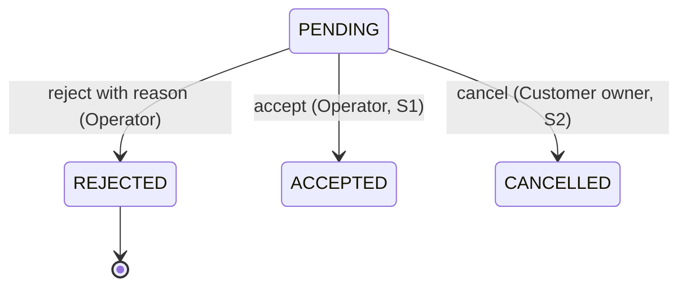

# Omazon — Sprint 3 Features: Engineering Contracts

| Item | Value |
|---|---|
| Document | `docs/sprints/sprint-3/features.md` |
| Sprint | 3 (F-09 due with Deliverable 2, 29 Nov 2026; the rest complete by 13 Dec 2026) |
| Staging branch | `sprint-3-staging` |
| Release candidate tag (planned) | `sprint-3-rc1` (Deliverable 2) |
| Release tag (planned) | `sprint-3-v3.0` (13 Dec 2026) |
| Version | 1.0 |
| Date | 2026-11-28 |
| Related | `docs/srs.md`, `docs/features.md` (whole-product inventory), `docs/traceability.md`, `docs/sprints/plan.md`, `docs/system-sds.md`, `docs/sprints/sprint-2/features.md`, `docs/evidence/nfr05/README.md` |

## Revision history (contract set)
| Version | Date | Change | Reason |
|---|---|---|---|
| 1.0 | 2026-11-28 | Initial contracts F-09 to F-13 and cross-cutting R-04 (AC-93 to AC-147, DEC-43 to DEC-57) | Written before implementation (Issue #59) |

Each contract below keeps its own revision history and a **Status** line with exactly one of: planned, in progress, implemented, tested, accepted. Log every change there with a reason; do not rewrite earlier entries.

Nothing in this document is implemented yet. Every test listed here is `NOT RUN` in `docs/traceability.md`.

## 1. Contract index

| Section | Feature | AC / tests | Requirements |
|---|---|---|---|
| 7 | F-09 Order rejection with reason | AC-93 to AC-104 | FR-14, BR-12, BR-06, BR-05, BR-07, BR-15 |
| 8 | F-10 Order search and filter | AC-105 to AC-115 | FR-15, BR-07 |
| 9 | F-11 Sales summary report | AC-116 to AC-123 | FR-16, BR-08 |
| 10 | F-12 Operator cancellation and refund | AC-124 to AC-135 | FR-17, BR-06, BR-10, BR-05, BR-15 |
| 11 | F-13 Login throttling | AC-136 to AC-143 | NFR-11 |
| 12 | R-04 Performance and final usability | AC-144 to AC-147 | NFR-05, NFR-09 |
| 13 | Decisions and open questions | DEC-43 to DEC-57 | — |

Total: **55 acceptance criteria (AC-93 to AC-147) and 55 test IDs** (TEST-nn verifies AC-nn, continuing from Sprint 2). TEST-144 is also named **LOAD-02** (the deployed run of the Sprint 1 LOAD-01 benchmark) and TEST-146 is also named **UI-CHECK-01** (DEC-54).

---

## 2. Product Definition of Done (applies to every feature)

A feature is **done** only when all items are true and the evidence is retained:

1. Required behavior is implemented as described in the feature contract, and its AC are met.
2. Every planned test for the feature has been **executed**; the command, tested commit, counts (pass / fail / skipped) and output are saved.
3. Assertions are meaningful. No required test is skipped, disabled, mocked-away or weakened. Any failed or skipped test is disclosed.
4. For each meaningful rule, a test was seen **failing first** (red) and then passing (green); both commit IDs are recorded.
5. The work is on a feature branch created from `sprint-3-staging`, in a PR into `sprint-3-staging` reviewed by the teammate with a specific comment. The author does not approve their own PR.
6. Integration tests and acceptance checks pass on `sprint-3-staging`. The reviewed release PR from staging to `main` is merged and the release is deployed. The Deliverable 2 candidate is tagged `sprint-3-rc1`; the accepted final release is tagged `sprint-3-v3.0`.
7. Documents are current: contract revisions are logged with reasons, `README.md`, `.env.example`, migrations and seed match the code.
8. No real secrets or personal data are in Git or in the PDF. Demo data is synthetic.
9. Incomplete work, known defects and limitations are listed in the submitted PDF.
10. Completion is shown by test output and screenshots that you produced by running the product, not by an AI agent's statement.
11. Every new endpoint is in `backend/src/routes/registry.ts` and covered by TEST-43 and TEST-92 in the same PR that adds it. All Sprint 1 and Sprint 2 tests (TEST-01 to TEST-92) still pass. An earlier test may change **only** where a contract in this document names the test and the new expected value (§2.1).
12. Line coverage of `backend/src/services` stays at or above 85% (COV-01).

### 2.1 Earlier tests that Sprint 3 changes

Some Sprint 1 and Sprint 2 tests pin the exact route list, transition table or row buttons. Sprint 3 requirements change those facts. The table lists every planned change. Each one updates a pinned value; no assertion is removed or loosened (DEC-45). If implementation finds another test that must change, the contract is revised first, with the reason.

| Test | Feature | Planned change |
|---|---|---|
| TEST-43, TEST-92 | F-09 | Protected routes 13 → 14, mounted routes 18 → 19, the TEST-92 sweep count (and the number in its title) 13 → 14. Add a pinned entry `POST /api/orders/:id/reject [OPERATOR]` with a valid body in the sweep. The pinned list of 7 Sprint 2 routes is unchanged |
| TEST-81 | F-09 | Allowed pairs gain `PENDING → REJECTED`: 5 → 6 allowed, the other 43 rejected. All 49 pairs are still tested |
| TEST-86 (operator) | F-09 | A `PENDING` row expects the buttons `Accept`, `Reject` instead of `Accept` only. The exact-button-list assertion stays |
| TEST-43, TEST-92 | F-11 | Protected 14 → 15, mounted 19 → 20; pin `GET /api/reports/sales [OPERATOR]` |
| TEST-43, TEST-92 | F-12 | Protected 15 → 16, mounted 20 → 21; pin `POST /api/orders/:id/operator-cancel [OPERATOR]` |
| TEST-60 | F-12 | The `ACCEPTED → CANCELLED` case becomes allowed in the state machine. TEST-61 is unchanged and still proves that the **Customer** gets 409 from `ACCEPTED` |
| TEST-81 | F-12 | Allowed pairs gain `ACCEPTED → CANCELLED`: 6 → 7 allowed, the other 42 rejected |
| TEST-86 (operator) | F-12 | An `ACCEPTED` row also expects `Cancel order`: `Start preparing`, `Cancel order` when paid; `Cancel order` (with "Awaiting payment") when unpaid |

AC-60 and AC-81 (Sprint 2) describe the transitions that existed in Sprint 2. AC-95 and AC-127 extend them (F-12 makes `ACCEPTED → CANCELLED` possible for an Operator only); the Sprint 2 contract is not rewritten.

The route counts assume the planned merge order (F-09, F-11, F-12). If the order changes, each PR adds its own one route to the current count and states the numbers in its description.

---

## 3. Test-level summary

| Level | Count | Test IDs |
|---|---|---|
| Unit | 4 | TEST-95, 96, 108, 127 |
| Unit + API/database integration | 3 | TEST-107, 119, 138 |
| API + database integration (API-DB) | 33 | TEST-93, 94, 97 to 101, 105, 106, 109 to 112, 116 to 118, 120, 121, 124 to 126, 128 to 133, 136, 137, 139 to 142 |
| UI component | 8 | TEST-102, 103, 113, 114, 122, 134, 143, 145 |
| End-to-end (Playwright) | 5 | TEST-104, 115, 123, 135, 147 |
| Check (post-deployment) | 2 | TEST-144 (LOAD-02), TEST-146 (UI-CHECK-01) |
| **Total** | **55** | |

The 55 is the number of test IDs, not the number of executed cases. One TEST-nn can be implemented by several cases.

---

## 4. Planned Issues and branches

| GitHub issue | Contract item | Planned branch |
|---|---|---|
| #59 | Sprint 3 contracts (this document) | `docs/sprint3-contracts` |
| #59 | F-09 Order rejection with reason | `feature/F-09-reject` |
| issue to be opened | F-10 Order search and filter | `feature/F-10-search-filter` |
| issue to be opened | F-11 Sales summary report | `feature/F-11-sales-summary` |
| issue to be opened | F-12 Operator cancellation and refund | `feature/F-12-operator-cancel` |
| issue to be opened | F-13 Login throttling | `feature/F-13-login-throttling` |
| issue to be opened (also closes #50) | R-04 Performance and final usability | `chore/R-04-performance-usability` |

Every branch starts from `sprint-3-staging` and is merged back into it through a reviewed PR. The release goes `sprint-3-staging` → `main`. The Deliverable 2 candidate on `main` is tagged `sprint-3-rc1`; the final release is tagged `sprint-3-v3.0` on 13 Dec 2026.

Order: this contract PR is merged before the first F-09 implementation commit. F-09 is merged first. F-10, F-11, F-12 and F-13 follow. R-04 is last, because its screen checks and load test cover the final build.

Both students author at least two Issues and review the others; record who authored and who reviewed in each PR.

---

## 5. Commit sequence to keep for evidence

For each feature, make these commits in order and keep the hashes:

1. `docs(F-xx): contract revision` (only if the contract must change before coding, with the reason)
2. `test(F-xx): failing tests for AC-.. (red)` — run and save the failing output to `docs/evidence/F-xx-red-<sha>.txt`
3. `feat(F-xx): implementation (green)` — run and save the passing output to `docs/evidence/F-xx-green-<sha>.txt`
4. `docs(F-xx): contract revision` (only if the contract changed during implementation, with the reason)

The specification commits for Sprint 3 are this document, delivered under Issue #59.

---

## 6. Evidence to collect for the submitted PDF

| Evidence | From | Maps to |
|---|---|---|
| Versioned contract history: this file's revision tables and `git log` showing contracts merged before implementation | `git log`, contracts PR | all |
| Rejection screenshots: reject dialog with a validation error, rejected order on the operator list, customer view with the reason | AC-102, AC-103, AC-104 | F-09 |
| API output: a Customer gets 403 on reject; a 4-character reason gets 400 | AC-100 | F-09 |
| Search and filter screenshots for both roles | AC-113 to AC-115 | F-10 |
| Sales report screenshot with figures checked against the orders | AC-122, AC-123 | F-11 |
| Operator cancellation screenshots: `CANCELLED` and `Refunded` badges, stock before and after | AC-134, AC-135 | F-12 |
| Throttling: test output with the fake clock; login screen showing the 429 message | AC-136, AC-137, AC-143 | F-13 |
| LOAD-02 record: environment, deployed commit, raw output, verdict | TEST-144 | NFR-05 |
| UI-CHECK-01 screen checklist | TEST-146 | NFR-09 |
| TDD red then green output with commit IDs for the tests named in each feature DoD | git history, `docs/evidence/` | TDD evidence |
| Full test command and output with counts and the tested commit hash | all | Build and test results |
| AC → TEST → actual test file::name → result table | `docs/traceability.md` | Results table |
| Issue and PR chains with branch, author, reviewer, review comment, staging merge, release merge (F-09, #59, is the suggested second chain) | GitHub | Workflow evidence |
| Remaining-work plan with owner and date, contribution table, AI-use declaration, known limitations | team | PDF |

---

## 7. F-09 — Order Rejection with Reason (Engineering Contract)

| Item | Value |
|---|---|
| Feature | F-09 Order rejection with reason |
| Requirements | FR-14, BR-12, BR-06, BR-05, BR-07, BR-15 |
| Sprint | 3 |
| Depends on | F-04 (the race tests also use F-06 cancel and F-04 accept) |
| Contract version | 1.0 (2026-11-28) |
| Status | planned |
| Issue / branch | #59 / `feature/F-09-reject` |

### Revision history
| Version | Date | Change | Reason |
|---|---|---|---|
| 1.0 | 2026-11-28 | Initial contract, status planned | Before implementation |

### 1. Feature design

**Behavior.** An Operator rejects a `PENDING` order and must give a reason of 5 to 200 characters. The order becomes `REJECTED`, the stock reserved by every line is given back, and one history entry stores the reason in `note`, all in one transaction. The Customer sees the reason on the order detail page.

**State transitions added.**

`orderStateMachine.ts` gains `PENDING → REJECTED` and nothing else. `REJECTED` is terminal. No other status can move to `REJECTED`. No other file lists allowed transitions.

**Workflow (`POST /api/orders/:id/reject`).** Checks run in this order, and the first failure is returned:
1. Authenticate (401) and require role `OPERATOR` (403).
2. Validate the body (400), then `:id` (400). This is the same order as the pay endpoint.
3. In one transaction load the order status and its lines, ordered by ascending `menuItemId`: missing → 404.
4. `assertTransition(status, "REJECTED")` → 409 if the status is not `PENDING`.
5. Conditional update: set `status = REJECTED` where `id` matches **and** `status = PENDING`. Zero rows → re-read the order and return 409 `INVALID_TRANSITION` with the current status (404 if it no longer exists).
6. Only after that update succeeds, add each line's quantity back to `MenuItem.stockQty` with an atomic increment, in ascending `menuItemId` order (the same lock order as order creation and F-06).
7. Insert one history row: `fromStatus = PENDING`, `toStatus = REJECTED`, `actorId` = the Operator, `actorRole = OPERATOR`, `note` = the trimmed reason.
8. Commit and return 200. Any failure rolls back steps 5 to 7.

**Business rules.** BR-12 (reason required, 5 to 200 characters), BR-06, BR-05 (stock never wrong or negative), BR-07 (the Customer reads the reason only on their own order), BR-15. `paymentStatus` stays `UNPAID`: a `PENDING` order cannot have been paid (BR-11), and the endpoint never writes `paymentStatus`.

**Validation (zod, strict).** `reason`: required string, trimmed, then 5 to 200 characters. The length is the JavaScript string length of the trimmed value, the same measure `pickupNote` uses (DEC-43). Unknown fields are rejected. `:id` is a positive integer.

**Dependencies.** `Order`, `OrderItem`, `OrderStatusHistory.note` (exists since `0001_init`), `MenuItem.stockQty`.

**Permissions.** Operator only; any Operator may reject any order (SRS A-01). A Customer gets 403, including on their own order.

**Failure and boundary cases.**
- Reason of 4 characters, 201 characters, only whitespace, or `"  abcd  "` (4 after trimming) returns 400 and nothing changes (AC-96, AC-100). 5 and 200 characters are accepted.
- A missing reason, a non-string reason or an unknown field returns 400 (AC-96, AC-100).
- Rejecting an order that is `ACCEPTED`, `PREPARING`, `READY`, `COMPLETED`, `CANCELLED` or `REJECTED` returns 409 and changes nothing, so a repeated reject never restores stock twice (AC-97).
- Reject and customer cancel at once: exactly one wins and stock is restored once (AC-98).
- Reject and accept at once: exactly one wins (AC-99).
- A failure part-way leaves order, stock and history unchanged (AC-101).
- Stock is restored to an item even if it has since been disabled; the item stays disabled, and the restored value is added to the current stock (DEC-34 applies).

### 2. API specification

All errors use the shape `{ "error": { "code", "message", "details?" } }` (System SDS §4). Malformed JSON returns 400 `VALIDATION_ERROR`; an unexpected failure returns 500 `INTERNAL_ERROR`. This applies to every endpoint in this document. No new error code is added by F-09.

```ts
export const orderRejectSchema = z
  .object({ reason: z.string().trim().min(5).max(200) })
  .strict();
```

#### `POST /api/orders/:id/reject` (Operator)
| Item | Spec |
|---|---|
| Role / ownership | `OPERATOR`; no ownership rule |
| Request | `orderRejectSchema`, for example `{ "reason": "Sold out of basil today" }` |
| 200 | `{ "order": { ...order detail with customer, same shape as accept... } }` with `status` `REJECTED`, `paymentStatus` `UNPAID` and the new history entry with its `note` |
| 400 | `VALIDATION_ERROR`: body violation (`details: [ { "field": "reason", "message": "..." } ]`; an unknown field is also rejected) or invalid `:id` |
| 401 | `UNAUTHENTICATED` |
| 403 | `FORBIDDEN` (Customer). Generic error only, no order data |
| 404 | `NOT_FOUND`: no such order |
| 409 | `INVALID_TRANSITION`: order is not `PENDING`; `details: { "from": "<current status>", "to": "REJECTED" }` |

**Order detail response (changed).** Every history entry gains `note: string | null`. It is `null` for all entries except a rejection. This applies to `GET /api/orders/:id` and to every endpoint that returns order detail. No other field changes (DEC-43). The access rule is unchanged: only the owner Customer or an Operator receives the detail (BR-07).

**Registry.** Add `POST /api/orders/:id/reject` with `[OPERATOR]` to `protectedRoutes` and mount it in `routes/orders.ts` with `guardsFor`. Update TEST-43 and TEST-92 as listed in §2.1 (14 protected, 19 mounted).

### 3. UI specification
| Element | Behavior |
|---|---|
| `/operator/orders` `PENDING` row | Two buttons: **Accept** (unchanged) and **Reject**. Other statuses never show Reject |
| Reject dialog | Opened by **Reject**. An element with `role="dialog"` and the accessible name "Reject order CB-000001" (the order's number). It holds a labelled multi-line field **Reason**, a character counter, and the buttons **Reject order** and **Back**. One dialog at a time. Reason starts empty. **Back** closes it and sends nothing (DEC-44) |
| Counter | `<n>/200`, where `n` is the length of the trimmed text. It is styled as an error above 200. The field does not cut off longer text |
| Validation | Pressing **Reject order** with `n < 5` or `n > 200` shows "Reason must be 5 to 200 characters." next to the field and sends no request. The message goes away when the field is edited |
| Pending | "Rejecting…"; **Reject order**, **Back** and the field are disabled, and so is that row's **Accept** |
| Success | The dialog closes. The request carries the trimmed reason. The row shows "Rejected" with no action button; if the active status filter no longer matches, the list reloads (same rule as F-08) |
| 409 | The dialog closes, the alert "This order was already handled." is shown and the list reloads |
| 400 | The dialog stays open with the typed text and shows the API's `reason` message from `details` (else the API message) |
| Other errors | The dialog stays open with the typed text and shows the API message for other statuses below 500, or "Could not reject this order. Please try again." for network and 500 errors |
| Order detail `/orders/:id` | When the status is `REJECTED`, show **Reason for rejection:** followed by the note of the `REJECTED` history entry, to the owner and to an Operator. The text wraps even without spaces (Bootstrap `text-break`) and is rendered as plain text. No Pay or Cancel button |
| Loading / empty / error | Existing states of both screens are unchanged |
| My orders | No change; it already shows "Rejected" |
| API client | `rejectOrder(id, reason)`; `OrderHistoryEntry` gains `note: string \| null` |

There is no Reject button on the order detail page (DEC-44). The customer sees the new status on load or reload; there is no push (DEC-38).

### 4. Data specification
| Layer | Change |
|---|---|
| Prisma schema | **No change.** `OrderStatus.REJECTED` and `OrderStatusHistory.note` exist |
| Constraints and indexes | **No change.** The 5 to 200 rule is API validation only; `note` stays an unlimited text column |
| Migration | **None** |
| Data written | `Order.status`, `MenuItem.stockQty`, one `OrderStatusHistory` row with `note` |
| Seed | **No change** |

### 5. Acceptance criteria

| AC | Statement |
|---|---|
| AC-93 | An Operator rejecting a `PENDING` order with a valid reason gets 200. Read back from the database, the order is `REJECTED` and `UNPAID`, and there is exactly one new history row: `PENDING → REJECTED`, actor = that Operator, role `OPERATOR`, `note` = the trimmed reason, with a `createdAt`. The owner and an Operator read the same reason in the `note` of that entry from `GET /api/orders/:id`; the other entries have `note: null`. |
| AC-94 | Rejection increases the stock of every ordered item by exactly its ordered quantity, including an item that has since been disabled (which stays disabled); other items are unchanged. |
| AC-95 | The state machine allows `PENDING → REJECTED` and rejects a transition to `REJECTED` from `ACCEPTED`, `PREPARING`, `READY`, `COMPLETED`, `CANCELLED` and `REJECTED` with `INVALID_TRANSITION`. |
| AC-96 | The reason rule accepts 5 and 200 characters and rejects 4 and 201 characters, whitespace-only text, a value with fewer than 5 characters after trimming, a missing or non-string value and an unknown field. An accepted value is trimmed. |
| AC-97 | Rejecting an order that is not `PENDING` (including a second reject) returns 409 `INVALID_TRANSITION` with `details` `{ from, to: "REJECTED" }`; status, payment status, stock and history are unchanged. |
| AC-98 | When an Operator rejects while the owner cancels, exactly one request gets 200 and the other 409. The final status and the single new history row match the winner, and stock is restored exactly once. |
| AC-99 | When one request rejects while another accepts, exactly one gets 200 and the other 409. Reject wins: `REJECTED`, stock restored, history note stored. Accept wins: `ACCEPTED`, stock still reserved, no note. Exactly one history row after creation. |
| AC-100 | A Customer (owner or not) gets 403 `FORBIDDEN` with no order data, an anonymous caller gets 401, a missing order gets 404, a non-numeric id gets 400, and an invalid body (including a 4-character reason) gets 400 `VALIDATION_ERROR`; nothing changes. |
| AC-101 | Rejection is atomic: if writing the history row fails, the response is 500 `INTERNAL_ERROR` and the order status, every stock value and the history are unchanged. |
| AC-102 | In the operator list, Reject appears only on `PENDING` rows and opens a dialog with a reason field and a live character counter; an invalid length shows a message and sends nothing; a valid submit sends the trimmed reason, shows a pending state and then "Rejected"; 409 shows an alert and reloads the list; 400 and other errors keep the dialog and the typed text. |
| AC-103 | On the order detail of a rejected order the Customer sees "Rejected" and the reason, wrapped as plain text, with no Pay or Cancel button; an order that is not rejected shows no reason line. |
| AC-104 | In the UI a Customer places an order, an Operator rejects it with a reason, the Customer then sees "Rejected" and that reason after login, and the menu stock is back to its earlier value. |

### 6. Software Test Specification (STS)

| Test | AC | Level | Precondition and input | Action | Expected result | Planned file::test name |
|---|---|---|---|---|---|---|
| TEST-93 | AC-93 | API-DB | `customer1` owns `PENDING` order O1; `operator1` logged in; reason with surrounding spaces | POST `/api/orders/O1/reject`; read order and history from the DB; GET O1 as `customer1` and as `operator1` | 200; DB `REJECTED`, `UNPAID`; history has 2 rows, the second as in AC-93 with the trimmed note; both GETs show that note and `note: null` on the first entry | `backend/tests/orders.reject.test.ts::TEST-93` |
| TEST-94 | AC-94 | API-DB | O1 = item 1 × 2 and item 4 × 3; note all stock; then disable item 4 | Reject O1; read all stock | Item 1 +2, item 4 +3 and still disabled; all others unchanged | `backend/tests/orders.reject.test.ts::TEST-94` |
| TEST-95 | AC-95 | Unit | None | Table-driven `canTransition` and `assertTransition(from, "REJECTED")` over all 7 statuses | Only `PENDING` passes; the other 6 throw 409 `INVALID_TRANSITION` with `{from, to}` | `backend/src/services/orderStateMachine.test.ts::TEST-95` |
| TEST-96 | AC-96 | Unit | None | Parse with `orderRejectSchema`: 4, 5, 200 and 201 characters; `"     "`; `""`; `"  abcd  "`; `"  abcde  "`; missing; number; extra field | 5 and 200 accepted; `"  abcde  "` becomes `"abcde"`; all others rejected | `backend/src/middleware/orderRejectSchema.test.ts::TEST-96` |
| TEST-97 | AC-97 | API-DB | Orders in `ACCEPTED`, `PREPARING`, `READY`, `COMPLETED`, `CANCELLED` (set in the DB by the helper) and `REJECTED` (reached by a first reject) | Reject each | Each 409 with `details` `{from, to: "REJECTED"}`; status, payment status, stock and history unchanged | `backend/tests/orders.reject.test.ts::TEST-97` |
| TEST-98 | AC-98 | API-DB | `PENDING` order; `customer1` and `operator1` logged in | Reject and cancel with `Promise.all` behind a synchronization barrier (as TEST-63); repeat 10 times | Exactly one 200 and one 409 each time; the 409 `details.from` is the winner's status; DB status and the one new history row match the winner; stock back to the value before the order | `backend/tests/orders.reject.test.ts::TEST-98` |
| TEST-99 | AC-99 | API-DB | `PENDING` order; `operator1` and `operator2` logged in | Reject (`operator1`) and accept (`operator2`) behind the barrier; repeat 10 times | Exactly one 200 and one 409. Reject wins: `REJECTED`, stock restored, note stored. Accept wins: `ACCEPTED`, stock reserved, `note` null. One history row after creation, actor = winner | `backend/tests/orders.reject.test.ts::TEST-99` |
| TEST-100 | AC-100 | API-DB | O1 owned by `customer1` | Valid reject as `customer1`, `customer2`, anonymous; `operator1` rejects id 99999 and `abc`; `operator1` sends O1 a 4-character reason, `{}` and an extra field | 403, 403, 401, 404, 400, then 400 three times (`details[0].field` is `reason` for the short reason); 403 bodies contain only `error` with `code` and `message`; O1, stock and history unchanged | `backend/tests/orders.reject.test.ts::TEST-100` |
| TEST-101 | AC-101 | API-DB | `PENDING` order; a temporary test-database trigger raises on insert of a `REJECTED` history row (as TEST-64) | Reject; read DB; drop the trigger | 500 `INTERNAL_ERROR` with the generic message; order still `PENDING`; stock and history unchanged | `backend/tests/orders.reject.test.ts::TEST-101` |
| TEST-102 | AC-102 | UI component | API client mocked: rows in every status; reject pending, success, 409, 400 with `details`, 500 | Open the dialog; type 4, 201 and valid text; press Back; submit | Reject only on `PENDING`; dialog name and counter correct; message and no call for 4 and 201; Back sends nothing; trimmed reason sent; "Rejecting…" with controls disabled; row "Rejected" (All filter) or reload (Pending filter); 409 alert and reload; 400 and 500 keep the text with the right message | `frontend/src/pages/OperatorOrders.test.tsx::TEST-102` |
| TEST-103 | AC-103 | UI component | API client mocked: a rejected order with a note, and a pending order | Render the detail as Customer and as Operator | Rejected: badge "Rejected", "Reason for rejection:" and the note in an element with `text-break`, no Pay or Cancel button. Pending: no reason line | `frontend/src/pages/OrderDetail.test.tsx::TEST-103` |
| TEST-104 | AC-104 | E2E | Seeded database; `customer1`, `operator1` | Note menu stock; customer orders; operator opens Reject, submits a short reason, then a valid one; customer logs in and opens the order | Validation message appears; the row becomes rejected; the customer sees "Rejected", the reason and the history entry; menu stock equals the earlier value | `frontend/e2e/reject.spec.ts::TEST-104` |

`reject.spec.ts` re-seeds after itself, like `cancel.spec.ts`, so later journeys see the seeded orders only.

### 7. Definition of Done (feature-specific)
In addition to the Product Definition of Done:
- TEST-93 to TEST-104 executed and passing, results recorded; TEST-43 and TEST-92 pass with the new route; TEST-81 and TEST-86 are changed only as listed in §2.1.
- **TDD evidence** (red then green with commit IDs) for TEST-94 (stock restore), TEST-96 (reason boundaries), TEST-98 and TEST-99 (races).
- Race and atomicity tests run against the real PostgreSQL test database (no mock).
- Screenshots: reject dialog with a validation error, rejected order on the operator list, customer view with the reason. API output: a Customer's 403 and a 4-character reason's 400. No password or token appears.
- Transitions stay in `orderStateMachine.ts`; none are duplicated in controllers.
- Traceability rows FR-14, BR-12 and the BR-06 S3 part updated.

---

## 13. Decisions and open questions

These continue the decision numbering (last used: DEC-42). The SRS and SDS do not settle these points; each takes the simplest option consistent with the current code. Status of all entries: **proposed**, confirmed by merging the contracts PR for Issue #59.

| ID | Decision | Rationale | Applies to | Date |
|---|---|---|---|---|
| DEC-43 | Reject is `POST /api/orders/:id/reject` with `{ reason }`, trimmed, 5–200 by JavaScript string length. The reason is stored in `OrderStatusHistory.note`; every history entry in order detail gains `note` (string or null). No new column or error code. | The path is in the System SDS, the column already exists, and `pickupNote` uses the same length measure. | F-09 | 2026-11-28 |
| DEC-44 | Reject is offered only on the operator list, in a small in-page dialog with a counter of the trimmed length. The submit button stays enabled and validates when pressed. | FR-14 needs one place to reject; fulfilment actions are also list-only (DEC-38). A pressed button can show why the input is wrong. | F-09 | 2026-11-28 |
| DEC-45 | Earlier tests that pin route counts, the transition table or row buttons are updated only as listed in §2.1. Sprint 2 contract text is not rewritten. | The Sprint 3 requirements change those facts; naming each change keeps it reviewable and separate from weakening a test. | F-09, F-11, F-12 | 2026-11-28 |

### Open questions for the team

| ID | Question | Default in this contract |
|---|---|---|
| OQ-06 | Is the sales definition right: only `PAID` orders, dated by when the order was placed? | Yes (DEC-49) |
| OQ-07 | Is it acceptable that anyone who knows an email can lock it for 15 minutes, with no per-IP limit? | Yes (NFR-11 wording, DEC-53) |
| OQ-08 | LOAD-02 leaves many synthetic orders in the demo database, which fill the operator list and the sales report. Keep them, restore a backup, or measure against a separate database? | Keep them and disable the test item (DEC-55). Decide before running LOAD-02 |
| OQ-09 | Should `sprint-3-staging` be added to `ci-docker.yml` before F-09, instead of in R-04? | In R-04 (DEC-57) |
| OQ-10 | Who owns F-10 to F-13 and R-04, and by which date before 13 Dec? | Not set; to be recorded when the issues are opened |
