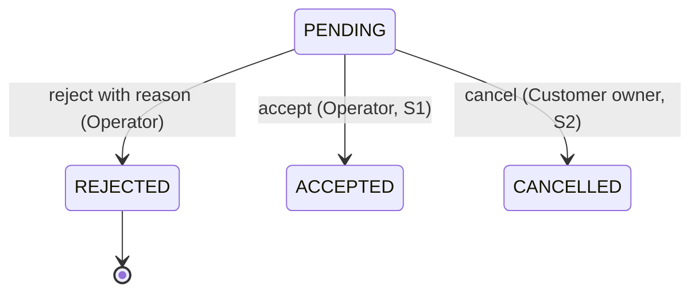
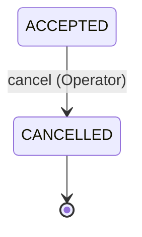
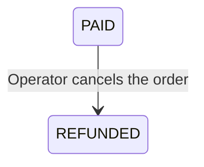

# Omazon — Sprint 3 Features: Engineering Contracts

| Item | Value |
|---|---|
| Document | `docs/sprints/sprint-3/features.md` |
| Sprint | 3 (F-09 due with Deliverable 2, 29 Nov 2026; the rest complete by 13 Dec 2026) |
| Staging branch | `sprint-3-staging` |
| Release candidate tag (planned) | `sprint-3-rc1` (Deliverable 2) |
| Release tag (planned) | `sprint-3-v3.0` (13 Dec 2026) |
| Version | 1.1 |
| Date | 2026-11-28 |
| Related | `docs/srs.md`, `docs/features.md` (whole-product inventory), `docs/traceability.md`, `docs/sprints/plan.md`, `docs/system-sds.md`, `docs/sprints/sprint-2/features.md`, `docs/evidence/nfr05/README.md` |

## Revision history (contract set)
| Version | Date | Change | Reason |
|---|---|---|---|
| 1.0 | 2026-11-28 | Initial contracts F-09 to F-13 and cross-cutting R-04 (AC-93 to AC-147, DEC-43 to DEC-57) | Written before implementation (Issue #59) |
| 1.1 | 2026-11-28 | §2.1 adds a type-only change to the history sample data in `OrderDetail.test.tsx`; F-09 contract 1.1, status in progress. No AC or STS changed | Found while preparing the F-09 tests: the frontend type check includes test files, and history entries gain a required `note` (§7.2) (Issue #59) |

Each contract below keeps its own revision history and a **Status** line with exactly one of: planned, in progress, implemented, tested, accepted. Log every change there with a reason; do not rewrite earlier entries.

Nothing in this document is implemented yet. Every test listed here is `NOT RUN` in `docs/traceability.md`.

## 1. Contract index

| Section | Feature | AC / tests | Requirements |
|---|---|---|---|
| 7 | F-09 Order rejection with reason | AC-93 to AC-104 | FR-14, BR-12, BR-06, BR-05, BR-07, BR-15 |
| 8 | F-10 Order search and filter | AC-105 to AC-115 | FR-15, BR-07 |
| 9 | F-11 Sales summary report | AC-116 to AC-123 | FR-16, BR-08 |
| 10 | F-12 Operator cancellation and refund | AC-124 to AC-135 | FR-17, BR-06, BR-10, BR-05, BR-15 |
| 11 | F-13 Login throttling | AC-136 to AC-143 | NFR-11 |
| 12 | R-04 Performance and final usability | AC-144 to AC-147 | NFR-05, NFR-09 |
| 13 | Decisions and open questions | DEC-43 to DEC-57 | — |

Total: **55 acceptance criteria (AC-93 to AC-147) and 55 test IDs** (TEST-nn verifies AC-nn, continuing from Sprint 2). TEST-144 is also named **LOAD-02** (the deployed run of the Sprint 1 LOAD-01 benchmark) and TEST-146 is also named **UI-CHECK-01** (DEC-54).

---

## 2. Product Definition of Done (applies to every feature)

A feature is **done** only when all items are true and the evidence is retained:

1. Required behavior is implemented as described in the feature contract, and its AC are met.
2. Every planned test for the feature has been **executed**; the command, tested commit, counts (pass / fail / skipped) and output are saved.
3. Assertions are meaningful. No required test is skipped, disabled, mocked-away or weakened. Any failed or skipped test is disclosed.
4. For each meaningful rule, a test was seen **failing first** (red) and then passing (green); both commit IDs are recorded.
5. The work is on a feature branch created from `sprint-3-staging`, in a PR into `sprint-3-staging` reviewed by the teammate with a specific comment. The author does not approve their own PR.
6. Integration tests and acceptance checks pass on `sprint-3-staging`. The reviewed release PR from staging to `main` is merged and the release is deployed. The Deliverable 2 candidate is tagged `sprint-3-rc1`; the accepted final release is tagged `sprint-3-v3.0`.
7. Documents are current: contract revisions are logged with reasons, `README.md`, `.env.example`, migrations and seed match the code.
8. No real secrets or personal data are in Git or in the PDF. Demo data is synthetic.
9. Incomplete work, known defects and limitations are listed in the submitted PDF.
10. Completion is shown by test output and screenshots that you produced by running the product, not by an AI agent's statement.
11. Every new endpoint is in `backend/src/routes/registry.ts` and covered by TEST-43 and TEST-92 in the same PR that adds it. All Sprint 1 and Sprint 2 tests (TEST-01 to TEST-92) still pass. An earlier test may change **only** where a contract in this document names the test and the new expected value (§2.1).
12. Line coverage of `backend/src/services` stays at or above 85% (COV-01).

### 2.1 Earlier tests that Sprint 3 changes

Some Sprint 1 and Sprint 2 tests pin the exact route list, transition table or row buttons. Sprint 3 requirements change those facts. The table lists every planned change. Each one updates a pinned value; no assertion is removed or loosened (DEC-45). If implementation finds another test that must change, the contract is revised first, with the reason.

| Test | Feature | Planned change |
|---|---|---|
| TEST-43, TEST-92 | F-09 | Protected routes 13 → 14, mounted routes 18 → 19, the TEST-92 sweep count (and the number in its title) 13 → 14. Add a pinned entry `POST /api/orders/:id/reject [OPERATOR]` with a valid body in the sweep. The pinned list of 7 Sprint 2 routes is unchanged |
| TEST-81 | F-09 | Allowed pairs gain `PENDING → REJECTED`: 5 → 6 allowed, the other 43 rejected. All 49 pairs are still tested |
| TEST-86 (operator) | F-09 | A `PENDING` row expects the buttons `Accept`, `Reject` instead of `Accept` only. The exact-button-list assertion stays |
| TEST-66, TEST-75, TEST-86 (order detail) and the other cases in `OrderDetail.test.tsx` | F-09 | Type only: the shared sample history entries gain `note: null`. No expected value or assertion changes |
| TEST-43, TEST-92 | F-11 | Protected 14 → 15, mounted 19 → 20; pin `GET /api/reports/sales [OPERATOR]` |
| TEST-43, TEST-92 | F-12 | Protected 15 → 16, mounted 20 → 21; pin `POST /api/orders/:id/operator-cancel [OPERATOR]` |
| TEST-60 | F-12 | The `ACCEPTED → CANCELLED` case becomes allowed in the state machine. TEST-61 is unchanged and still proves that the **Customer** gets 409 from `ACCEPTED` |
| TEST-81 | F-12 | Allowed pairs gain `ACCEPTED → CANCELLED`: 6 → 7 allowed, the other 42 rejected |
| TEST-86 (operator) | F-12 | An `ACCEPTED` row also expects `Cancel order`: `Start preparing`, `Cancel order` when paid; `Cancel order` (with "Awaiting payment") when unpaid |

AC-60 and AC-81 (Sprint 2) describe the transitions that existed in Sprint 2. AC-95 and AC-127 extend them (F-12 makes `ACCEPTED → CANCELLED` possible for an Operator only); the Sprint 2 contract is not rewritten.

The route counts assume the planned merge order (F-09, F-11, F-12). If the order changes, each PR adds its own one route to the current count and states the numbers in its description.

---

## 3. Test-level summary

| Level | Count | Test IDs |
|---|---|---|
| Unit | 4 | TEST-95, 96, 108, 127 |
| Unit + API/database integration | 3 | TEST-107, 119, 138 |
| API + database integration (API-DB) | 33 | TEST-93, 94, 97 to 101, 105, 106, 109 to 112, 116 to 118, 120, 121, 124 to 126, 128 to 133, 136, 137, 139 to 142 |
| UI component | 8 | TEST-102, 103, 113, 114, 122, 134, 143, 145 |
| End-to-end (Playwright) | 5 | TEST-104, 115, 123, 135, 147 |
| Check (post-deployment) | 2 | TEST-144 (LOAD-02), TEST-146 (UI-CHECK-01) |
| **Total** | **55** | |

The 55 is the number of test IDs, not the number of executed cases. One TEST-nn can be implemented by several cases.

---

## 4. Planned Issues and branches

| GitHub issue | Contract item | Planned branch |
|---|---|---|
| #59 | Sprint 3 contracts (this document) | `docs/sprint3-contracts` |
| #59 | F-09 Order rejection with reason | `feature/F-09-reject` |
| issue to be opened | F-10 Order search and filter | `feature/F-10-search-filter` |
| issue to be opened | F-11 Sales summary report | `feature/F-11-sales-summary` |
| issue to be opened | F-12 Operator cancellation and refund | `feature/F-12-operator-cancel` |
| issue to be opened | F-13 Login throttling | `feature/F-13-login-throttling` |
| issue to be opened (also closes #50) | R-04 Performance and final usability | `chore/R-04-performance-usability` |

Every branch starts from `sprint-3-staging` and is merged back into it through a reviewed PR. The release goes `sprint-3-staging` → `main`. The Deliverable 2 candidate on `main` is tagged `sprint-3-rc1`; the final release is tagged `sprint-3-v3.0` on 13 Dec 2026.

Order: this contract PR is merged before the first F-09 implementation commit. F-09 is merged first. F-10, F-11, F-12 and F-13 follow. R-04 is last, because its screen checks and load test cover the final build.

Both students author at least two Issues and review the others; record who authored and who reviewed in each PR.

---

## 5. Commit sequence to keep for evidence

For each feature, make these commits in order and keep the hashes:

1. `docs(F-xx): contract revision` (only if the contract must change before coding, with the reason)
2. `test(F-xx): failing tests for AC-.. (red)` — run and save the failing output to `docs/evidence/F-xx-red-<sha>.txt`
3. `feat(F-xx): implementation (green)` — run and save the passing output to `docs/evidence/F-xx-green-<sha>.txt`
4. `docs(F-xx): contract revision` (only if the contract changed during implementation, with the reason)

The specification commits for Sprint 3 are this document, delivered under Issue #59.

---

## 6. Evidence to collect for the submitted PDF

| Evidence | From | Maps to |
|---|---|---|
| Versioned contract history: this file's revision tables and `git log` showing contracts merged before implementation | `git log`, contracts PR | all |
| Rejection screenshots: reject dialog with a validation error, rejected order on the operator list, customer view with the reason | AC-102, AC-103, AC-104 | F-09 |
| API output: a Customer gets 403 on reject; a 4-character reason gets 400 | AC-100 | F-09 |
| Search and filter screenshots for both roles | AC-113 to AC-115 | F-10 |
| Sales report screenshot with figures checked against the orders | AC-122, AC-123 | F-11 |
| Operator cancellation screenshots: `CANCELLED` and `Refunded` badges, stock before and after | AC-134, AC-135 | F-12 |
| Throttling: test output with the fake clock; login screen showing the 429 message | AC-136, AC-137, AC-143 | F-13 |
| LOAD-02 record: environment, deployed commit, raw output, verdict | TEST-144 | NFR-05 |
| UI-CHECK-01 screen checklist | TEST-146 | NFR-09 |
| TDD red then green output with commit IDs for the tests named in each feature DoD | git history, `docs/evidence/` | TDD evidence |
| Full test command and output with counts and the tested commit hash | all | Build and test results |
| AC → TEST → actual test file::name → result table | `docs/traceability.md` | Results table |
| Issue and PR chains with branch, author, reviewer, review comment, staging merge, release merge (F-09, #59, is the suggested second chain) | GitHub | Workflow evidence |
| Remaining-work plan with owner and date, contribution table, AI-use declaration, known limitations | team | PDF |

---

## 7. F-09 — Order Rejection with Reason (Engineering Contract)

| Item | Value |
|---|---|
| Feature | F-09 Order rejection with reason |
| Requirements | FR-14, BR-12, BR-06, BR-05, BR-07, BR-15 |
| Sprint | 3 |
| Depends on | F-04 (the race tests also use F-06 cancel and F-04 accept) |
| Contract version | 1.1 (2026-11-28) |
| Status | in progress |
| Issue / branch | #59 / `feature/F-09-reject` |

### Revision history
| Version | Date | Change | Reason |
|---|---|---|---|
| 1.0 | 2026-11-28 | Initial contract, status planned | Before implementation |
| 1.1 | 2026-11-28 | Status in progress; §2.1 lists the type-only `note: null` sample-data change. No AC or STS changed | The required `note` field on history entries makes the existing sample data fail the type check |

### 1. Feature design

**Behavior.** An Operator rejects a `PENDING` order and must give a reason of 5 to 200 characters. The order becomes `REJECTED`, the stock reserved by every line is given back, and one history entry stores the reason in `note`, all in one transaction. The Customer sees the reason on the order detail page.

**State transitions added.**

`orderStateMachine.ts` gains `PENDING → REJECTED` and nothing else. `REJECTED` is terminal. No other status can move to `REJECTED`. No other file lists allowed transitions.

**Workflow (`POST /api/orders/:id/reject`).** Checks run in this order, and the first failure is returned:
1. Authenticate (401) and require role `OPERATOR` (403).
2. Validate the body (400), then `:id` (400). This is the same order as the pay endpoint.
3. In one transaction load the order status and its lines, ordered by ascending `menuItemId`: missing → 404.
4. `assertTransition(status, "REJECTED")` → 409 if the status is not `PENDING`.
5. Conditional update: set `status = REJECTED` where `id` matches **and** `status = PENDING`. Zero rows → re-read the order and return 409 `INVALID_TRANSITION` with the current status (404 if it no longer exists).
6. Only after that update succeeds, add each line's quantity back to `MenuItem.stockQty` with an atomic increment, in ascending `menuItemId` order (the same lock order as order creation and F-06).
7. Insert one history row: `fromStatus = PENDING`, `toStatus = REJECTED`, `actorId` = the Operator, `actorRole = OPERATOR`, `note` = the trimmed reason.
8. Commit and return 200. Any failure rolls back steps 5 to 7.

**Business rules.** BR-12 (reason required, 5 to 200 characters), BR-06, BR-05 (stock never wrong or negative), BR-07 (the Customer reads the reason only on their own order), BR-15. `paymentStatus` stays `UNPAID`: a `PENDING` order cannot have been paid (BR-11), and the endpoint never writes `paymentStatus`.

**Validation (zod, strict).** `reason`: required string, trimmed, then 5 to 200 characters. The length is the JavaScript string length of the trimmed value, the same measure `pickupNote` uses (DEC-43). Unknown fields are rejected. `:id` is a positive integer.

**Dependencies.** `Order`, `OrderItem`, `OrderStatusHistory.note` (exists since `0001_init`), `MenuItem.stockQty`.

**Permissions.** Operator only; any Operator may reject any order (SRS A-01). A Customer gets 403, including on their own order.

**Failure and boundary cases.**
- Reason of 4 characters, 201 characters, only whitespace, or `"  abcd  "` (4 after trimming) returns 400 and nothing changes (AC-96, AC-100). 5 and 200 characters are accepted.
- A missing reason, a non-string reason or an unknown field returns 400 (AC-96, AC-100).
- Rejecting an order that is `ACCEPTED`, `PREPARING`, `READY`, `COMPLETED`, `CANCELLED` or `REJECTED` returns 409 and changes nothing, so a repeated reject never restores stock twice (AC-97).
- Reject and customer cancel at once: exactly one wins and stock is restored once (AC-98).
- Reject and accept at once: exactly one wins (AC-99).
- A failure part-way leaves order, stock and history unchanged (AC-101).
- Stock is restored to an item even if it has since been disabled; the item stays disabled, and the restored value is added to the current stock (DEC-34 applies).

### 2. API specification

All errors use the shape `{ "error": { "code", "message", "details?" } }` (System SDS §4). Malformed JSON returns 400 `VALIDATION_ERROR`; an unexpected failure returns 500 `INTERNAL_ERROR`. This applies to every endpoint in this document. No new error code is added by F-09.

```ts
export const orderRejectSchema = z
  .object({ reason: z.string().trim().min(5).max(200) })
  .strict();
```

#### `POST /api/orders/:id/reject` (Operator)
| Item | Spec |
|---|---|
| Role / ownership | `OPERATOR`; no ownership rule |
| Request | `orderRejectSchema`, for example `{ "reason": "Sold out of basil today" }` |
| 200 | `{ "order": { ...order detail with customer, same shape as accept... } }` with `status` `REJECTED`, `paymentStatus` `UNPAID` and the new history entry with its `note` |
| 400 | `VALIDATION_ERROR`: body violation (`details: [ { "field": "reason", "message": "..." } ]`; an unknown field is also rejected) or invalid `:id` |
| 401 | `UNAUTHENTICATED` |
| 403 | `FORBIDDEN` (Customer). Generic error only, no order data |
| 404 | `NOT_FOUND`: no such order |
| 409 | `INVALID_TRANSITION`: order is not `PENDING`; `details: { "from": "<current status>", "to": "REJECTED" }` |

**Order detail response (changed).** Every history entry gains `note: string | null`. It is `null` for all entries except a rejection. This applies to `GET /api/orders/:id` and to every endpoint that returns order detail. No other field changes (DEC-43). The access rule is unchanged: only the owner Customer or an Operator receives the detail (BR-07).

**Registry.** Add `POST /api/orders/:id/reject` with `[OPERATOR]` to `protectedRoutes` and mount it in `routes/orders.ts` with `guardsFor`. Update TEST-43 and TEST-92 as listed in §2.1 (14 protected, 19 mounted).

### 3. UI specification
| Element | Behavior |
|---|---|
| `/operator/orders` `PENDING` row | Two buttons: **Accept** (unchanged) and **Reject**. Other statuses never show Reject |
| Reject dialog | Opened by **Reject**. An element with `role="dialog"` and the accessible name "Reject order CB-000001" (the order's number). It holds a labelled multi-line field **Reason**, a character counter, and the buttons **Reject order** and **Back**. One dialog at a time. Reason starts empty. **Back** closes it and sends nothing (DEC-44) |
| Counter | `<n>/200`, where `n` is the length of the trimmed text. It is styled as an error above 200. The field does not cut off longer text |
| Validation | Pressing **Reject order** with `n < 5` or `n > 200` shows "Reason must be 5 to 200 characters." next to the field and sends no request. The message goes away when the field is edited |
| Pending | "Rejecting…"; **Reject order**, **Back** and the field are disabled, and so is that row's **Accept** |
| Success | The dialog closes. The request carries the trimmed reason. The row shows "Rejected" with no action button; if the active status filter no longer matches, the list reloads (same rule as F-08) |
| 409 | The dialog closes, the alert "This order was already handled." is shown and the list reloads |
| 400 | The dialog stays open with the typed text and shows the API's `reason` message from `details` (else the API message) |
| Other errors | The dialog stays open with the typed text and shows the API message for other statuses below 500, or "Could not reject this order. Please try again." for network and 500 errors |
| Order detail `/orders/:id` | When the status is `REJECTED`, show **Reason for rejection:** followed by the note of the `REJECTED` history entry, to the owner and to an Operator. The text wraps even without spaces (Bootstrap `text-break`) and is rendered as plain text. No Pay or Cancel button |
| Loading / empty / error | Existing states of both screens are unchanged |
| My orders | No change; it already shows "Rejected" |
| API client | `rejectOrder(id, reason)`; `OrderHistoryEntry` gains `note: string \| null` |

There is no Reject button on the order detail page (DEC-44). The customer sees the new status on load or reload; there is no push (DEC-38).

### 4. Data specification
| Layer | Change |
|---|---|
| Prisma schema | **No change.** `OrderStatus.REJECTED` and `OrderStatusHistory.note` exist |
| Constraints and indexes | **No change.** The 5 to 200 rule is API validation only; `note` stays an unlimited text column |
| Migration | **None** |
| Data written | `Order.status`, `MenuItem.stockQty`, one `OrderStatusHistory` row with `note` |
| Seed | **No change** |

### 5. Acceptance criteria

| AC | Statement |
|---|---|
| AC-93 | An Operator rejecting a `PENDING` order with a valid reason gets 200. Read back from the database, the order is `REJECTED` and `UNPAID`, and there is exactly one new history row: `PENDING → REJECTED`, actor = that Operator, role `OPERATOR`, `note` = the trimmed reason, with a `createdAt`. The owner and an Operator read the same reason in the `note` of that entry from `GET /api/orders/:id`; the other entries have `note: null`. |
| AC-94 | Rejection increases the stock of every ordered item by exactly its ordered quantity, including an item that has since been disabled (which stays disabled); other items are unchanged. |
| AC-95 | The state machine allows `PENDING → REJECTED` and rejects a transition to `REJECTED` from `ACCEPTED`, `PREPARING`, `READY`, `COMPLETED`, `CANCELLED` and `REJECTED` with `INVALID_TRANSITION`. |
| AC-96 | The reason rule accepts 5 and 200 characters and rejects 4 and 201 characters, whitespace-only text, a value with fewer than 5 characters after trimming, a missing or non-string value and an unknown field. An accepted value is trimmed. |
| AC-97 | Rejecting an order that is not `PENDING` (including a second reject) returns 409 `INVALID_TRANSITION` with `details` `{ from, to: "REJECTED" }`; status, payment status, stock and history are unchanged. |
| AC-98 | When an Operator rejects while the owner cancels, exactly one request gets 200 and the other 409. The final status and the single new history row match the winner, and stock is restored exactly once. |
| AC-99 | When one request rejects while another accepts, exactly one gets 200 and the other 409. Reject wins: `REJECTED`, stock restored, history note stored. Accept wins: `ACCEPTED`, stock still reserved, no note. Exactly one history row after creation. |
| AC-100 | A Customer (owner or not) gets 403 `FORBIDDEN` with no order data, an anonymous caller gets 401, a missing order gets 404, a non-numeric id gets 400, and an invalid body (including a 4-character reason) gets 400 `VALIDATION_ERROR`; nothing changes. |
| AC-101 | Rejection is atomic: if writing the history row fails, the response is 500 `INTERNAL_ERROR` and the order status, every stock value and the history are unchanged. |
| AC-102 | In the operator list, Reject appears only on `PENDING` rows and opens a dialog with a reason field and a live character counter; an invalid length shows a message and sends nothing; a valid submit sends the trimmed reason, shows a pending state and then "Rejected"; 409 shows an alert and reloads the list; 400 and other errors keep the dialog and the typed text. |
| AC-103 | On the order detail of a rejected order the Customer sees "Rejected" and the reason, wrapped as plain text, with no Pay or Cancel button; an order that is not rejected shows no reason line. |
| AC-104 | In the UI a Customer places an order, an Operator rejects it with a reason, the Customer then sees "Rejected" and that reason after login, and the menu stock is back to its earlier value. |

### 6. Software Test Specification (STS)

| Test | AC | Level | Precondition and input | Action | Expected result | Planned file::test name |
|---|---|---|---|---|---|---|
| TEST-93 | AC-93 | API-DB | `customer1` owns `PENDING` order O1; `operator1` logged in; reason with surrounding spaces | POST `/api/orders/O1/reject`; read order and history from the DB; GET O1 as `customer1` and as `operator1` | 200; DB `REJECTED`, `UNPAID`; history has 2 rows, the second as in AC-93 with the trimmed note; both GETs show that note and `note: null` on the first entry | `backend/tests/orders.reject.test.ts::TEST-93` |
| TEST-94 | AC-94 | API-DB | O1 = item 1 × 2 and item 4 × 3; note all stock; then disable item 4 | Reject O1; read all stock | Item 1 +2, item 4 +3 and still disabled; all others unchanged | `backend/tests/orders.reject.test.ts::TEST-94` |
| TEST-95 | AC-95 | Unit | None | Table-driven `canTransition` and `assertTransition(from, "REJECTED")` over all 7 statuses | Only `PENDING` passes; the other 6 throw 409 `INVALID_TRANSITION` with `{from, to}` | `backend/src/services/orderStateMachine.test.ts::TEST-95` |
| TEST-96 | AC-96 | Unit | None | Parse with `orderRejectSchema`: 4, 5, 200 and 201 characters; `"     "`; `""`; `"  abcd  "`; `"  abcde  "`; missing; number; extra field | 5 and 200 accepted; `"  abcde  "` becomes `"abcde"`; all others rejected | `backend/src/middleware/orderRejectSchema.test.ts::TEST-96` |
| TEST-97 | AC-97 | API-DB | Orders in `ACCEPTED`, `PREPARING`, `READY`, `COMPLETED`, `CANCELLED` (set in the DB by the helper) and `REJECTED` (reached by a first reject) | Reject each | Each 409 with `details` `{from, to: "REJECTED"}`; status, payment status, stock and history unchanged | `backend/tests/orders.reject.test.ts::TEST-97` |
| TEST-98 | AC-98 | API-DB | `PENDING` order; `customer1` and `operator1` logged in | Reject and cancel with `Promise.all` behind a synchronization barrier (as TEST-63); repeat 10 times | Exactly one 200 and one 409 each time; the 409 `details.from` is the winner's status; DB status and the one new history row match the winner; stock back to the value before the order | `backend/tests/orders.reject.test.ts::TEST-98` |
| TEST-99 | AC-99 | API-DB | `PENDING` order; `operator1` and `operator2` logged in | Reject (`operator1`) and accept (`operator2`) behind the barrier; repeat 10 times | Exactly one 200 and one 409. Reject wins: `REJECTED`, stock restored, note stored. Accept wins: `ACCEPTED`, stock reserved, `note` null. One history row after creation, actor = winner | `backend/tests/orders.reject.test.ts::TEST-99` |
| TEST-100 | AC-100 | API-DB | O1 owned by `customer1` | Valid reject as `customer1`, `customer2`, anonymous; `operator1` rejects id 99999 and `abc`; `operator1` sends O1 a 4-character reason, `{}` and an extra field | 403, 403, 401, 404, 400, then 400 three times (`details[0].field` is `reason` for the short reason); 403 bodies contain only `error` with `code` and `message`; O1, stock and history unchanged | `backend/tests/orders.reject.test.ts::TEST-100` |
| TEST-101 | AC-101 | API-DB | `PENDING` order; a temporary test-database trigger raises on insert of a `REJECTED` history row (as TEST-64) | Reject; read DB; drop the trigger | 500 `INTERNAL_ERROR` with the generic message; order still `PENDING`; stock and history unchanged | `backend/tests/orders.reject.test.ts::TEST-101` |
| TEST-102 | AC-102 | UI component | API client mocked: rows in every status; reject pending, success, 409, 400 with `details`, 500 | Open the dialog; type 4, 201 and valid text; press Back; submit | Reject only on `PENDING`; dialog name and counter correct; message and no call for 4 and 201; Back sends nothing; trimmed reason sent; "Rejecting…" with controls disabled; row "Rejected" (All filter) or reload (Pending filter); 409 alert and reload; 400 and 500 keep the text with the right message | `frontend/src/pages/OperatorOrders.test.tsx::TEST-102` |
| TEST-103 | AC-103 | UI component | API client mocked: a rejected order with a note, and a pending order | Render the detail as Customer and as Operator | Rejected: badge "Rejected", "Reason for rejection:" and the note in an element with `text-break`, no Pay or Cancel button. Pending: no reason line | `frontend/src/pages/OrderDetail.test.tsx::TEST-103` |
| TEST-104 | AC-104 | E2E | Seeded database; `customer1`, `operator1` | Note menu stock; customer orders; operator opens Reject, submits a short reason, then a valid one; customer logs in and opens the order | Validation message appears; the row becomes rejected; the customer sees "Rejected", the reason and the history entry; menu stock equals the earlier value | `frontend/e2e/reject.spec.ts::TEST-104` |

`reject.spec.ts` re-seeds after itself, like `cancel.spec.ts`, so later journeys see the seeded orders only.

### 7. Definition of Done (feature-specific)
In addition to the Product Definition of Done:
- TEST-93 to TEST-104 executed and passing, results recorded; TEST-43 and TEST-92 pass with the new route; TEST-81 and TEST-86 are changed only as listed in §2.1.
- **TDD evidence** (red then green with commit IDs) for TEST-94 (stock restore), TEST-96 (reason boundaries), TEST-98 and TEST-99 (races).
- Race and atomicity tests run against the real PostgreSQL test database (no mock).
- Screenshots: reject dialog with a validation error, rejected order on the operator list, customer view with the reason. API output: a Customer's 403 and a 4-character reason's 400. No password or token appears.
- Transitions stay in `orderStateMachine.ts`; none are duplicated in controllers.
- Traceability rows FR-14, BR-12 and the BR-06 S3 part updated.

---

## 8. F-10 — Order Search and Filter (Engineering Contract)

| Item | Value |
|---|---|
| Feature | F-10 Order search and filter |
| Requirements | FR-15, BR-07 |
| Sprint | 3 |
| Depends on | F-03, F-04 |
| Contract version | 1.0 (2026-11-28) |
| Status | planned |
| Issue / branch | issue to be opened / `feature/F-10-search-filter` |

### Revision history
| Version | Date | Change | Reason |
|---|---|---|---|
| 1.0 | 2026-11-28 | Initial contract, status planned | Before implementation |

### 1. Feature design

**Behavior.** Customers filter their own orders, and Operators filter all orders, by status, date range and order number. Operators can also search by customer name. Filters combine with AND. Both lists are paginated. The two existing list endpoints gain query parameters; no new endpoint is added (DEC-46).

**Business and security rules.** BR-07: `GET /api/orders/mine` always restricts to the session user, whatever the parameters. Parameters never widen what a caller may read.

**Date range.** `from` and `to` are calendar dates (`YYYY-MM-DD`) in Asia/Bangkok (SRS A-03) and apply to `createdAt`, the time the order was placed. Both ends are inclusive: an order matches when `createdAt >= from 00:00:00+07:00` and `createdAt < (to + 1 day) 00:00:00+07:00`. Either may be given alone (DEC-47).

**Order number.** The input is `CB-000012` (the `CB-` prefix in any letter case) or just the digits (`000012` or `12`). It matches exactly one order id (BR-14). It is not a partial match (DEC-48).

**Customer name** (Operator only). Case-insensitive "contains" match on the customer's display name. `%` and `_` match literally (DEC-48).

**Validation (zod, strict).** An empty parameter value counts as not given. A repeated parameter or an unknown parameter is 400.

| Parameter | `/mine` | `/api/orders` | Rule |
|---|---|---|---|
| `status` | yes | yes | one of the 7 order statuses |
| `from`, `to` | yes | yes | real calendar date `YYYY-MM-DD`; when both are given, `from <= to` |
| `orderNumber` | yes | yes | after trimming, matches `^(CB-)?\d+$` (prefix case-insensitive) and the number is 1 to 2,147,483,647 |
| `customerName` | **rejected (400)** | yes | trimmed, 1 to 100 characters |
| `page` | yes | yes | integer 1 to 100,000; default 1 |
| `pageSize` | yes | yes | integer 1 to 100; default 20 |

**Dependencies.** `Order`, `User.displayName`.

**Permissions.** Unchanged: `/mine` is `CUSTOMER`; `GET /api/orders` is `OPERATOR`.

**Failure and boundary cases.** An order at 00:00:00.000 Bangkok time on `from` is included; one 1 ms earlier is not. An order at 23:59:59.999 on `to` is included; midnight of the next day is not. A well-formed order number that does not exist, or that belongs to another customer on `/mine`, gives an empty list, not 403 or 404. A page past the end gives an empty list with the correct `total`.

### 2. API specification

#### `GET /api/orders/mine` (Customer)
| Item | Spec |
|---|---|
| Query | `status`, `from`, `to`, `orderNumber`, `page`, `pageSize` |
| 200 | `{ "orders": [ ...same item shape as F-03... ], "page": 1, "pageSize": 20, "total": 42 }`; newest first (`createdAt`, then `id`, descending); `total` counts all matches of the caller |
| 400 | `VALIDATION_ERROR` with `details` naming the parameter |
| 401 / 403 | `UNAUTHENTICATED` / `FORBIDDEN` (Operator) |

#### `GET /api/orders` (Operator)
| Item | Spec |
|---|---|
| Query | `status`, `from`, `to`, `orderNumber`, `customerName`, `page`, `pageSize` |
| 200 | `{ "orders": [ ...same item shape as F-04... ], "page", "pageSize", "total" }`; oldest first (`createdAt`, then `id`, ascending), as FR-08 requires |
| 400 / 401 / 403 | As above (403 for a Customer) |

The fixed limit of 200 rows is replaced by pagination. **Registry:** no change.

### 3. UI specification
| Element | Behavior |
|---|---|
| `/orders` (My orders) | A filter form: Status (default All), From, To, Order number, **Search**, **Clear** |
| `/operator/orders` | The existing status buttons stay (default Pending) and gain From, To, Order number, Customer name, **Search**, **Clear**. **Clear** empties those four fields and keeps the status |
| Applying | Typing does not send a request; **Search** or Enter does. A changed filter returns to page 1 |
| Pagination | "Previous" and "Next" with "Page x of y"; disabled at the ends; hidden when there is one page |
| Validation | An API 400 shows its `details` messages; the typed values are kept |
| Loading / empty / error | Existing states. With any filter applied (other than the screen's default), the empty text is "No orders match these filters."; without, the existing texts "You have no orders yet." and "No orders to show." |
| Actions | Accept, Reject and fulfilment actions behave as before; a reload keeps the filters and page. If a reload leaves a page past the end, the screen moves to the last page |
| API client | `fetchMyOrders(query?)` and `fetchOperatorOrders(status?, query?)`; `query` is passed only when it holds a filter or a page above 1, so the existing calls are unchanged |

### 4. Data specification
| Layer | Change |
|---|---|
| Prisma schema | **No change** |
| Indexes and migration | **No change; no migration.** Order number search uses the primary key. At coursework data volume no new index is needed (DEC-48) |
| Seed | **No change** |

### 5. Acceptance criteria

| AC | Statement |
|---|---|
| AC-105 | Both list endpoints filter by each order status; without filters they return the same orders and order as before (newest first for `/mine`, oldest first for the Operator list). |
| AC-106 | `from` and `to` select orders by their placement date in Asia/Bangkok, inclusive at both ends, alone or together, including the boundaries to the millisecond. |
| AC-107 | Invalid parameters return 400 `VALIDATION_ERROR`: a bad or impossible date, `from` after `to`, an unknown status, `page` or `pageSize` out of range or not an integer, a repeated or unknown parameter. Empty values are ignored. |
| AC-108 | The order number forms `CB-000012`, `cb-000012`, `000012` and `12` identify order 12 only; any other form, 0 or a value above 2,147,483,647 is invalid. |
| AC-109 | An Operator's `customerName` search matches part of a display name without regard to case; `%` and `_` are literal; a name with no match gives an empty list. |
| AC-110 | `/mine` returns only the caller's orders under every filter: searching another customer's order number gives an empty list with `total` 0, and `customerName` is rejected with 400. Anonymous and wrong-role calls with filters get 401 and 403. |
| AC-111 | Both lists paginate: defaults 1 and 20, `total` counts all matches, pages do not overlap and keep the sort order, and a page past the end is empty. |
| AC-112 | Filters combine with AND, and `total` matches the combined result. |
| AC-113 | The operator list screen sends the chosen filters, resets to page 1 when they change, paginates, keeps them across a reload, shows 400 messages, and shows the filtered empty text. |
| AC-114 | The My orders screen does the same for its filters, without a customer name field. |
| AC-115 | In the UI a Customer finds their order by number, and an Operator finds it by customer name and status. |

### 6. Software Test Specification (STS)

| Test | AC | Level | Precondition and input | Action | Expected result | Planned file::test name |
|---|---|---|---|---|---|---|
| TEST-105 | AC-105 | API-DB | Orders of two customers in every status | List with each `status` and with none, on both endpoints | Only matching orders; unfiltered order as before | `backend/tests/orders.search.test.ts::TEST-105` |
| TEST-106 | AC-106 | API-DB | `createdAt` set in the DB around two Bangkok midnights | List with `from`, `to`, both, and a one-day range | Exact sets including the millisecond boundaries | `backend/tests/orders.search.test.ts::TEST-106` |
| TEST-107 | AC-107 | Unit + API-DB | None | Parse each invalid and empty case; send them to both endpoints | Invalid rejected with 400 and `details`; empty ignored | `backend/src/middleware/orderListQuerySchema.test.ts::TEST-107`; `backend/tests/orders.search.test.ts::TEST-107` |
| TEST-108 | AC-108 | Unit | None | Table-driven parse of valid forms and `CB-`, `CB-12x`, `-1`, `0`, `1.5`, `XX-000012`, `2147483648` | Valid forms give 12; the rest are rejected | `backend/src/services/orderRules.test.ts::TEST-108` |
| TEST-109 | AC-109 | API-DB | Customers with distinct names, one containing `_` | Search lower case, partial, `%`, `_`, no match | As in AC-109 | `backend/tests/orders.search.test.ts::TEST-109` |
| TEST-110 | AC-110 | API-DB | `customer1` and `customer2` orders | `customer1` searches `customer2`'s number and uses every filter; `customerName` on `/mine`; wrong role and anonymous | No foreign order ever returned; 400; 401; 403 | `backend/tests/orders.search.test.ts::TEST-110` |
| TEST-111 | AC-111 | API-DB | 25 matching orders | Default page, page 2, `pageSize` 10 and 100, page 99 | Sizes, `total`, ordering and no overlap | `backend/tests/orders.search.test.ts::TEST-111` |
| TEST-112 | AC-112 | API-DB | Mixed data | Status + dates + name; status + order number | Intersection only; `total` matches | `backend/tests/orders.search.test.ts::TEST-112` |
| TEST-113 | AC-113 | UI component | API client mocked: pages, filtered empty, 400 | Apply, page, clear, run an action | As in AC-113 | `frontend/src/pages/OperatorOrders.test.tsx::TEST-113` |
| TEST-114 | AC-114 | UI component | API client mocked: pages, filtered empty, 400 | Apply, page, clear | As in AC-114 | `frontend/src/pages/MyOrders.test.tsx::TEST-114` |
| TEST-115 | AC-115 | E2E | Seeded database | Customer places an order and searches its number; operator filters by name and status | The order is found in both screens | `frontend/e2e/search.spec.ts::TEST-115` |

### 7. Definition of Done (feature-specific)
In addition to the Product Definition of Done:
- TEST-105 to TEST-115 executed and passing; TEST-31, TEST-32, TEST-33 and TEST-28 still pass without changes.
- **TDD evidence** for TEST-106 (date boundaries) and TEST-110 (ownership).
- Screenshots of both filter forms and a paginated result.
- Traceability row FR-15 updated.

---

## 9. F-11 — Sales Summary Report (Engineering Contract)

| Item | Value |
|---|---|
| Feature | F-11 Sales summary report |
| Requirements | FR-16, BR-08 |
| Sprint | 3 |
| Depends on | F-08 |
| Contract version | 1.0 (2026-11-28) |
| Status | planned |
| Issue / branch | issue to be opened / `feature/F-11-sales-summary` |

### Revision history
| Version | Date | Change | Reason |
|---|---|---|---|
| 1.0 | 2026-11-28 | Initial contract, status planned | Before implementation |

### 1. Feature design

**Behavior.** An Operator picks a date range and sees total sales, the number of orders in each status, and the top-selling items. The report only reads data.

**Definitions (DEC-49).**
- **Range:** orders whose `createdAt` falls in `from` to `to`, inclusive, as Asia/Bangkok calendar dates (the same rule as DEC-47). No paid time is stored (DEC-35), so the placement date is used.
- **Sale:** an order with `paymentStatus = PAID`. `UNPAID` and `REFUNDED` orders are not sales.
- **Total sales:** the sum of `totalSatang` over sales. **Sales order count:** the number of sales.
- **Count per status:** all orders in the range, for all 7 statuses, with 0 where there is none.
- **Top-selling items:** order lines of sales, grouped by `menuItemId`, with summed `quantity` and summed `lineTotalSatang` (the stored snapshots, BR-04). Sorted by quantity descending, then amount descending, then `menuItemId` ascending; at most 5. The displayed name is the `itemName` snapshot of the newest line (highest id) in the group.

All figures are computed in the database over every matching order, in one `REPEATABLE READ` transaction so they agree with each other.

**Validation.** `from` and `to` are required real calendar dates, `from <= to`; unknown parameters are rejected.

**Permissions.** Operator only (BR-08).

**Failure and boundary cases.** A range with no orders gives zeros and an empty item list. A paid order that is later refunded (F-12) leaves the total. Date boundaries follow DEC-47.

### 2. API specification

#### `GET /api/reports/sales?from=YYYY-MM-DD&to=YYYY-MM-DD` (Operator)
| Item | Spec |
|---|---|
| 200 | `{ "report": { "from", "to", "totalSalesSatang": 15000, "salesOrderCount": 2, "orderCountByStatus": { "PENDING": 1, "ACCEPTED": 2, "REJECTED": 0, "CANCELLED": 0, "PREPARING": 0, "READY": 0, "COMPLETED": 0 }, "topItems": [ { "menuItemId": 1, "itemName": "Basil Pork Rice", "quantity": 3, "salesSatang": 18000 } ] } }` |
| 400 | `VALIDATION_ERROR`: missing or invalid parameter, `from` after `to`, unknown parameter |
| 401 / 403 | `UNAUTHENTICATED` / `FORBIDDEN` (Customer) |

The numbers in the example only show the shape. **Registry:** add the route with `[OPERATOR]` through a new reports router mounted with `mountRouter(app, "/api/reports", ...)`; update TEST-43 and TEST-92 as in §2.1.

### 3. UI specification
| Element | Behavior |
|---|---|
| `/operator/reports` | `ProtectedRoute roles={["OPERATOR"]}`; the Operator header gains a "Sales report" link |
| Form | From and To date fields, both preset to today in Bangkok, and **Show report**. The first report loads on open |
| Result | Total sales in ฿, sales order count, a table of counts per status, a table of top items (name, quantity, amount) |
| Loading | "Loading report…"; the button is disabled |
| Empty | When every status count is 0: "No orders in this period." |
| No sales | When there are orders but no sale, totals show ฿0.00 and the items area says "No sales in this period." |
| Error | Alert with Retry; a 400 shows the `details` messages and keeps the dates |

### 4. Data specification
| Layer | Change |
|---|---|
| Prisma schema, indexes, migration, seed | **No change; no migration** |

The aggregation lives in a service in `backend/src/services` so it is inside the coverage gate.

### 5. Acceptance criteria

| AC | Statement |
|---|---|
| AC-116 | Total sales and the sales order count include exactly the `PAID` orders in the range; `UNPAID` and `REFUNDED` orders are excluded. The total equals the sum read from the database. |
| AC-117 | The report counts all orders in the range for each of the 7 statuses, including zeros. |
| AC-118 | Top items are computed from sold lines only, summed per item, sorted by quantity, then amount, then id, limited to 5, using stored line amounts so that later catalog price or name changes do not alter amounts. |
| AC-119 | The range is inclusive in Asia/Bangkok dates; missing, invalid, reversed or unknown parameters return 400. |
| AC-120 | A period with no orders returns 200 with zero totals, zero counts and an empty item list. |
| AC-121 | A Customer gets 403 with no report data and an anonymous caller gets 401. |
| AC-122 | The report screen shows loading, empty, no-sales, error and result states, formats satang as ฿, and keeps the dates after an error. |
| AC-123 | In the UI an Operator opens the report after an order is paid and sees it in the total, status counts and top items. |

### 6. Software Test Specification (STS)

| Test | AC | Level | Precondition and input | Action | Expected result | Planned file::test name |
|---|---|---|---|---|---|---|
| TEST-116 | AC-116 | API-DB | Paid, unpaid, refunded (set in the DB), rejected and cancelled orders with known totals | GET the report | Totals include only paid orders | `backend/tests/reports.sales.test.ts::TEST-116` |
| TEST-117 | AC-117 | API-DB | Orders in several statuses | GET the report | Exact counts and zeros for all 7 keys | `backend/tests/reports.sales.test.ts::TEST-117` |
| TEST-118 | AC-118 | API-DB | Six sold items with a quantity tie and an amount tie; an unpaid order for another item; then a catalog price and name change | GET the report | Order, limit 5, amounts from snapshots, newest snapshot name, unsold item absent | `backend/tests/reports.sales.test.ts::TEST-118` |
| TEST-119 | AC-119 | Unit + API-DB | Orders around Bangkok midnights | Parse invalid queries; GET boundary ranges | As in AC-119 | `backend/src/middleware/salesReportQuerySchema.test.ts::TEST-119`; `backend/tests/reports.sales.test.ts::TEST-119` |
| TEST-120 | AC-120 | API-DB | A range with no orders | GET the report | Zeros and `topItems: []` | `backend/tests/reports.sales.test.ts::TEST-120` |
| TEST-121 | AC-121 | API-DB | `customer1`; no-cookie client | GET the report | 403 and 401 with only `error` | `backend/tests/reports.sales.test.ts::TEST-121` |
| TEST-122 | AC-122 | UI component | API client mocked: pending, empty, no sales, data, 400, 500 | Render and retry | States as specified | `frontend/src/pages/OperatorReports.test.tsx::TEST-122` |
| TEST-123 | AC-123 | E2E | Seeded database | Order, accept, pay; operator opens the report | Figures include the new order | `frontend/e2e/report.spec.ts::TEST-123` |

### 7. Definition of Done (feature-specific)
In addition to the Product Definition of Done:
- TEST-116 to TEST-123 executed and passing; TEST-43 and TEST-92 pass with the new route.
- **TDD evidence** for TEST-116 (what counts as a sale).
- Screenshot of the report and the matching order data.
- Traceability row FR-16 updated.

---

## 10. F-12 — Operator Cancellation and Refund (Engineering Contract)

| Item | Value |
|---|---|
| Feature | F-12 Operator cancellation and refund |
| Requirements | FR-17, BR-06, BR-10, BR-05, BR-15 |
| Sprint | 3 |
| Depends on | F-07, F-08 |
| Contract version | 1.0 (2026-11-28) |
| Status | planned |
| Issue / branch | issue to be opened / `feature/F-12-operator-cancel` |

### Revision history
| Version | Date | Change | Reason |
|---|---|---|---|
| 1.0 | 2026-11-28 | Initial contract, status planned | Before implementation |

### 1. Feature design

**Behavior.** An Operator cancels an `ACCEPTED` order before preparation starts. The order becomes `CANCELLED`, reserved stock is restored and a history entry is written, in one transaction. If the order was `PAID` it becomes `REFUNDED` (simulated: no money moves); if it was `UNPAID` it stays `UNPAID`.

**State and payment transitions added.**



**Who may cancel what.** `orderStateMachine.ts` gains `ACCEPTED → CANCELLED`. The table alone no longer says who may cancel, so the same file also gets the two role rules and no other file repeats them (DEC-50):
- Customer cancel is allowed only from `PENDING` (BR-10).
- Operator cancel is allowed only from `ACCEPTED` (FR-17).

Both rules fail with the same 409 `INVALID_TRANSITION` and `{ from, to: "CANCELLED" }`. The Customer cancel endpoint keeps calling `assertTransition` (TEST-63 depends on it) and then applies the Customer rule. From `PREPARING`, `READY` and `COMPLETED` nobody can cancel (BR-10).

**Workflow (`POST /api/orders/:id/operator-cancel`).**
1. Authenticate (401), require role `OPERATOR` (403). Validate `:id` (400).
2. In one transaction load the status and lines (ascending `menuItemId`): missing → 404.
3. `assertTransition` and the Operator rule → 409.
4. **One atomic statement** updates the row only where `id` matches and `status = ACCEPTED`, setting `status = CANCELLED` and `paymentStatus = REFUNDED` if it is `PAID` at that moment, otherwise leaving it unchanged. It must not decide the refund from the earlier read, because a payment can commit in between (DEC-51). Zero rows → re-read and return 409.
5. Restore stock with atomic increments in ascending `menuItemId` order.
6. Insert history `ACCEPTED → CANCELLED`, actor = the Operator, role `OPERATOR`, `note` null.
7. Commit and return 200. Any failure rolls back steps 4 to 6.

**Validation.** `:id` only. No body and no reason; FR-17 asks for none. A body is ignored, as for accept.

**Permissions.** Operator only. The Customer endpoint `/cancel` is unchanged and still Customer only.

**Failure and boundary cases.**
- From `PENDING` (use Reject instead), `PREPARING`, `READY`, `COMPLETED`, `REJECTED` or `CANCELLED`: 409, nothing changes; a repeated cancel restores nothing (AC-128, AC-129).
- Cancel against start preparing: exactly one wins (AC-130).
- Cancel against customer payment: the order never ends `CANCELLED` and `PAID` (AC-131).
- Stock is restored to disabled items, which stay disabled (DEC-34).

### 2. API specification

#### `POST /api/orders/:id/operator-cancel` (Operator)
| Item | Spec |
|---|---|
| Role / ownership | `OPERATOR`; no ownership rule |
| Request | No body |
| 200 | `{ "order": { ...order detail with customer... } }` with `status` `CANCELLED` and `paymentStatus` `REFUNDED` or `UNPAID` |
| 400 / 401 / 403 | `VALIDATION_ERROR` (bad `:id`) / `UNAUTHENTICATED` / `FORBIDDEN` (Customer) |
| 404 | `NOT_FOUND` |
| 409 | `INVALID_TRANSITION`; `details: { "from": "<current status>", "to": "CANCELLED" }` |

A separate path keeps the Customer endpoint and its tests unchanged (DEC-50). **Registry:** add the route with `[OPERATOR]`; update TEST-43 and TEST-92 as in §2.1.

### 3. UI specification
| Element | Behavior |
|---|---|
| `/operator/orders` `ACCEPTED` row | **Cancel order** button, paid or unpaid, beside **Start preparing** or "Awaiting payment" |
| Confirmation | Inline: "Cancel this order?" for unpaid, "Cancel this order and refund the payment (simulated)?" for paid, with **Yes, cancel** and **Keep order** |
| Pending | "Cancelling…"; both buttons and that row's **Start preparing** are disabled |
| Success | The row shows "Cancelled" and "Refunded" or "Unpaid", with no action; the list reloads if the filter no longer matches |
| 409 | Alert "This order can no longer be cancelled." and the list reloads |
| Other errors | The API message below 500, else "Could not cancel this order. Please try again." |
| Order detail | Shows the "Cancelled" badge, the "Refunded" payment badge and the history entry. No new control; no Pay button |
| Loading / empty / error | Existing states |

### 4. Data specification
| Layer | Change |
|---|---|
| Prisma schema | **No change.** `PaymentStatus.REFUNDED` exists; no refund table or refund time (DEC-51) |
| Constraints, indexes, migration, seed | **No change; no migration** |

### 5. Acceptance criteria

| AC | Statement |
|---|---|
| AC-124 | An Operator cancelling an `ACCEPTED`, `UNPAID` order gets 200; the database shows `CANCELLED`, `UNPAID` and one new history row (`ACCEPTED → CANCELLED`, that Operator, role `OPERATOR`). |
| AC-125 | Cancelling an `ACCEPTED`, `PAID` order sets `CANCELLED` and `REFUNDED` together; the total and lines are unchanged. |
| AC-126 | Stock rises by exactly the ordered quantities, including disabled items, which stay disabled. |
| AC-127 | The state machine allows `ACCEPTED → CANCELLED`; the Customer rule allows cancel only from `PENDING` and the Operator rule only from `ACCEPTED`; no cancel is possible from `PREPARING`, `READY`, `COMPLETED`, `REJECTED` or `CANCELLED`. |
| AC-128 | Operator cancel from any status other than `ACCEPTED` (including `PENDING` and a second cancel) returns 409; status, payment status, stock and history are unchanged. |
| AC-129 | The Customer endpoint still returns 409 for the owner's `ACCEPTED` order, paid or unpaid, and changes nothing. |
| AC-130 | When Operator cancel races start preparing on a paid order, exactly one gets 200; the status, payment status, stock and history match the winner. |
| AC-131 | When Operator cancel races the owner's payment, the order ends `CANCELLED` with either `REFUNDED` (payment won first, both 200) or `UNPAID` (payment got 409); it is never `CANCELLED` and `PAID`, and stock is restored once. |
| AC-132 | A Customer gets 403 with no order data, anonymous 401, missing order 404, non-numeric id 400; nothing changes. |
| AC-133 | If writing the history row fails, the response is 500 and status, payment status, stock and history are unchanged. |
| AC-134 | In the UI Cancel order appears only on `ACCEPTED` rows, confirms with the matching text, shows a pending state, shows the new badges, and handles 409 and other errors; the order detail shows "Cancelled" and "Refunded". |
| AC-135 | In the UI a Customer orders and pays, an Operator cancels, the Customer sees "Cancelled" and "Refunded", and the menu stock is restored. |

### 6. Software Test Specification (STS)

| Test | AC | Level | Precondition and input | Action | Expected result | Planned file::test name |
|---|---|---|---|---|---|---|
| TEST-124 | AC-124 | API-DB | Accepted unpaid order | Operator cancels; read DB and GET | As in AC-124 | `backend/tests/orders.operatorCancel.test.ts::TEST-124` |
| TEST-125 | AC-125 | API-DB | Accepted paid order | Same | `CANCELLED`, `REFUNDED`; amounts unchanged | `backend/tests/orders.operatorCancel.test.ts::TEST-125` |
| TEST-126 | AC-126 | API-DB | Two lines; one item then disabled | Cancel; read all stock | Exact increments; flags unchanged | `backend/tests/orders.operatorCancel.test.ts::TEST-126` |
| TEST-127 | AC-127 | Unit | None | Table-driven state machine and both role rules over all 7 statuses | As in AC-127 | `backend/src/services/orderStateMachine.test.ts::TEST-127` |
| TEST-128 | AC-128 | API-DB | Orders in the 6 non-`ACCEPTED` statuses (the second cancel reached by a first one) | Operator cancel on each | All 409 with `details.from`; nothing changes | `backend/tests/orders.operatorCancel.test.ts::TEST-128` |
| TEST-129 | AC-129 | API-DB | Owner's accepted unpaid and accepted paid orders | Owner calls `/cancel` on each | Both 409 with `details`; nothing changes | `backend/tests/orders.operatorCancel.test.ts::TEST-129` |
| TEST-130 | AC-130 | API-DB | Paid accepted order | Cancel and start behind a barrier; 10 times | One winner; data matches it | `backend/tests/orders.operatorCancel.test.ts::TEST-130` |
| TEST-131 | AC-131 | API-DB | Unpaid accepted order | Cancel and pay with `Promise.all`, 10 times; plus a forced run where payment commits after the cancel's read | Only the two allowed outcomes; forced run ends `REFUNDED` | `backend/tests/orders.operatorCancel.test.ts::TEST-131` |
| TEST-132 | AC-132 | API-DB | `customer1`'s accepted order | Customer, anonymous, id 99999, id `abc` | 403, 401, 404, 400; nothing changes | `backend/tests/orders.operatorCancel.test.ts::TEST-132` |
| TEST-133 | AC-133 | API-DB | Paid accepted order; trigger raises on `CANCELLED` history insert | Cancel | 500; order still `ACCEPTED` and `PAID`; stock unchanged | `backend/tests/orders.operatorCancel.test.ts::TEST-133` |
| TEST-134 | AC-134 | UI component | API client mocked | Rows in all statuses; confirm, keep, success, 409, 500; render a refunded order detail | As in AC-134 | `frontend/src/pages/OperatorOrders.test.tsx::TEST-134`; `frontend/src/pages/OrderDetail.test.tsx::TEST-134` |
| TEST-135 | AC-135 | E2E | Seeded database | Order, accept, pay, operator cancel, customer view | As in AC-135 | `frontend/e2e/operator-cancel.spec.ts::TEST-135` |

### 7. Definition of Done (feature-specific)
In addition to the Product Definition of Done:
- TEST-124 to TEST-135 executed and passing; TEST-43, TEST-92 pass with the new route; TEST-60, TEST-81 and TEST-86 are changed only as listed in §2.1; TEST-61 and TEST-63 pass unchanged.
- **TDD evidence** for TEST-125 (refund) and TEST-131 (cancel against payment).
- Screenshots: confirmation, refunded order for both roles, stock before and after.
- Traceability rows FR-17, BR-06 and BR-10 updated.

---

## 11. F-13 — Login Throttling (Engineering Contract)

| Item | Value |
|---|---|
| Feature | F-13 Login throttling |
| Requirements | NFR-11 |
| Sprint | 3 |
| Depends on | F-01 |
| Contract version | 1.0 (2026-11-28) |
| Status | planned |
| Issue / branch | issue to be opened / `feature/F-13-login-throttling` |

### Revision history
| Version | Date | Change | Reason |
|---|---|---|---|
| 1.0 | 2026-11-28 | Initial contract, status planned | Before implementation |

### 1. Feature design

**Behavior.** After 5 consecutive failed logins for one email within 15 minutes, further attempts for that email get 429 `TOO_MANY_ATTEMPTS` for 15 minutes, even with the correct password.

**Where the state lives.** In a database table, because Cloud Run runs up to 3 instances and scales to zero; a counter in memory would be per instance and lost on restart (DEC-52).

**Rules (DEC-53).**
- The key is the email after trimming and lower-casing (the login schema already does this). Unknown emails are counted and locked in the same way, so 429 does not reveal whether an account exists.
- A failure counts while it is less than 15 minutes old (a sliding window; a failure exactly 15 minutes old no longer counts).
- A successful login removes the counter, so only consecutive failures add up.
- The 5th counted failure still answers 401 and starts the lock: `lockedUntil` = the time of that attempt + 15 minutes. Later attempts answer 429.
- While locked, the password is not checked, nothing is recorded and the lock is not extended.
- At `lockedUntil` the lock and the old failures are gone.
- **Concurrency:** each attempt is recorded as a failure **before** the password is checked, in a short transaction that locks the email's row; a successful check then deletes the row. Parallel requests therefore cannot get more than 5 password checks. No transaction is held open while bcrypt runs.
- A request that fails validation (400) is not counted.
- Time comes from the application clock, so tests use a fake clock. The database clock is not used.

The window and lock decision is a pure function in `backend/src/services/loginThrottleRules.ts`.

**Permissions.** No change; login stays public. Existing sessions are not affected by a lock.

**Failure and boundary cases.** 4 failures then success: allowed and reset. At 14 minutes 59.999 seconds after locking: 429. At 15 minutes: the correct password works. A database failure returns 500; it never skips the check.

**Known limitations.** Anyone who knows an email can lock that account for 15 minutes (this follows from NFR-11). There is no per-IP limit. Rows for emails that are never tried again stay until the table is cleared.

### 2. API specification

#### `POST /api/auth/login` (changed)
| Item | Spec |
|---|---|
| 200 / 400 / 401 | Unchanged |
| 429 | `TOO_MANY_ATTEMPTS`, message "Too many failed login attempts. Try again later." No `details`, no cookie, no session |

**Registry:** no change.

### 3. UI specification
| Element | Behavior |
|---|---|
| `/login` | A 429 shows the API message in the existing alert; the email stays filled; the button is enabled again. No countdown |
| Loading / empty / error | Existing states |

### 4. Data specification
| Layer | Change |
|---|---|
| Prisma schema | New model `LoginThrottle { email String @id; failedAt DateTime[]; lockedUntil DateTime? }`. No relation to `User` |
| Migration | New `0003_login_throttle` (one table; additive) |
| Indexes | The primary key only |
| Seed | **No change** |
| Test helpers | `clearTestDatabase` also truncates `LoginThrottle` |

`failedAt` never holds more than 5 timestamps.

### 5. Acceptance criteria

| AC | Statement |
|---|---|
| AC-136 | After 5 consecutive wrong passwords (each 401), the 6th attempt and an attempt with the correct password return 429 `TOO_MANY_ATTEMPTS`; no session or cookie is created. |
| AC-137 | The lock lasts 15 minutes from the 5th failure: 1 ms before the end the answer is 429, even after further attempts during the lock; at the end the correct password returns 200. |
| AC-138 | Only failures less than 15 minutes old count: 5 failures spread so that no 5 fall within 15 minutes do not lock, and a 5th failure within 15 minutes of the 4 before it does. |
| AC-139 | A successful login resets the count: 4 failures, a success and 4 more failures do not lock. |
| AC-140 | The count is per normalized email: case and surrounding spaces do not create a new count, another email is unaffected, and an unknown email behaves exactly like a known one. |
| AC-141 | 20 simultaneous wrong-password requests for one email give exactly five 401 and fifteen 429. |
| AC-142 | The state is stored in the database, so a new application instance still applies the lock; requests rejected with 400 are not counted. |
| AC-143 | The login screen shows the 429 message, keeps the email and re-enables the button. |

### 6. Software Test Specification (STS)

| Test | AC | Level | Precondition and input | Action | Expected result | Planned file::test name |
|---|---|---|---|---|---|---|
| TEST-136 | AC-136 | API-DB | Fake clock (`Date` only) | 5 wrong, 1 wrong, 1 correct | 401 × 5, then 429, 429; session count unchanged; no `Set-Cookie` | `backend/tests/auth.throttle.test.ts::TEST-136` |
| TEST-137 | AC-137 | API-DB | Locked email; fake clock | Try during the lock, at end − 1 ms and at the end | 429, 429, then 200 | `backend/tests/auth.throttle.test.ts::TEST-137` |
| TEST-138 | AC-138 | Unit + API-DB | Fake clock | Table of attempt times, including exactly 15:00 | As in AC-138 | `backend/src/services/loginThrottleRules.test.ts::TEST-138`; `backend/tests/auth.throttle.test.ts::TEST-138` |
| TEST-139 | AC-139 | API-DB | Fake clock | 4 wrong, correct, 4 wrong, correct | Both correct logins 200 | `backend/tests/auth.throttle.test.ts::TEST-139` |
| TEST-140 | AC-140 | API-DB | Known and unknown emails | Mix case and spaces; lock one; log in another | As in AC-140; identical bodies for known and unknown | `backend/tests/auth.throttle.test.ts::TEST-140` |
| TEST-141 | AC-141 | API-DB | Real PostgreSQL | 20 requests with `Promise.all` | Exactly 5 × 401 and 15 × 429 | `backend/tests/auth.throttle.test.ts::TEST-141` |
| TEST-142 | AC-142 | API-DB | Locked email; and invalid bodies | Call a second `createApp()`; send 10 invalid bodies for a fresh email, then a wrong password | 429 from the new app; the invalid bodies did not count | `backend/tests/auth.throttle.test.ts::TEST-142` |
| TEST-143 | AC-143 | UI component | API client mocked: 429 | Submit the form | Message, email kept, button enabled | `frontend/src/pages/Login.test.tsx::TEST-143` |

TEST-143 may pass without a UI change, because the screen already shows API error messages. That is recorded honestly: it has no red run in that case.

### 7. Definition of Done (feature-specific)
In addition to the Product Definition of Done:
- TEST-136 to TEST-143 executed and passing; TEST-01 to TEST-09 still pass.
- **TDD evidence** for TEST-136, TEST-137 and TEST-141.
- The migration applies to an existing database without data loss (`prisma migrate deploy`).
- README lists the known limitations; the System SDS data model gains `LoginThrottle`.
- Traceability row NFR-11 updated.

---

## 12. R-04 — Performance and Final Usability (Engineering Contract)

| Item | Value |
|---|---|
| Responsibility | R-04 Performance and final usability |
| Requirements | NFR-05, NFR-09 (includes enhancement FND-01, Issue #50) |
| Sprint | 3 |
| Depends on | F-09 to F-13 (runs against the final build) |
| Contract version | 1.0 (2026-11-28) |
| Status | planned |
| Issue / branch | issue to be opened / `chore/R-04-performance-usability` |

### Revision history
| Version | Date | Change | Reason |
|---|---|---|---|
| 1.0 | 2026-11-28 | Initial contract, status planned | Before implementation |

### 1. Feature design

#### Part A — NFR-05 on the deployed build (LOAD-02)

The Sprint 1 result is `PASS (S1 baseline)`: one local machine (`docs/evidence/nfr05/README.md`). R-04 measures the deployed Cloud Run service with Cloud SQL, using `backend/benchmarks/nfr05-load.js` **unchanged** (DEC-54).

1. Deploy the release build; record the commit from `GET /api/health`, the Cloud Run revision, region and settings (CPU, memory, min and max instances) and the Cloud SQL tier.
2. Open a Cloud SQL Auth Proxy connection. The script needs `DATABASE_URL` (to find and restock the order-test item and count rows), `BASE_URL` and `SEED_CUSTOMER_PASSWORD`. These are set in the shell only and never saved.
3. Seed the 500-order baseline and the order-test item: `SEED_DEMO_DATA=false npm run db:seed --workspace=backend -- --with-perf-orders` (DEC-55). Record row counts. The seed tops the first customer up to 500 orders; it does not delete other orders, so the real starting counts are recorded.
4. Run `npm run bench:nfr05` (20 connections, 30 s, 5 runs per endpoint). Save the console output.
5. The script writes into `docs/evidence/nfr05/`. Move the new `summary.json` and `raw/` to `docs/evidence/nfr05-s3/`, then restore the Sprint 1 files with git so they are not changed.
6. Disable "Order Test Item (NFR-05)" through the catalog screen so it leaves the order menu. Record final row counts. Generated orders are not deleted by this procedure (DEC-55).
7. Write `docs/evidence/nfr05-s3/README.md`: environment, load-generator machine and network, procedure, results per run, verdict and limitations.

**Pass rule.** For each of `GET /api/menu` and `POST /api/orders`: p95 ≤ 500 ms in every run and zero 5xx. The run is valid only if the successful responses are all `200` (GET) and `201` (POST); other status codes, errors and timeouts are reported, and any of them is explained. A failed result is recorded as `FAIL` with the numbers; it is not re-run until it passes without recording the earlier runs.

The latency includes the network between the load generator and Cloud Run; the evidence says so.

#### Part B — NFR-09 on all screens

| Screen | Loading | Empty | Error |
|---|---|---|---|
| `/menu` | "Loading menu…" | existing empty text | alert with Retry |
| `/orders` | "Loading…" | "You have no orders yet." / filtered text | alert with Retry |
| `/orders/:id` | "Loading order…" | not applicable (one record) | alert with Retry |
| `/operator/orders` | "Loading orders…" | "No orders to show." / filtered text | alert with Retry |
| `/operator/menu` | "Loading menu…" | "No menu items yet." | alert with Retry |
| `/operator/reports` | "Loading report…" | "No orders in this period." | alert with Retry |
| `/login` | "Logging in…" while submitting | not applicable | alert with the message |
| Protected route session check | "Loading…" | not applicable | alert asking to refresh |

Every error message is in an element with `role="alert"`. R-04 fixes any screen that does not meet this table. It adds no other redesign.

#### Part C — FND-01 (Issue #50)

An unbroken 200-character pickup note must wrap on the order detail page instead of causing horizontal overflow. Use Bootstrap `text-break` on user-entered text there: the pickup note, and the rejection reason from F-09 (DEC-56). The stored value and the API are unchanged.

**Permissions and validation.** No change.

### 2. API specification
**No change.** No new route.

### 3. UI specification
Parts B and C above.

### 4. Data specification
| Layer | Change |
|---|---|
| Prisma schema, indexes, migration, seed code | **No change** |
| Cloud data | LOAD-02 creates the performance seed and many synthetic orders in Cloud SQL |

If LOAD-02 fails, any code or index change needs a contract revision first, with the measurement as the reason.

**Delivery.** `.github/workflows/ci.yml` already runs on every pull request, including the coverage gate. R-04 adds `sprint-3-staging` to the pull-request branches of `ci-docker.yml` (DEC-57).

### 5. Acceptance criteria

| AC | Statement |
|---|---|
| AC-144 | On the deployed release, `GET /api/menu` and `POST /api/orders` each meet p95 ≤ 500 ms with zero 5xx at 20 connections for 30 s in every one of 5 runs, on the seeded database with enough order-test stock; raw output, tested commit and environment are saved, and the Sprint 1 evidence is unchanged. |
| AC-145 | Every data screen in the Part B table shows its loading state, its empty state where applicable, and an error alert whose Retry loads the data again. |
| AC-146 | On the deployed release, every row of the Part B table is checked by hand and recorded with screenshots or notes, including any state that could not be produced. |
| AC-147 | With an unbroken 200-character pickup note, and with an unbroken 200-character rejection reason, the order detail page has no horizontal overflow at a 375 px wide viewport. |

### 6. Software Test Specification (STS)

| Test | AC | Level | Precondition and input | Action | Expected result | Planned file::test name |
|---|---|---|---|---|---|---|
| TEST-144 (**LOAD-02**) | AC-144 | Check (post-deployment) | Deployed release; Cloud SQL; proxy | Part A steps 1 to 7 | Pass rule met, or `FAIL` recorded with numbers | `docs/evidence/nfr05-s3/README.md`::LOAD-02 |
| TEST-145 | AC-145 | UI component | API client mocked per screen: pending, empty, failure then success | Render each data screen; press Retry | States as in the table | `frontend/src/pages/screenStates.test.tsx::TEST-145` |
| TEST-146 (**UI-CHECK-01**) | AC-146 | Check (post-deployment) | Deployed release; demo accounts | Walk the Part B table | Completed checklist saved | `docs/evidence/UI-CHECK-01-<sha>.md`::UI-CHECK-01 |
| TEST-147 | AC-147 | E2E | Seeded database; 375 px viewport | Place an order with a 200-character note without spaces; open it; reject it with a 200-character reason without spaces; open it again | `document.documentElement.scrollWidth <= clientWidth` both times, and the line-item table does not force overflow | `frontend/e2e/usability.spec.ts::TEST-147` |

TEST-145 may pass on its first run for screens that already meet the table; that is recorded honestly.

### 7. Definition of Done (feature-specific)
In addition to the Product Definition of Done:
- TEST-144 to TEST-147 executed and recorded; TEST-13, TEST-30 and TEST-31 still pass.
- **TDD evidence** for TEST-147 (it fails before the wrap fix).
- NFR-05 in traceability records the deployed result separately; the Sprint 1 baseline text stays.
- Issue #50 is closed by the R-04 PR.
- Traceability rows NFR-05 and NFR-09 updated.

---

## 13. Decisions and open questions

These continue the decision numbering (last used: DEC-42). The SRS and SDS do not settle these points; each takes the simplest option consistent with the current code. Status of all entries: **proposed**, confirmed by merging the contracts PR for Issue #59.

| ID | Decision | Rationale | Applies to | Date |
|---|---|---|---|---|
| DEC-43 | Reject is `POST /api/orders/:id/reject` with `{ reason }`, trimmed, 5–200 by JavaScript string length. The reason is stored in `OrderStatusHistory.note`; every history entry in order detail gains `note` (string or null). No new column or error code. | The path is in the System SDS, the column already exists, and `pickupNote` uses the same length measure. | F-09 | 2026-11-28 |
| DEC-44 | Reject is offered only on the operator list, in a small in-page dialog with a counter of the trimmed length. The submit button stays enabled and validates when pressed. | FR-14 needs one place to reject; fulfilment actions are also list-only (DEC-38). A pressed button can show why the input is wrong. | F-09 | 2026-11-28 |
| DEC-45 | Earlier tests that pin route counts, the transition table or row buttons are updated only as listed in §2.1. Sprint 2 contract text is not rewritten. | The Sprint 3 requirements change those facts; naming each change keeps it reviewable and separate from weakening a test. | F-09, F-11, F-12 | 2026-11-28 |
| DEC-46 | Search and filter are query parameters on the two existing list endpoints, with page-number pagination (`page`, `pageSize` default 20, maximum 100) replacing the 200-row limit. Query parsing is strict. | The SDS says pagination arrives with F-10. No new route; strictness matches DEC-07. | F-10 | 2026-11-28 |
| DEC-47 | Date filters are inclusive Asia/Bangkok calendar days applied to `createdAt`. | SRS A-03 stores UTC and shows Bangkok time. | F-10, F-11 | 2026-11-28 |
| DEC-48 | Order number search is exact on the id behind `CB-nnnnnn`; customer name search is a case-insensitive substring of `displayName`. No new index. | The order number is derived from the id (BR-14); data volume is small. | F-10 | 2026-11-28 |
| DEC-49 | The report is `GET /api/reports/sales`. A sale is a `PAID` order, dated by placement. Status counts cover all orders; top items are the 5 largest by quantity among sales. | No paid time is stored (DEC-35); refunded and unpaid orders are not income. | F-11 | 2026-11-28 |
| DEC-50 | Operator cancel is a separate `POST /api/orders/:id/operator-cancel` with no body or reason. `orderStateMachine.ts` holds the transition and the two per-role cancel rules. | The Customer endpoint is Customer only and tested (DEC-33, TEST-65, TEST-92); FR-17 asks for no reason. | F-12 | 2026-11-28 |
| DEC-51 | A refund only changes `paymentStatus` from `PAID` to `REFUNDED`, in the same atomic statement that cancels. No refund record. | Payment is simulated and stored only as a status (DEC-35). One statement closes the race with payment. | F-12 | 2026-11-28 |
| DEC-52 | Throttle state is a new `LoginThrottle` table (migration `0003_login_throttle`). | Cloud Run is configured for 0 to 3 instances, so memory counters would not meet NFR-11. | F-13 | 2026-11-28 |
| DEC-53 | Sliding 15-minute window; success resets; the 5th failure answers 401 and starts a 15-minute lock that is not extended; attempts are counted before the password check; 400s are not counted; no `Retry-After` header or countdown. | Meets the NFR-11 wording, including under parallel requests, with the least extra behavior. | F-13 | 2026-11-28 |
| DEC-54 | LOAD-02 runs the unchanged Sprint 1 script against the deployed service; new output moves to `docs/evidence/nfr05-s3/` and the Sprint 1 files are restored. Every run must meet p95 ≤ 500 ms (stricter than the script's median-based verdict). TEST-144 is also named LOAD-02 and TEST-146 UI-CHECK-01. | Keeps the two measurements comparable and the baseline intact. NFR-05 states no "median of runs" allowance. | R-04 | 2026-11-28 |
| DEC-55 | The cloud performance seed runs with `SEED_DEMO_DATA=false`; afterwards the order-test item is disabled and generated orders are kept. | Avoids adding demo accounts with local passwords; deleting cloud data needs a team decision (OQ-08). | R-04 | 2026-11-28 |
| DEC-56 | FND-01 is fixed with Bootstrap `text-break` on user-entered text on order detail. | One CSS utility, no data change. | R-04, F-09 | 2026-11-28 |
| DEC-57 | Sprint 3 PRs are checked by `ci.yml`; R-04 adds `sprint-3-staging` to `ci-docker.yml`. The release PR to `main` runs both. | `ci.yml` already runs tests, coverage and E2E on every PR. | R-04 | 2026-11-28 |

### Open questions for the team

| ID | Question | Default in this contract |
|---|---|---|
| OQ-06 | Is the sales definition right: only `PAID` orders, dated by when the order was placed? | Yes (DEC-49) |
| OQ-07 | Is it acceptable that anyone who knows an email can lock it for 15 minutes, with no per-IP limit? | Yes (NFR-11 wording, DEC-53) |
| OQ-08 | LOAD-02 leaves many synthetic orders in the demo database, which fill the operator list and the sales report. Keep them, restore a backup, or measure against a separate database? | Keep them and disable the test item (DEC-55). Decide before running LOAD-02 |
| OQ-09 | Should `sprint-3-staging` be added to `ci-docker.yml` before F-09, instead of in R-04? | In R-04 (DEC-57) |
| OQ-10 | Who owns F-10 to F-13 and R-04, and by which date before 13 Dec? | Not set; to be recorded when the issues are opened |
