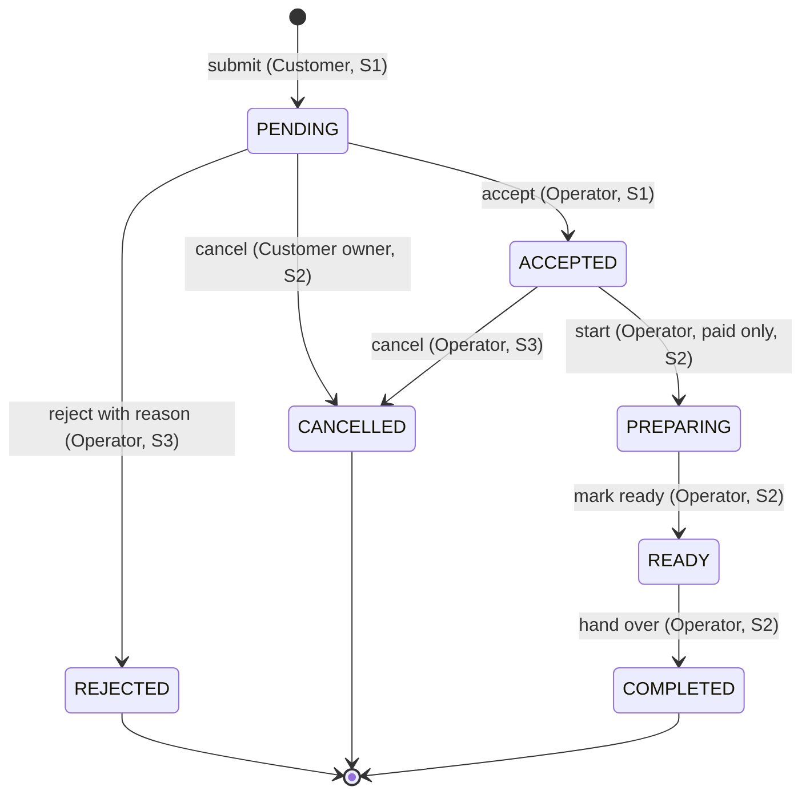

# Omazon — Software Requirements Specification (SRS)

| Item | Value |
|---|---|
| Document | `docs/srs.md` |
| Version | 1.11 |
| Date | 2026-11-12 |
| Course / Theme | CPE 334, Semester 1/2026 — Theme 4: E-Commerce or Ordering System |
| Student 1 | Krittaphat Panyasomphan (67070501052) |
| Student 2 | Napat Kasemweerasan (67070501014) |
| Repository | https://github.com/krittaphato3/E-Commerce-GroupProject-1052-1014 |

### Revision history
| Version | Date | Author | Change | Reason |
|---|---|---|---|---|
| 1.0 | 2026-11-03 | Both | Initial baseline | Deliverable 1 |
| 1.1 | 2026-11-05 | Both | BR-13 reduced to lower bounds only (`priceSatang > 0`, `stockQty >= 0`); BR-15 now names the acting user; NFR-05 restated with zero 5xx, 20 concurrent connections, 30 s per endpoint, a 500-order seed and a stock-provisioned order-test item; Q-03 resolved (403 for another customer's order); Q-04 resolved (targets in NFR-05) | Audit corrections: align the SRS with the System SDS, the contracts and AC-46 |
| 1.2 | 2026-11-05 | Both | BR-04 sprint cell updated to 1 (snapshot), 2 (catalog edits); BR-06 sprint cell updated to 1 (F-04); 2 (F-06, F-08); 3 (F-09, F-12) | Align BR-04 and BR-06 sprint allocations with traceability.md and features.md |
| 1.3 | 2026-11-05 | Both | BR-10 extended: prohibit cancellation from PREPARING, READY and COMPLETED with 409 INVALID_TRANSITION; added assumption A-08 and matching exclusion in §3.2 for partial fulfillment, waste tracking and no-show terminal state | Clarify cancellation boundaries and out-of-system resolution |
| 1.4 | 2026-11-06 | Both | Added §9.1 decision entries DEC-12 to DEC-16 for the F-01 implementation decisions (D-1 to D-5); no requirement, AC, TEST or contract wording changed | Record the decisions taken while implementing Issue #3 (F-01) |
| 1.5 | 2026-11-06 | Both | Added §9.1 decision entries DEC-17 (remove unused `SESSION_SECRET`), DEC-18 (cap F-01 login password validation at 72 UTF-8 bytes), DEC-19 (`requireRole` stub-route tests), DEC-20 (lazy `BCRYPT_ROUNDS` dummy hash, explicit `/me` field projection, expired-session deletion on lookup and startup, and Node `>=20.12` engine requirement), and DEC-21 (literal `TEST-44` error-handler test additions) | Record decisions taken during PR #10 review of Issue #3 (F-01) |
| 1.6 | 2026-11-06 | Both | Added §9.1 decision entry DEC-22 clarifying that following `1ea658b`, `seed.ts` uses `env.BCRYPT_ROUNDS` whose unset default is 10 (superseding the dual 10/4 fallback described in DEC-15; test cost 4 is set by `backend/tests/setup.ts`) | Align DEC-15 documentation with single-source-of-truth env refactor in PR #10 Tier 2 |
| 1.7 | 2026-11-07 | Both | Added §9.1 decision entry DEC-23 for F-04 contract revision (AC-42 / TEST-42 in-place 403 alert per DEC-23 Option A), POST /api/orders Location header, and Menu UI quantity capping by stockQty | Record decisions and contract revisions taken for F-04 (Issue #6) |
| 1.8 | 2026-11-07 | Both | Rename user-facing brand display name and document titles to Omazon; add §9.1 decision entries DEC-24 (R-01 route registry and Express 5 route extraction), DEC-25 (Omazon display rename scope and the technical identifiers kept), DEC-26 (Playwright E2E isolated on TEST_DATABASE_URL with a globalSetup reset and serial workers), and DEC-27 (separate 409 ITEM_UNAVAILABLE E2E test for AC-21 and AC-30) | Complete Issue #3 (R-01, AC-43/TEST-43) and the display brand rename |
| 1.9 | 2026-11-07 | Both | DEC-26 amended: `globalSetup` (`db:reset:test`) is the single owner of E2E migrations, the `_test` guard is shared by `playwright.config.ts` and `globalSetup` through `frontend/e2e/testDatabase.ts`, and `.github/workflows/ci.yml` runs the suites sequentially. DEC-27 amended: the 409 journey prepares its own sold-out state at run time instead of relying on Playwright's spec-file order. README gained a leftover-port troubleshooting note and a Sprint 2 “Known Limitations” section for the route registry. No requirement, AC, TEST or contract wording changed. | Non-blocking PR review follow-ups: E2E robustness, CI, and cleanup |
| 1.10 | 2026-11-12 | Both | FR-03 identity now lists `email` as well as id, display name and role | FR-03 contradicted AC-01 and the F-01 contract, which both return `email` (PR #20 review) |
| 1.11 | 2026-11-12 | Both | §9 note on issue numbering now says that `docs/sprints/sprint-1/features.md` §4 carries the actual GitHub issue, branch and PR beside the planned branch names | The note still said the §4 table was left unchanged, which stopped being true once the actual names were added (PR #20 review) |

---

## 1. Stakeholder problem and context

**Context chosen:** a food pre-order system for a small campus food stall, **Omazon** (one shop, one kitchen, a short daily menu).

**Problem.** At lunch peak the stall takes orders verbally at the counter. Queues are long, staff lose track of what was ordered and what has been accepted, and limited-stock dishes get oversold. Customers (students and staff) cannot see what is still available before they walk over.

**Solution.** A web application where customers log in, pre-order available dishes for pickup, and track the order. Shop operators see incoming orders, accept or reject them, move them through preparation to pickup, and review sales. Payment is **simulated** (no real payment gateway).

## 2. Actors

| Actor | Description | Responsibilities |
|---|---|---|
| Anonymous visitor | Not logged in | View the menu only |
| Customer | Logged-in student/staff member | Submit, view, pay for (simulated) and cancel **own** orders |
| Operator | Logged-in stall staff. All operators have identical permissions (single shop) | Manage the catalog; accept, reject, fulfil and cancel orders; view sales summary |

Each account has exactly one role. Seeded accounts only (no self-registration).

## 3. Scope

### 3.1 In scope
Authentication (login/logout/current user), role-based authorization, menu catalog with stock, order submission with server-side price calculation, order lifecycle (accept, reject, cancel, prepare, ready, complete), simulated payment, order history/status timeline, filtering/search, sales summary.

### 3.2 Explicit exclusions
Real payment gateway or card data; delivery; multiple shops or branches; self-registration, password recovery, email verification; email/SMS/push notifications; coupons, discounts, taxes and tips; editing an order after submission; pickup time-slot scheduling; user administration screens; native mobile apps; multi-role accounts; partial fulfillment, waste tracking or a no-show terminal state (resolved outside the system).

## 4. Functional requirements (FR)

| ID | Requirement (observable behavior) | Actor | Sprint |
|---|---|---|---|
| FR-01 | A user can log in with email and password. Valid credentials start a session; invalid credentials are rejected with a generic error that does not reveal whether the email exists. | All | 1 |
| FR-02 | A logged-in user can log out. The session is unusable immediately afterwards. | All | 1 |
| FR-03 | The system returns the identity (id, email, display name, role) of the logged-in user. Anonymous requests are rejected. | All | 1 |
| FR-04 | Any visitor can view the menu: name, description, price in THB, and whether each item is currently available. | Anonymous, Customer, Operator | 1 |
| FR-05 | A Customer can submit an order with one or more menu items, quantities and an optional pickup note. The order is saved as `PENDING` and `UNPAID` with a server-calculated total. | Customer | 1 |
| FR-06 | A Customer can open the detail of their own order: items, unit prices, line totals, total, status, payment status and status history. | Customer | 1 |
| FR-07 | A Customer can list their own orders, newest first. | Customer | 1 |
| FR-08 | An Operator can list incoming orders (oldest first) and filter by status. | Operator | 1 |
| FR-09 | An Operator can accept a `PENDING` order. The order becomes `ACCEPTED` and the change is recorded in the history. | Operator | 1 |
| FR-10 | An Operator can create menu items, edit name, description, price and stock, and enable or disable availability. | Operator | 2 |
| FR-11 | A Customer can cancel their own `PENDING` order. Reserved stock is restored. | Customer | 2 |
| FR-12 | An Operator can advance a paid `ACCEPTED` order to `PREPARING`, then `READY`, then `COMPLETED`. | Operator | 2 |
| FR-13 | A Customer can pay (simulated) for their own `ACCEPTED` order. | Customer | 2 |
| FR-14 | An Operator can reject a `PENDING` order and must give a reason. Reserved stock is restored. | Operator | 3 |
| FR-15 | Customers (own orders) and Operators (all orders) can filter and search orders by status, date range and order number; Operators can also search by customer name. | Customer, Operator | 3 |
| FR-16 | An Operator can view a sales summary for a date range: total sales, order count per status, top-selling items. | Operator | 3 |
| FR-17 | An Operator can cancel an `ACCEPTED` order before preparation starts. Stock is restored and a paid order is marked `REFUNDED` (simulated). | Operator | 3 |

## 5. Business rules (BR)

| ID | Rule | Enforced in | Sprint |
|---|---|---|---|
| BR-01 | Each order line has an integer quantity from 1 to 10. An order has 1 to 10 lines, and no menu item appears twice in one order. | Service + schema validation | 1 |
| BR-02 | An item can be ordered only if it is enabled and its stock is at least the requested quantity. If any line fails, the whole order is rejected and nothing is saved. | Service (transaction) | 1 |
| BR-03 | The order total is calculated by the server from current database prices: total = sum(unit price × quantity). Prices or totals sent by the client are rejected. | Service + schema | 1 |
| BR-04 | The unit price and item name at order time are stored on the order line. Later catalog changes do not alter existing orders. | Data model + service | 1 (snapshot), 2 (catalog edits) |
| BR-05 | Stock is reserved (decremented) atomically when an order is submitted. Two concurrent orders for the last unit cannot both succeed, and stock never goes below 0. | Conditional DB update + CHECK constraint | 1 |
| BR-06 | Order status changes only along the allowed transitions in section 7. Any other transition is rejected and nothing changes. | Service (state machine) | 1 (F-04); 2 (F-06, F-08); 3 (F-09, F-12) |
| BR-07 | A Customer can access only their own orders. Operators can access all orders (single shop). | Backend authorization | 1 |
| BR-08 | Only Operators can accept, reject, fulfil or cancel orders and change the catalog. Customers cannot. | Backend authorization | 1 |
| BR-09 | An order cannot move to `PREPARING` unless its payment status is `PAID`. | Service | 2 |
| BR-10 | A Customer can cancel only while the order is `PENDING`. Cancellation restores the reserved stock. Cancellation is not allowed from `PREPARING`, `READY` or `COMPLETED` by any role; such a request is rejected with 409 `INVALID_TRANSITION`. | Service | 2 |
| BR-11 | Simulated payment is allowed only for the owner's `ACCEPTED`, `UNPAID` order, the amount must equal the order total, and an order can be paid at most once. | Service | 2 |
| BR-12 | Rejection requires a reason of 5 to 200 characters. | Schema + service | 3 |
| BR-13 | Catalog price is a positive integer in satang (`priceSatang > 0`). Stock is a non-negative integer (`stockQty >= 0`). | Schema + DB CHECK | 2 (DB check in 1) |
| BR-14 | Each order has a unique, human-readable order number `CB-` followed by the order id padded to 6 digits (for example `CB-000012`). | Service | 1 |
| BR-15 | Every order creation and status change records a history entry: previous status, new status, the acting user (actor identity), the acting role and a timestamp. | Service (same transaction as the change) | 1 |

## 6. Non-functional requirements (NFR)

| ID | Category | Measurable target | Verification method | Sprint |
|---|---|---|---|---|
| NFR-01 | Security — authentication | Every protected endpoint returns 401 with no private data when called without a valid session. 100% of protected routes covered. | Table-driven API test over the route list | Established 1, extended each sprint |
| NFR-02 | Security — authorization | Every protected endpoint returns 403 with no private data for a wrong role or non-owner. 100% of protected routes covered. | Table-driven API test | Established 1, extended each sprint |
| NFR-03 | Security — passwords | No plaintext passwords stored. Stored value is a bcrypt hash. API responses never contain the hash. | DB inspection test + response assertion | 1 |
| NFR-04 | Security — session | Session lifetime is 8 hours. After logout the old session token is rejected immediately (the next request returns 401). | API tests (logout, expiry) | 1 |
| NFR-05 | Performance | p95 response time ≤ 500 ms and zero 5xx responses for `GET /api/menu` and `POST /api/orders`, measured at 20 concurrent connections for 30 s per endpoint, on a database seeded with 500 orders and an order-test item with enough stock for the whole run. | autocannon script run on the local or deployed build; raw output and tested commit saved as evidence | 3 |
| NFR-06 | Reliability — durability | Orders, stock and accounts persist across an application restart and a redeployment. | Create order, restart/redeploy, retrieve the same order; screenshot and logs | 2 (deployment from Lab 5) |
| NFR-07 | Safe error handling | Invalid input returns 400 with the standard error shape. Unexpected errors return 500 with a generic message; no stack trace or SQL is exposed. | API tests with malformed input and a forced internal error | 1 |
| NFR-08 | Reproducibility | A fresh clone reaches a running app and a passing test run by following the README in 8 commands or fewer. Seed is repeatable. | Fresh-clone manual check + seed idempotence test | 1 |
| NFR-09 | Usability | Every list or data screen has loading, empty and error states. | UI component tests + manual checklist | Partly 1, complete 3 |
| NFR-10 | Test quality | At least 85% line coverage on the service layer (business rules). | Vitest coverage report | 2 |
| NFR-11 | Brute-force protection | After 5 consecutive failed logins for one email within 15 minutes, further attempts return 429 for 15 minutes. | API test with fake clock | 3 |

## 7. Order lifecycle

| From | Action | To | Who | Extra precondition | Sprint |
|---|---|---|---|---|---|
| (none) | submit | PENDING | Customer | BR-01..BR-05 satisfied | 1 |
| PENDING | accept | ACCEPTED | Operator | none | 1 |
| PENDING | cancel | CANCELLED | Customer (owner) | stock restored | 2 |
| ACCEPTED | start | PREPARING | Operator | paymentStatus = PAID | 2 |
| PREPARING | ready | READY | Operator | none | 2 |
| READY | complete | COMPLETED | Operator | none | 2 |
| PENDING | reject | REJECTED | Operator | reason, stock restored | 3 |
| ACCEPTED | cancel | CANCELLED | Operator | stock restored; PAID becomes REFUNDED | 3 |

Payment status: `UNPAID` → `PAID` (Customer pays an `ACCEPTED` order, Sprint 2) → `REFUNDED` (operator cancels a paid order, Sprint 3). Terminal order statuses: `REJECTED`, `CANCELLED`, `COMPLETED`.

## 8. Assumptions

| ID | Assumption |
|---|---|
| A-01 | One shop and one kitchen. All operators have the same permissions and see all orders. |
| A-02 | Currency is Thai Baht. Money is stored as integer satang (1 THB = 100 satang) so no floating-point arithmetic is used. |
| A-03 | Timestamps are stored in UTC and displayed in Asia/Bangkok. |
| A-04 | Users access the app with a current desktop or mobile browser. |
| A-05 | The operator sets daily stock manually through catalog management (Sprint 2). Until then stock comes from the seed. |
| A-06 | Demo data is synthetic. Seeded accounts use the `@campusbites.test` domain. |
| A-07 | Pickup happens at the stall; there are no time slots. |
| A-08 | The system does not support partial fulfillment, waste tracking or a no-show terminal state. If a customer does not collect an order at READY, or ingredients run out during PREPARING, the operator resolves it outside the system. |

## 9. Decision log

| ID | Decision | Rationale | Date |
|---|---|---|---|
| DEC-01 | Context is a campus food pre-order stall (Theme 4). | Small, bounded domain with clear stock and lifecycle rules. | 2026-11-03 |
| DEC-02 | Stack is React + TypeScript + Vite, Node.js + Express + TypeScript, PostgreSQL + Prisma, Vitest + Supertest + Playwright. | Same stack as Labs 1–4. Docker and GCP friendly. | 2026-11-03 |
| DEC-03 | Money is stored as integer satang. | Avoids rounding errors; total calculation is exact. | 2026-11-03 |
| DEC-04 | Stock is reserved at order submission, not at acceptance. | Prevents overselling while an order waits for an operator. Restored on cancel or reject. | 2026-11-03 |
| DEC-05 | Sessions are server-side: an opaque random token in an httpOnly cookie, stored hashed in the database. JWT is not used. | Logout can invalidate the session immediately and be tested. | 2026-11-03 |
| DEC-06 | Ownership and role violations return 403 with a generic body. Non-existent resources return 404. | Simple, testable. The small information leak about order id existence is accepted for coursework scale (see Q-03). | 2026-11-03 |
| DEC-07 | Request schemas are strict: unknown fields (for example `totalSatang` or `unitPriceSatang`) cause a 400. | Makes BR-03 explicit and testable. | 2026-11-03 |
| DEC-08 | Payment is simulated and happens after the operator accepts the order; the operator cannot start preparing an unpaid order. | Gives BR-09 and BR-11 a real cross-feature rule. | 2026-11-03 |
| DEC-09 | The menu is publicly readable. | Customers can check availability before logging in. | 2026-11-03 |
| DEC-10 | Orders cannot be edited after submission. | Keeps price and stock logic simple; the customer cancels and re-orders. | 2026-11-03 |
| DEC-11 | Sprint 1 slice is: login, menu, customer submits order, operator accepts. | Matches the Theme 4 Sprint 1 example exactly. | 2026-11-03 |

### 9.1 Sprint 1 implementation decisions (DEC-12 to DEC-27)

These entries continue the §9 numbering. They record decisions taken while delivering and reviewing F-01 (Issue #3, PR #10) and F-04 (Issue #6). DEC-17 edits an Issue #2 test file (`backend/tests/env.test.ts`), DEC-21 adds `TEST-44` cases to an Issue #2 test file (`backend/tests/error.test.ts`), DEC-18 changes one contract wording item (`docs/sprints/sprint-1/features.md` §7 (F-01 contract), subsection 1 (Feature design), password maximum `128 characters` → `72 bytes`), DEC-22 clarifies the single-source-of-truth rounds default following the `seed.ts` refactor, and DEC-23 records the F-04 contract revision for AC-42 / TEST-42, Location header, and stock-capped UI quantity stepper. DEC-24 to DEC-27 record the R-01 route registry, the display brand rename, and the Playwright isolation delivered on `feature/sprint1/access-and-e2e-tests`.

| ID | Decision | Rationale | Affected files / requirements | Status | Date |
|---|---|---|---|---|---|
| DEC-12 (D-1) | F-01 is delivered backend-first, then frontend, on `feature/sprint1/auth-login-logout` as separate commits: login, logout and current user first, then the router, login page, header, route guards and TEST-09. `react-router-dom` ^6.30.6 and `@playwright/test` (Chromium) are added to the frontend workspace. | The API is proven by TEST-01 to TEST-08 before a UI depends on it, and each layer keeps its own red-then-green evidence. | `backend/src/services`, `backend/src/repositories`, `backend/src/middleware`, `backend/src/controllers`, `backend/src/routes`, `frontend/src`, `frontend/e2e/auth.spec.ts`; FR-01, FR-02, FR-03, AC-09, TEST-09 | Implemented in f222daa (backend) and 097da41 (UI) | 2026-11-06 |
| DEC-13 (D-2) | The R-01 route registry and its meta-test (AC-43/TEST-43) are not part of this branch; they belong to the R-01/R-02 issue. This branch builds only the `requireAuth` and `requireRole` middleware that F-01 needs. `requireRole` is exported but not used by any F-01 route, and `GET /api/auth/me` is the only protected route. | F-01 needs session authentication, while a route-registry meta-test only becomes meaningful once the Sprint 1 route set exists. | `backend/src/middleware/auth.ts`, `backend/src/routes/auth.ts`; NFR-01, NFR-02, R-01, AC-43, TEST-43 (deferred, not run) | Implemented in f222daa; AC-43/TEST-43 deferred to the R-01/R-02 issue | 2026-11-06 |
| DEC-14 (D-3) | No password literal is kept in the repository. `backend/.env.example` uses the placeholders `change-me-local`; `seed.ts` reads `SEED_CUSTOMER_PASSWORD` and `SEED_OPERATOR_PASSWORD` only, fails with a clear error when either is missing or empty, and refuses the placeholder when `NODE_ENV=production`. Tests generate random seed passwords per run in `backend/tests/setup.ts`; Playwright reads the same variables from `backend/.env`. | Implements the F-01 Definition of Done ("Seed passwords come from `.env`; no password appears in the repository or the PDF") and SDS §2.3/§7.1 exactly as written. This is not a contract change. | `backend/.env.example`, `backend/prisma/seed.ts`, `backend/tests/setup.ts`, `backend/tests/seed.test.ts`, `backend/tests/auth.test.ts`, `README.md`, `frontend/playwright.config.ts`, `frontend/e2e/auth.spec.ts`; F-01 DoD, SDS §2.3, SDS §7.1, NFR-03, NFR-08 | Implemented in e78cb7f (seed, env, tests) and 097da41 (E2E) | 2026-11-06 |
| DEC-15 (D-4) | The seed hashes passwords with `BCRYPT_ROUNDS` (default 10, or 4 when `NODE_ENV=test` and the variable is absent) instead of a hardcoded cost of 10. | One configuration source for hashing; keeps the test seed fast without changing production strength. | `backend/prisma/seed.ts`, `backend/src/config/env.ts`, `backend/.env.example`; SDS §6, SDS §7.1 | Implemented in e78cb7f | 2026-11-06 |
| DEC-16 (D-5) | The local `graphify-out/` folder stays untracked. `.gitignore` is not changed and the folder is never staged. | It is a local analysis artifact outside the F-01 scope, so no unrelated ignore rules are added. | Working tree only; no tracked file | Decided; applied to commits e78cb7f to 097da41 | 2026-11-06 |
| DEC-17 | Remove `SESSION_SECRET` and `DEV_SESSION_SECRET` from `backend/src/config/env.ts`, `backend/.env.example`, and `backend/tests/env.test.ts` (replacing the 4 `SESSION_SECRET` tests added in Issue #2 with `parseEnv` tests for defaults, `NODE_ENV=production` without `SESSION_SECRET`, and `BCRYPT_ROUNDS` bounds). | Sessions use opaque random 32-byte tokens stored as SHA-256 hashes (`DEC-05`, SDS §6, §7.1), not signed cookies. Nothing reads `SESSION_SECRET`, and the leftover production `superRefine` check would block production startup unless a dead secret was configured. | `backend/src/config/env.ts`, `backend/.env.example`, `backend/tests/env.test.ts`; DEC-05, SDS §6, SDS §7.1 | Implemented in a7daacb (red) and 0074cb3 (green) | 2026-11-06 |
| DEC-18 | Change the F-01 login `password` maximum from 128 characters to 72 UTF-8 bytes (`Buffer.byteLength(val, "utf8") <= 72`, minimum 1) in `backend/src/middleware/validate.ts` and `docs/sprints/sprint-1/features.md` §7 (F-01 contract), subsection 1 (Feature design). | `bcryptjs` only processes the first 72 UTF-8 bytes of a password; capping at 72 bytes prevents distinct passwords that share a 72-byte prefix from colliding. | `backend/src/middleware/validate.ts`, `backend/tests/auth.test.ts`, `docs/sprints/sprint-1/features.md` §7 (F-01 contract), subsection 1 (Feature design); FR-01, AC-04, TEST-04 | Implemented in 9ecb718 (red) and 83f0337 (green) | 2026-11-06 |
| DEC-19 | `requireRole` is now covered by stub-route integration tests in `backend/tests/auth.test.ts` (`f45ba47`: no cookie → 401, `CUSTOMER` → 403 `FORBIDDEN`, `OPERATOR` → 200); the status of DEC-13 is otherwise unchanged (`AC-43`/`TEST-43` route registry remains deferred to the R-01/R-02 issue). | Verifies the role-guard invariant introduced in `backend/src/middleware/auth.ts` immediately rather than leaving it untested until F-03/F-04. | `backend/tests/auth.test.ts`, `backend/src/middleware/auth.ts`; R-01, NFR-01, NFR-02, DEC-13 | Implemented in f45ba47 | 2026-11-06 |
| DEC-20 | Lazily hash and cache the unknown-email dummy password at `env.BCRYPT_ROUNDS` (`9587c12` red, `bb0acb4` green), explicitly project `{ id, email, displayName, role }` in `authController.me` (`eff7034` red, `2022899` green), delete expired sessions on lookup in `sessionRepository.findValid` and at startup via `sessionRepository.deleteExpired()` in `server.ts` (`ad00bd2` red, `6e68bee` green), and declare `"engines": { "node": ">=20.12" }` in root `package.json` and `README.md` (`84fb684`). | Matches dummy-hash cost to configured `BCRYPT_ROUNDS`, prevents extra user fields from leaking through `/me`, removes expired session rows, and documents the Node.js `>=20.12` requirement for `process.loadEnvFile`. | `backend/src/services/authService.ts`, `backend/src/controllers/authController.ts`, `backend/src/repositories/sessionRepository.ts`, `backend/src/server.ts`, `backend/tests/auth.test.ts`, `package.json`, `README.md`; FR-01, FR-02, FR-03, NFR-03, NFR-04, NFR-08 | Implemented in 9587c12 (red), bb0acb4 (green), eff7034 (red), 2022899 (green), ad00bd2 (red), 6e68bee (green), 84fb684 | 2026-11-06 |
| DEC-21 | Add literal `TEST-44` test cases (`POST /api/auth/login` with body `{bad json` and a route throwing `new Error("db password leak")`) to `backend/tests/error.test.ts` (`9de7923`) while keeping all existing Issue #2 assertions intact, and mark `NFR-07` (`TEST-04`, `TEST-44`) as `PASS`. | Aligns `backend/tests/error.test.ts` with the exact `TEST-44` specification in `docs/sprints/sprint-1/features.md` §11 (R-01, R-02, R-03 Cross-Cutting contract), subsection 6 (Software Test Specification (STS)) without weakening any existing check. | `backend/tests/error.test.ts`, `docs/traceability.md`; R-02, NFR-07, AC-44, TEST-44 | Implemented in 9de7923 | 2026-11-06 |
| DEC-22 | Following the `seed.ts` refactor in `1ea658b` to reuse `hashPassword` and import `env.BCRYPT_ROUNDS` directly from `backend/src/config/env.ts`, the effective default when `BCRYPT_ROUNDS` is unset is unconditionally 10 (as defined by `env.ts`), superseding the dual 10/4 fallback logic previously described in DEC-15. Fast test hashing (cost 4) is set by `backend/tests/setup.ts` via `process.env.BCRYPT_ROUNDS = "4"` prior to env parsing. | Unifies password hashing across seed and runtime into a single configuration source (`env.ts`), avoiding duplicate fallback logic. | `backend/prisma/seed.ts`, `backend/src/config/env.ts`, `backend/tests/setup.ts`; DEC-15, SDS §6, SDS §7.1 | Implemented in 1ea658b | 2026-11-06 |
| DEC-23 | F-04 contract revision for AC-42 / TEST-42: wrong-role navigation renders an in-place 403 Forbidden alert without the operator table, rather than redirecting, matching ProtectedRoute behavior established in d7ec1c2 (Option A); POST /api/orders returns Location: /api/orders/:id on 201 (Follow-up 3); Menu UI caps line quantity at Math.min(10, stockQty) (Follow-up 5) while retaining 409 ITEM_UNAVAILABLE backend safety net. | Option A avoids regressions and maintains consistent ProtectedRoute behavior; Location header adheres to RESTful standard on resource creation; UI quantity cap improves UX without weakening backend concurrency protection. | `frontend/src/components/ProtectedRoute.tsx`, `frontend/e2e/operator.spec.ts`, `backend/src/controllers/orderController.ts`, `frontend/src/pages/Menu.tsx`, `docs/sprints/sprint-1/features.md`; FR-08, FR-09, AC-42, TEST-42, AC-14, TEST-14, AC-30 | Implemented in c04ca45 (red), 6d1d2f7 (backend), 984ddb9 (UI) | 2026-11-07 |
| DEC-24 | The R-01 route registry lives in `backend/src/routes/registry.ts` and is shared three ways: `guardsFor(method, path)` supplies the guards to `auth.ts` and `orders.ts` and throws at startup when a protected route is missing, `mountRouter(app, prefix, router)` records the mount prefix in a `WeakMap` and performs the standard `app.use(prefix, router)`, and `extractExpressRoutes(app)` rebuilds every served path from `app.router.stack` (`layer.route` for top-level routes, `layer.handle.stack` for mounted routers). `findUnregisteredRoutes(app)` compares that list with `publicRoutes` and `protectedRoutes`. No Express method is monkey-patched and no circular import is introduced. | Express 5 (`router` 2.2.0) does not expose a mount path on a layer, so the prefix has to be recorded at mount time; one declarative helper keeps the mount and the registry from drifting, and the meta-test in `backend/tests/routes.access.test.ts` catches both an unregistered top-level route and a router mounted without `mountRouter`. | `backend/src/routes/registry.ts`, `backend/src/app.ts`, `backend/src/routes/auth.ts`, `backend/src/routes/orders.ts`, `backend/tests/routes.access.test.ts`; R-01, AC-43, TEST-43, NFR-01, NFR-02 | Implemented in d7792c8 (red) and 8f42cbd (green) | 2026-11-07 |
| DEC-25 | The display rename to `Omazon` replaces only the brand token in user-facing strings and document titles. Technical identifiers are unchanged: the session cookie `cb_session`, the `CB-` order-number prefix, the seeded addresses such as `customer1@campusbites.test`, the databases `campusbites` and `campusbites_test`, the package name fields (`"name": "campusbites"`, `"name": "campusbites-backend"`, `"name": "campusbites-frontend"`), the Compose service `campusbites-postgres`, and the `POSTGRES_DB: campusbites` default. | Renaming identifiers would break existing sessions, migrations, seed addresses and E2E credentials for no user-visible benefit; the brand token is the only part a user reads, so it is the only part renamed. | `README.md`, `backend/.env.example`, `backend/package.json`, `backend/src/server.ts`, `frontend/index.html`, `frontend/package.json`, `frontend/src/components/Header.tsx`, `frontend/src/App.test.tsx`, `package.json`, `docs/*`; AC-09, TEST-09 | Implemented in e78ea16 (red) and the brand rename commit of `feature/sprint1/access-and-e2e-tests` (green) | 2026-11-07 |
| DEC-26 | Playwright runs on `TEST_DATABASE_URL` (database `campusbites_test`) with `workers: 1` and `fullyParallel: false`; `globalSetup` is the single owner of migrations and state, running `db:reset:test` (which applies `prisma migrate deploy`, truncates and re-seeds with the `backend/.env` passwords), while the API `webServer` deliberately does not migrate, so exactly one migration step runs per run. The `_test` suffix guard is shared by `playwright.config.ts` and `e2e/globalSetup.ts` via `frontend/e2e/testDatabase.ts`; `backend/scripts/reset-test-db.ts` and `backend/tests/setup.ts` keep an equivalent copy for the backend runtime. `npm test` and `npm run e2e` must never run concurrently because both own that database, and the rule is stated in `README.md` without adding a setup command, so NFR-08 stays at eight commands or fewer. `.github/workflows/ci.yml` runs both suites sequentially in one job for the same reason. | The journeys share one seeded catalog, so serial execution keeps the stock arithmetic deterministic; a per-run reset removes any dependency on what a previous run or the unit suite left behind, and a single migration owner avoids applying migrations twice per run. | `frontend/playwright.config.ts`, `frontend/e2e/globalSetup.ts`, `backend/scripts/reset-test-db.ts`, `backend/package.json`, `README.md`; NFR-08, TEST-09, TEST-12, TEST-29, TEST-41, TEST-42 | Implemented in d266329 | 2026-11-07 |
| DEC-27 | A separate self-contained Playwright test in `frontend/e2e/order.spec.ts`, titled `AC-21 / AC-30` and placed after `TEST-29`, drives the 409 `ITEM_UNAVAILABLE` path with no mocking. The journey prepares its own sold-out state instead of inheriting it: it reads the public menu and picks the orderable item with the smallest positive stock plus a second item that stays available, `customer1` puts both in the cart, a dedicated API request context has `customer2` buy every remaining unit of the first item (chunked at the BR-01 cap of 10 per line), and `customer1` then presses Place order. Because the item is chosen at run time, the test does not depend on Playwright's spec-file order, and `globalSetup` re-seeds before every run so the depletion never accumulates. It adds no new `TEST-nn` id, so the 46 acceptance criteria / 46 tests table is unchanged. | F-03's evidence set needs the real 409 state, and a single-user click sequence cannot reach it because the UI caps quantity at `Math.min(10, stockQty)`; a two-customer race is the only deterministic way to reproduce a stale cart without mocking the backend. | `frontend/e2e/order.spec.ts`; AC-21, AC-30, TEST-29 | Implemented in d266329 | 2026-11-07 |

Note on issue numbering: `docs/sprints/sprint-1/features.md` §4 labels F-01 as ISSUE-2 and R-01/R-02 as ISSUE-3, while GitHub numbers Issue #2 as the scaffold (R-03) and Issue #3 as F-01. The work follows the GitHub numbering and the contract's AC/TEST IDs; §4 keeps the planned branch names as the contract baseline and records the actual GitHub issue, branch and pull request beside each row.

## 10. Questions and resolutions

| ID | Question | Resolution / status |
|---|---|---|
| Q-01 | Is the Sprint 1 slice (submit order, operator accepts) sufficient for Theme 4? | Resolved: it follows the Sprint 1 example in the Group Work Specification. |
| Q-02 | Is a concurrency test for the last stock unit expected? | Resolved: included (AC-24) because the specification asks for tests of competing requests in similar themes and it is a meaningful rule. |
| Q-03 | Is returning 403 (instead of 404) for another customer's order acceptable? | Resolved (team decision, 2026-11-05): a customer requesting another customer's order receives HTTP 403 with the standard error body and no order data. |
| Q-04 | Are the NFR-05 performance numbers acceptable? | Resolved (team decision, 2026-11-05): targets defined in NFR-05. |
